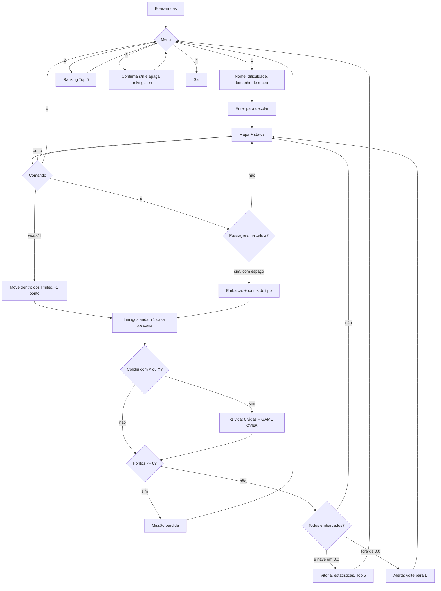

# Fase 0 — Comportamento de referência e validação

Linha de base: o projeto inicial em console (tag `fase-0`, pasta `src/`), **sem alterações**.
Este documento registra como o jogo se comporta hoje. As fases seguintes têm que preservar isso, e cada
diferença intencional precisa estar escrita aqui ou no tutorial da fase.

## Como compilar e executar a Fase 0

```bash
javac -encoding UTF-8 -d out src/*.java
java -cp out Main
```

Requer JDK 17. As classes usam o pacote padrão. O `ranking.json` é criado no diretório de onde o jogo é iniciado.

## Fluxo de uma partida



## Regras observadas

| Regra | Valor / comportamento |
|---|---|
| Mapa | de `-N` a `+N` nos dois eixos; `N` é digitado (padrão 5; inválido ou ≤ 0 vira 5). `w` diminui `y` (sobe na tela) |
| Nave | começa em (0,0), que é a plataforma de pouso `L`; capacidade de 5 passageiros; 3 vidas |
| Pontos iniciais | Fácil **30**, Médio **20**, Difícil **45** (sim, o Difícil começa com mais pontos que o Fácil) |
| Movimento | `w/a/s/d` custa **1 ponto**, inclusive quando a nave está na borda e não sai do lugar |
| Embarque (`c`) | Professor **+10**, Engenheiro **+15**, Astronauta **+20** |
| Quantidades | Fácil: 4 passageiros, 1 asteroide, 1 inimigo. Médio: 5, 2, 2. Difícil: 5, 3, 3 |
| Passageiros | criados em ordem fixa: Dr. Silva (P), Eng. Rosa (E), Dr. Lima (P), Eng. Carlos (E), Ast. Maria (T). **No Fácil não existe Astronauta** |
| Inimigos | depois de cada `w/a/s/d` ou `c`, cada inimigo anda 1 casa numa direção aleatória (parado se bater na borda). Comando inválido, vazio ou `q` não move os inimigos |
| Colisão | nave na mesma célula de `#` ou `X` → −1 vida e a nave **fica na célula**. Com 0 vidas: GAME OVER |
| Derrota por pontos | pontos ≤ 0 depois do turno → "Combustível/Pontuação zerada! Missão perdida." |
| Vitória | todos embarcados **e** nave em (0,0). Se todos embarcados fora de (0,0), avisa a cada turno |
| Ranking | Top 5 em `ranking.json`, só para vitória com pontos > 0. Entra se houver < 5 entradas ou se superar o 5º. Abortar ou perder não grava |
| Estatísticas | pontuação final, movimentos, tempo em segundos (relógio real), passageiros resgatados, recorde |
| Fim da entrada (EOF) | encerra com segurança em qualquer ponto ("Entrada encerrada…") |

## Problemas encontrados (preservados na Fase 0)

> Os problemas 1 e 2 foram corrigidos na Fase 1 (ver o [tutorial da Fase 1](fase-01-tutorial.md), seção 8).
> O 3 é mantido como regra do jogo. Um quinto, encontrado durante a refatoração, também está na seção 8:
> a data do ranking pode falhar em vitórias com segundos e nanossegundos zerados.

1. **O menu só aparece depois do primeiro Enter.** O laço chama `scanner.hasNextLine()` *antes* de imprimir o
   menu, e essa chamada bloqueia esperando entrada. Esse Enter é consumido como opção, e o jogo responde "Opção inválida".
   Confirmado executando o jogo com a entrada aberta: 2 s depois de abrir só aparece o banner.
2. **Ranking perde nomes com vírgula.** O parser manual divide o objeto JSON por `,`. Uma entrada como
   `"Silva, Ana"` é descartada ao carregar (roteiro `10-ranking-nome-com-virgula`).
3. **Ficar sobre um asteroide tira outra vida.** Depois da colisão a nave continua na célula do `#`. Um `c` nessa
   célula faz os inimigos andarem e verifica a colisão de novo. *Concluído pela leitura do código, não reproduzido isoladamente.*
4. Um inimigo pode ficar sobre a plataforma `L` ou sobre um passageiro. O mapa mostra só um símbolo por célula.

## Validação da Fase 0

Ferramentas em `validacao/`; o gabarito da Fase 0 está em `validacao/gabarito/fase-00/`. Elas recebem o comando do jogo como argumento, então valem para todas as fases.

| Verificação | Resultado |
|---|---|
| Compilação `javac` (JDK 17) | ok, sem erros |
| `executar_roteiros.py`: 11 roteiros de entrada fixa (menu, opção inválida, EOF, ranking vazio/existente/com vírgula, reset confirmado/cancelado, partida abortada, entradas inválidas, comando inválido). O gabarito ficou em `validacao/gabarito/` | 11/11 idênticos (`docs/evidencias/fase-00/roteiros.txt`) |
| `piloto_automatico.py --modo vencer`: Fácil (mapa 2), Médio (mapa 3), Difícil (mapa 3), 10 partidas cada | 26 vitórias, 4 GAME OVER, **0 regras violadas** |
| `--modo colidir`: Difícil, 10 partidas | 10 GAME OVER depois de perder as 3 vidas, 0 violadas |
| `--modo esgotar`: Médio, mapa 4, 10 partidas | 10 "Missão perdida" ao zerar os pontos, 0 violadas |

Em cada turno o piloto confere que pontos = inicial − movimentos + soma dos embarques. Também confere que as vidas
caem de 1 em 1, que a vitória só acontece em (0,0), que as estatísticas batem com o que ele contou e que
o `ranking.json` recebe a vitória e nada além dela.
Logs completos estão em `docs/evidencias/fase-00/`.

Não verificado: a parte visual no terminal Windows/PowerShell (os emojis 🚀 ✨ 🏆 dependem da fonte do console).
