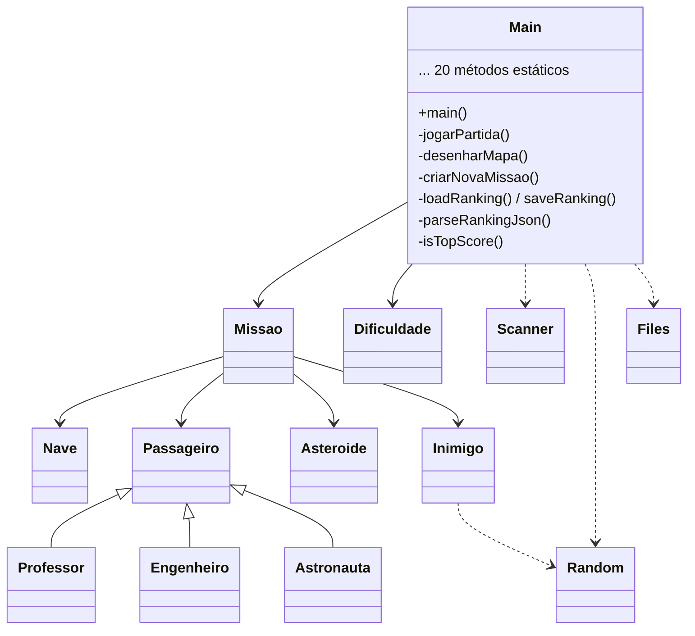
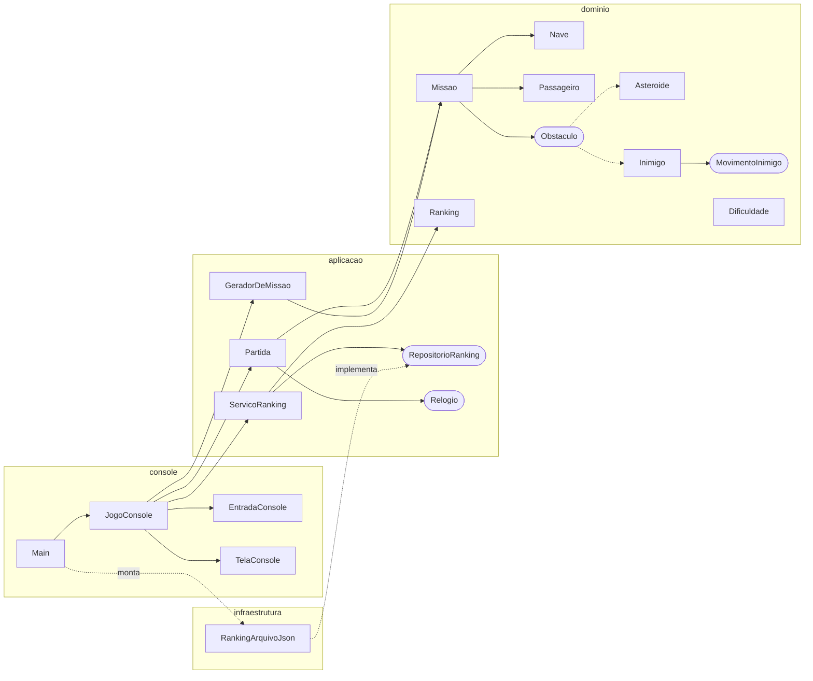

# Fase 1 — Refatoração arquitetural

## 1. Introdução

A Fase 0 é um jogo de console que funciona, mas quase tudo está numa única classe: o `Main`, com 570 linhas.
Nesta fase reorganizamos o código **sem mudar o que o jogador vê**. As regras vão para classes de domínio, a
coordenação da partida vai para a camada de aplicação, a leitura e a escrita do ranking vão para a
infraestrutura, e o texto da tela vai para o console. Só dois bugs do original foram corrigidos, cada um em
um commit separado, com teste e com a diferença documentada.

O ponto de partida é a tag `fase-0`. O comportamento de referência está em
[fase-00-comportamento-referencia.md](fase-00-comportamento-referencia.md).

## 2. Objetivos de aprendizagem

- Reconhecer um *God Object* (classe que faz tudo) e o custo que ele traz para testar e evoluir o código.
- Aplicar SOLID e GRASP para decidir **em que classe** cada responsabilidade deve ficar.
- Usar injeção de dependência para testar regras que dependem de sorteio, relógio e arquivo.
- Refatorar com segurança: primeiro provar que nada mudou, depois mudar de propósito.

## 3. Conceitos teóricos

| Conceito | Ideia | Onde aparece |
|---|---|---|
| **S** — Responsabilidade única | uma classe, um motivo para mudar | `TelaConsole` só desenha; `Partida` só aplica regras; `RankingArquivoJson` só lê e grava |
| **O** — Aberto/fechado | estender sem editar o que já funciona | novo tipo de passageiro = nova subclasse + valor no `TipoPassageiro`; nova forma de inimigo andar = nova `MovimentoInimigo` |
| **L** — Substituição de Liskov | subtipos usáveis no lugar do tipo base | `Asteroide` e `Inimigo` são `Obstaculo`; `Professor`, `Engenheiro` e `Astronauta` são `Passageiro` |
| **I** — Segregação de interfaces | interfaces pequenas | `Relogio` (2 métodos), `MovimentoInimigo` (1), `RepositorioRanking` (3) |
| **D** — Inversão de dependência | regras dependem de abstrações | `ServicoRanking` depende de `RepositorioRanking`, não do arquivo; `Partida` depende de `Relogio` |
| GRASP **Information Expert** | quem tem a informação faz o trabalho | `Dificuldade` conhece seus pontos iniciais e quantidades; `Ranking` sabe quem entra no Top 5 |
| GRASP **Controller** | um objeto recebe os comandos do sistema | `Partida.executar(Comando)` |
| GRASP **Creator / Factory** | quem cria objetos complexos | `GeradorDeMissao` monta a missão |
| GRASP **Pure Fabrication** | classe sem equivalente no domínio, criada para manter o domínio limpo | `RankingArquivoJson`, `EntradaConsole` |
| GRASP **Polymorphism** | variação por tipo sem `if/instanceof` | `getPontuacao()` de cada passageiro; o símbolo do mapa vem de `getTipo()` |
| Padrão **Strategy** | trocar um algoritmo por outro | `MovimentoInimigo`: `MovimentoAleatorio` no jogo, `PARADO` nos testes |
| Padrão **Repository** | coleção persistente atrás de uma interface | `RepositorioRanking` → `RankingArquivoJson` (Fase 5: servidor) |
| *Composition root* | um só lugar monta as dependências | `Main` |

## 4. Problemas encontrados no código original

1. **God Object**: `Main` mistura menu, leitura do teclado, desenho do mapa, regras do turno, sorteio da
   missão, regra do Top 5 e leitura e escrita do JSON.
2. **Regras dentro da interface**: pontos, colisão, vitória e derrota são decididos no laço que também
   chama `System.out.println`. Não dá para testar uma regra sem simular o teclado.
3. **Dependências fixas**: `new Random()`, `System.currentTimeMillis()`, `new Scanner(System.in)` e
   `Paths.get("ranking.json")` aparecem no meio da lógica. Por isso não há como ter partidas reproduzíveis.
4. **Conhecimento no lugar errado**: os números de cada dificuldade ficam em dois `switch` no `Main`, e não
   no enum `Dificuldade`.
5. **Duplicação**: o laço "sorteia até achar uma célula livre" aparece três vezes. `Asteroide` e `Inimigo`
   repetem o `colideCom` sem um tipo em comum.
6. **`instanceof` no desenho do mapa**: cada tipo novo de passageiro obriga a editar o desenho.
7. **Encapsulamento fraco**: `Missao` devolve as próprias listas, e qualquer um pode alterá-las.
8. **Código morto**: `Nave.id`, `moveUp/Down/Left/Right`. **Pacote padrão** (sem `package`).
9. **Bugs**: o menu só aparece depois do primeiro Enter, e o ranking perde nomes com vírgula (detalhes na seção 8).

## 5. Arquitetura antes da transformação



## 6. Passo a passo da implementação

A ordem importa. Cada passo terminou com o código compilando e o gabarito igual.

1. **Rede de segurança antes de mexer** (`validacao/`). Gravamos a saída da Fase 0 para 11 roteiros de entrada
   fixa e escrevemos um piloto automático que joga partidas inteiras e confere as regras (ver a Fase 0).
2. **Pacotes**: `git mv` das classes para `br.edu.unifor.missaomarte.dominio` e do `Main` para
   `br.edu.unifor.missaomarte`.
3. **Valores no domínio**: `Posicao` (record) e `Direcao` substituem os pares `x, y` e o `char`. `Mapa` reúne os
   limites que antes viajavam como `minX, maxX, minY, maxY` em todos os métodos.
4. **Information Expert**: os números de cada dificuldade foram para dentro do enum `Dificuldade`.
5. **Polimorfismo**: `Obstaculo` virou o tipo comum de `Asteroide` e `Inimigo`. `TipoPassageiro` substitui o
   `String tipo` e acaba com o `instanceof` no desenho.
6. **Strategy**: o movimento do inimigo virou `MovimentoInimigo`. `MovimentoAleatorio` mantém a ordem de
   sorteio do original (0 = direita, 1 = esquerda, 2 = baixo, 3 = cima).
7. **Controller**: o corpo do laço de turnos virou `Partida.executar(Comando)`, que **devolve eventos** em vez de
   imprimir. A ordem das regras é a do original: comando → inimigos andam → colisão → pontos → vitória.
8. **Factory**: `GeradorDeMissao(Random)` assumiu os três laços de sorteio e a ordem fixa dos passageiros.
9. **Repository + DIP**: `RepositorioRanking` (interface) e `RankingArquivoJson` (implementação). A regra do
   Top 5 foi para `Ranking`, e o caso de uso, para `ServicoRanking`.
10. **Console**: `EntradaConsole` (teclado e fim da entrada), `TelaConsole` (todo o texto) e `JogoConsole`
    (fluxo). O `Main` ficou só com a montagem das peças.
11. **Semente opcional**: `-Dmissaomarte.semente=N` permite partidas reproduzíveis. Sem a opção, nada muda.
12. **Testes** de unidade (seção 10) e **prova de equivalência** (200 partidas idênticas à Fase 0).
13. Só então os **dois bugs**, cada um num commit com teste que falha no código antigo.

## 7. Código antes e depois

**O turno.** Antes, regra e impressão eram a mesma coisa:

```java
// Fase 0 — Main.jogarPartida()
} else if (cmd == 'w' || cmd == 's' || cmd == 'a' || cmd == 'd') {
    nave.moverComLimites(cmd, minX, maxX, minY, maxY);
    score--;
    movimentos++;
}
missao.moverInimigos(random, minX, maxX, minY, maxY);
if (missao.verificaColisao()) {
    nave.perderVida();
    if (nave.getVidas() > 0) {
        System.out.printf("Alerta! Colisão detectada! Vidas restantes: %d%n", nave.getVidas());
```

Depois, a regra devolve eventos e não sabe que existe um console:

```java
// Fase 1 — aplicacao/Partida.executar(Comando)
default:
    nave.mover(comando.getDirecao().orElseThrow(), missao.getMapa());
    pontos--; // cada movimento gasta 1 ponto, mesmo encostado na borda
    movimentos++;
}
missao.moverInimigos();
if (missao.naveColidiu()) {
    nave.perderVida();
    if (nave.estaDestruida()) { ... NAVE_DESTRUIDA ... }
    else eventos.add(new Evento(Evento.Tipo.COLISAO, null, nave.getVidas()));
```

```java
// Fase 1 — console/TelaConsole.evento(Evento)
case COLISAO:
    out.printf("Alerta! Colisão detectada! Vidas restantes: %d%n", e.valor());
```

**A dificuldade.** Antes, os números ficavam espalhados pelo `Main`:

```java
// Fase 0 — Main
private static int definirPontuacaoInicial(Dificuldade dificuldade) {
    switch (dificuldade) { case FACIL: return 30; case DIFICIL: return 45; default: return 20; }
}
// ... e em criarNovaMissao(): qtdPassageiros = 4; qtdAsteroides = 1; ...
```

```java
// Fase 1 — dominio/Dificuldade
FACIL(30, 4, 1, 1),
MEDIO(20, 5, 2, 2),
DIFICIL(45, 5, 3, 3);
```

**O símbolo do mapa.** Antes era `instanceof`, agora vem do tipo:

```java
// Fase 0
if (p instanceof Engenheiro) symbol = 'E'; else if (p instanceof Astronauta) symbol = 'T'; else symbol = 'P';
// Fase 1 — TelaConsole
switch (tipo) { case ENGENHEIRO: return 'E'; case ASTRONAUTA: return 'T'; default: return 'P'; }
```

## 8. Explicação das alterações

**Por que a `Partida` devolve eventos.** Se ela imprimisse, a Fase 3 teria de reescrever as regras para
desenhar numa janela. Com eventos, o console e a futura tela libGDX consomem a mesma `Partida`. É também o que
permite testar um turno com uma única linha: `igual(List.of(COLISAO), tipos(p.executar(DIREITA)))`.

**Por que injetar `Random` e `Relogio`.** São as únicas fontes de imprevisibilidade. Injetadas, o teste usa um
inimigo parado e um relógio fixo, e a validação usa uma semente. Por isso conseguimos comparar
**200 partidas completas, byte a byte**, com a Fase 0.

**Por que o ranking tem interface.** Na Fase 5 o ranking vai para um servidor. Com `RepositorioRanking`, essa
troca é uma classe nova, e `ServicoRanking`, `Ranking` e o console não mudam.

**O que foi mantido de propósito**, mesmo parecendo estranho, porque é o comportamento do jogo:
- o Difícil começa com 45 pontos e o Fácil com 30;
- mover encostado na borda custa 1 ponto;
- no Fácil não há Astronauta;
- ficar sobre um asteroide tira outra vida (há um teste para isso);
- o formato do `ranking.json` e todas as mensagens.

**Herdado e ainda não corrigido**: `formatarDataHora()` usa `LocalDateTime.toString().substring(0, 19)`. Se uma
vitória acontecer exatamente num instante com segundos e nanossegundos zerados, o `toString()` sai sem os
segundos e o `substring` lança exceção. É raro (cerca de 1 em 60.000 vitórias), mas está documentado no código.

**Correções (diferenças intencionais em relação à Fase 0)**:

| Bug | Antes | Depois | Prova |
|---|---|---|---|
| Menu esperando entrada | ao abrir, só o banner; o primeiro Enter virava "Opção inválida" | menu e prompt aparecem antes da leitura | `JogoConsoleTeste` (2 testes falham no código antigo); gabarito: roteiros 01 e 08 mostram o menu antes de "Entrada encerrada" |
| Nome com vírgula no ranking | `"Silva, Ana"` descartado ao carregar | analisador JSON de verdade; nomes com `, } ] \ " :` e quebra de linha sobrevivem | `RankingArquivoJsonTeste` (ida e volta falha no leitor antigo); gabarito: roteiro 10 passa a mostrar o registro |

Nos dois casos, para nomes comuns o arquivo gravado continua **byte a byte igual** ao do original, e arquivos
antigos continuam sendo lidos (há teste para isso).

## 9. Arquitetura resultante



As setas só apontam para dentro: `console → aplicacao → dominio`. A infraestrutura implementa uma interface da
aplicação. **O domínio não importa nada de console, arquivo ou relógio.** Pode conferir com
`grep -r "import java.io\|System.out" src/br/edu/unifor/missaomarte/dominio`, que não encontra nada.

| Pacote | Classes |
|---|---|
| `dominio` | `Posicao`, `Direcao`, `Mapa`, `Nave`, `Passageiro` + `Professor`/`Engenheiro`/`Astronauta`, `TipoPassageiro`, `Obstaculo`, `Asteroide`, `Inimigo`, `MovimentoInimigo`, `MovimentoAleatorio`, `Dificuldade`, `Missao`, `Ranking`, `RegistroRanking` |
| `aplicacao` | `Partida`, `Comando`, `Evento`, `ResultadoPartida`, `GeradorDeMissao`, `ServicoRanking`, `RepositorioRanking`, `Relogio` |
| `infraestrutura` | `RankingArquivoJson` |
| `console` | `EntradaConsole`, `TelaConsole`, `JogoConsole` |
| raiz | `Main` |

## 10. Como executar e testar

Requisito: **JDK 17** (`java -version`). Se o JDK padrão for outro, aponte `JAVA_HOME` para o 17.

```bash
./build.sh          # compila e roda os 65 testes
./build.sh run      # ... e inicia o jogo
```

```powershell
.\build.ps1         # Windows
.\build.ps1 -Run
```

Os testes usam um executor próprio (`test/.../teste/ExecutarTestes.java`) com a anotação `@Teste`, porque o
JUnit 5 só entra com o Gradle, na Fase 2. A migração vai ser trocar `@Teste` por `@Test`.

**Validação da fase** (todas as saídas estão em `docs/evidencias/fase-01/`):

| Verificação | Resultado |
|---|---|
| Compilação com `-Xlint:all` | sem avisos |
| Testes de unidade | **65 testes, 0 falhas** em 13 classes |
| Os testes pegam defeitos? 4 defeitos inseridos de propósito | os 4 foram pegos |
| Roteiros × gabarito da Fase 1 | 11/11 idênticos |
| Roteiros × gabarito da Fase 0 | 8/11 idênticos; os 3 diferentes são exatamente as duas correções |
| Mesma semente, Fase 0 × Fase 1 (`comparar_com_semente.py --so-saida`) | **200/200 partidas idênticas** (40 sementes × 5 cenários) |
| Piloto automático (vencer nas 3 dificuldades, colidir, esgotar) | 50 partidas, 0 regras violadas |

Não verificado: `build.ps1` (não havia PowerShell na máquina de desenvolvimento); a renderização dos emojis
no console do Windows.

## 11. Exercícios para os alunos

1. Crie um passageiro `Medico` que vale 25 pontos. Quais arquivos mudam? Algum deles é `Partida` ou `TelaConsole`?
2. Escreva um `MovimentoPerseguidor` que leva o inimigo uma célula na direção da nave. Ligue-o no
   `GeradorDeMissao` e escreva um teste em que o inimigo alcança a nave em 2 turnos.
3. Corrija o bug herdado de `formatarDataHora()` usando `DateTimeFormatter`. Escreva primeiro o teste que falha
   com `LocalDateTime.of(2026, 11, 4, 10, 15, 0)`.
4. Implemente um `RepositorioRanking` em memória e use-o no `Main` com `-Dmissaomarte.semRanking=true`. Por que
   nenhuma outra classe precisou mudar?
5. Rode `validacao/comparar_com_semente.py` depois de trocar a ordem de `SORTEIO` em `MovimentoAleatorio`. O
   que acontece? Por que os testes de unidade continuam passando?

## 12. Conclusão

O jogo continua o mesmo para quem joga: 200 partidas idênticas à Fase 0 provam isso. Para quem programa,
mudou muito. As regras cabem em testes de poucos milissegundos, o sorteio e o tempo são controláveis, e cada
camada pode ser trocada sozinha. Isso prepara as próximas fases: na Fase 2 o build e o JUnit vão para o
Gradle; na Fase 3 uma tela libGDX consome a mesma `Partida`; na Fase 5 o ranking muda de repositório.
