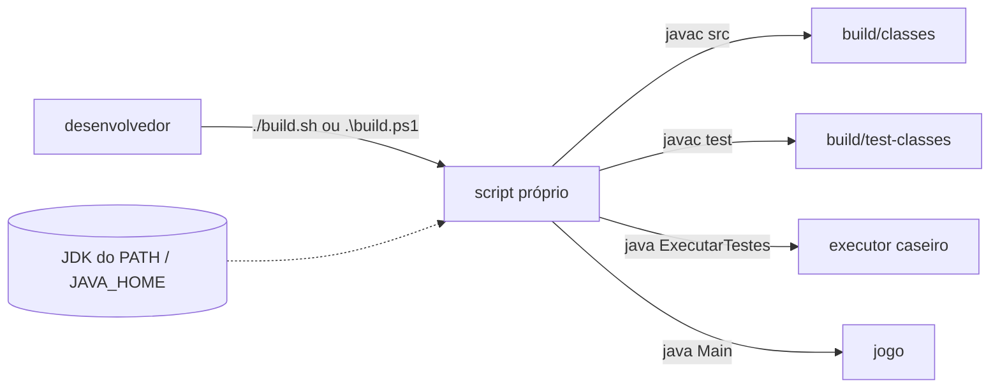
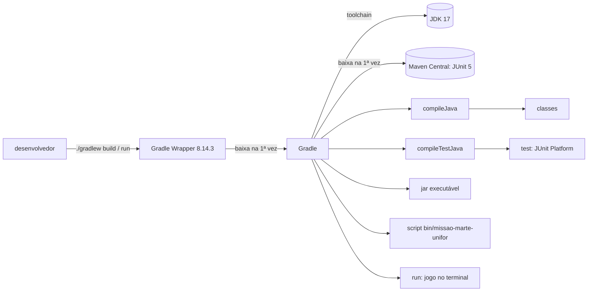

# Fase 2 — Migração para Gradle

## 1. Introdução

Na Fase 1 o jogo era compilado por scripts próprios (`build.sh` e `build.ps1`), que chamavam `javac` e `java` direto.
Os testes rodavam num executor feito à mão, porque não havia como baixar o JUnit. Nesta fase o **Gradle** assume a
compilação, os testes, a execução e o empacotamento. O código do jogo **não muda**: com a mesma semente, as
partidas da Fase 2 são idênticas byte a byte às da Fase 1 (200 de 200).

Ponto de partida: a tag `fase-1`. Resultado: a tag `fase-2`.

## 2. Objetivos de aprendizagem

- Explicar o que um *build tool* faz e o que o Gradle acrescenta a scripts com `javac`.
- Ler e escrever um `build.gradle`: plugins, repositórios, dependências e seus escopos, tarefas.
- Usar o **Gradle Wrapper** para que todos compilem com a mesma versão, sem instalar o Gradle.
- Usar o **Java toolchain** para fixar o JDK do projeto, independentemente do `java` padrão da máquina.
- Migrar testes para o **JUnit 5**.

## 3. Conceitos teóricos

O referencial teórico é o
[tutorial de API, Gradle e libGDX](https://github.com/marcelobezerra-dotcom/T200-ProjArqSist/blob/main/missaoMarteUnifor/projetoExtensaoFinal/tutorial-api-gradle-libgdx.md)
do projeto-base. Abaixo, um resumo e onde aprofundar cada assunto. As seções são citadas pelo título, porque a
numeração do tutorial não é contínua.

| Conceito | Resumo aplicado ao projeto | Seção do referencial |
|---|---|---|
| API | O JUnit é uma API: usamos `@Test` e `assertEquals` sem conhecer a implementação | Parte 1 – O que é uma API? |
| Build tool | Automatiza compilar, testar, empacotar e baixar dependências. Antes isso era feito pelo `build.sh` | 2.3 O que é um Build Tool? · 2.4 Gradle vs Maven |
| Tarefas e DAG | `build` depende de `check`, que depende de `test`, que depende de `compileTestJava`… O Gradle executa só o necessário (`UP-TO-DATE`) | 2.5.1 Tasks · 2.5.2 DAG |
| Daemon e cache | O segundo `./gradlew build` leva menos de 1 s: o daemon fica aquecido e as tarefas sem mudança são puladas | 2.5.3 Gradle Daemon · 2.5.4 Build Cache |
| DSL Groovy | `build.gradle` é código Groovy. Usamos a sintaxe de atribuição (`prop = valor`), porque a antiga (`prop valor`) gera aviso de obsoleto no Gradle 8.14 | 2.6 DSL: Groovy vs Kotlin · 2.7 Estrutura de um `build.gradle` |
| Dependências e escopos | `testImplementation` (só compila e roda os testes) e `testRuntimeOnly` (só na execução dos testes). O jogo em si não tem dependência nenhuma | 2.8 Dependências e seus Escopos |
| Wrapper | `gradlew` + `gradle/wrapper/` baixam a versão certa do Gradle. Regra de ouro: os arquivos do wrapper vão para o Git | 2.9 O Gradle Wrapper em Detalhes |
| Ciclo de vida | inicialização (`settings.gradle`) → configuração (`build.gradle`) → execução das tarefas | 2.10 Ciclo de Vida de um Build Gradle |
| Comandos | `build`, `test`, `run`, `clean`, `tasks`, `--console=plain` | 2.12 Comandos Gradle Essenciais · Parte 9 – Executando e Testando |
| Ambiente | JDK 17 e as extensões Extension Pack for Java e Gradle for Java no VS Code | 3.2 Passo 1 – Instalar o JDK 17 · 3.4 Passo 3 – Instalar as Extensões · 3.6 Passo 5 – Abrir o Projeto |

**Conceitos fora do referencial, com fonte oficial**:
- **Java toolchain**: o referencial só cita os toolchains na linha do tempo ("2.2 Versões do Gradle").
  Fonte: [Gradle — Toolchains for JVM projects](https://docs.gradle.org/8.14.3/userguide/toolchains.html).
- **JUnit BOM e `junit-platform-launcher`**: [JUnit 5 User Guide — Gradle](https://junit.org/junit5/docs/5.10.2/user-guide/#running-tests-build-gradle).
- **Plugin `application`** (`run`, `installDist`, `mainClass`):
  [Gradle — The Application Plugin](https://docs.gradle.org/8.14.3/userguide/application_plugin.html).

**Onde o referencial diverge do projeto** (registrado em DA-07):

| Referencial | Projeto | Motivo |
|---|---|---|
| Gradle 8.7 | **Gradle 8.14.3** | versão recente da linha 8, já usada nesta máquina com JDK 17 e libGDX 1.13.1 (o libGDX da Fase 3). A regra prática do próprio referencial é evitar versões antigas |
| exemplo multi-módulo (`core` + `lwjgl3`) | projeto de módulo único | ainda não há libGDX. O multi-módulo chega na Fase 3 ("2.11 Projeto Multi-módulo" é uma prévia) |
| pacote `br.unifor.missaomarte` nos exemplos | `br.edu.unifor.missaomarte` | o pacote definido na Fase 1 |
| comandos só para Windows (`gradlew.bat`) | Windows e macOS/Linux (`gradlew`) | o projeto foi desenvolvido em macOS; os comandos do Windows ficam documentados ao lado |

## 4. Problemas encontrados no código anterior

1. **Build feito à mão**: dois scripts (`build.sh` e `build.ps1`) com a mesma lógica, em duas linguagens. Uma
   mudança precisava ser feita duas vezes, e o `build.ps1` nunca chegou a ser executado nesta máquina.
2. **Recompila tudo sempre**: os scripts apagavam `build/` e compilavam todos os arquivos a cada execução.
3. **JDK implícito**: o `javac` usado era o do `PATH` ou o de `JAVA_HOME`. Numa máquina com Java 11 como padrão
   (como a de desenvolvimento), o build falhava em `--release 17` sem explicar o que fazer.
4. **Executor de testes caseiro**: cerca de 150 linhas mantidas por nós (`@Teste`, `Verifica`, `ExecutarTestes`),
   sem relatório, sem integração com IDE e sem recursos como pasta temporária automática.
5. **Sem artefato**: não havia um jar para distribuir o jogo.

## 5. Arquitetura antes da transformação



As camadas do código (domínio, aplicação, infraestrutura e console) não mudam nesta fase. O diagrama delas
está no [tutorial da Fase 1](fase-01-tutorial.md#9-arquitetura-resultante).

## 6. Passo a passo da implementação

1. **Layout padrão** (convenção do plugin `java`): `git mv src/br src/main/java/br` e
   `git mv test/br src/test/java/br`. O `git mv` preserva o histórico de cada arquivo.
2. **`settings.gradle`**: o nome do projeto (`missao-marte-unifor`), que vira o nome do jar e do script de execução.
3. **`build.gradle`**, em blocos:
   - `plugins { id 'java'; id 'application' }`;
   - `java { toolchain { languageVersion = JavaLanguageVersion.of(17) } }`;
   - `repositories { mavenCentral() }` e as dependências do JUnit (seção 7);
   - `application { mainClass = 'br.edu.unifor.missaomarte.Main' }`;
   - `run`: `standardInput = System.in`, porque sem isso o `Scanner` recebe uma entrada vazia e o jogo encerra na hora;
   - `test`: `useJUnitPlatform()`;
   - `jar`: atributo `Main-Class` no manifesto.
4. **Wrapper**: `gradle wrapper --gradle-version 8.14.3 --distribution-type bin` gerou `gradlew`,
   `gradlew.bat` e `gradle/wrapper/*`, todos versionados.
5. **Testes para JUnit 5**, troca mecânica feita por script nos 13 arquivos:
   `@Teste` → `@Test`, `igual` → `assertEquals`, `verdadeiro` → `assertTrue`, `falso` → `assertFalse`,
   `lanca` → `assertThrows`. Em `RankingArquivoJsonTeste`, a pasta temporária criada à mão virou `@TempDir`.
   O pacote `teste` (executor caseiro) foi apagado.
6. **Scripts antigos removidos**: `build.sh` e `build.ps1`.
7. **Avisos zerados**: `./gradlew build --warning-mode all` apontou `exceptionFormat 'full'` (sintaxe obsoleta),
   que virou `exceptionFormat = 'full'`.
8. **Pasta de trabalho do `run`**: o Gradle executa o jogo na pasta do projeto, e é lá que fica o `ranking.json`.
   Para usar outra pasta, existe a propriedade `-PpastaDoJogo=...`, que a validação usa para rodar cada roteiro
   numa pasta limpa.

## 7. Código antes e depois

**Compilar e testar.** Antes:

```sh
# build.sh (Fase 1)
rm -rf build
"${JBIN}javac" --release 17 -encoding UTF-8 -Xlint:all -d build/classes $(find src -name '*.java')
"${JBIN}javac" --release 17 -encoding UTF-8 -Xlint:all -cp build/classes -d build/test-classes $(find test -name '*.java')
"${JBIN}java" -cp build/classes:build/test-classes br.edu.unifor.missaomarte.teste.ExecutarTestes build/test-classes
```

Depois, o que fazer fica declarado, e o Gradle decide como e quando executar:

```groovy
// build.gradle (Fase 2)
java {
    toolchain {
        languageVersion = JavaLanguageVersion.of(17)
    }
}

dependencies {
    testImplementation platform('org.junit:junit-bom:5.10.2')
    testImplementation 'org.junit.jupiter:junit-jupiter'
    testRuntimeOnly 'org.junit.platform:junit-platform-launcher'
}

tasks.withType(JavaCompile).configureEach {
    options.encoding = 'UTF-8'
    options.compilerArgs << '-Xlint:all'
}
```

**Um teste.** Antes, com o executor caseiro:

```java
import static br.edu.unifor.missaomarte.teste.Verifica.igual;
import br.edu.unifor.missaomarte.teste.Teste;

@Teste
void cadaMovimentoCustaUmPontoMesmoParadoNaBorda() {
    ...
    igual(17, p.getPontos());
```

Depois, com o JUnit 5:

```java
import static org.junit.jupiter.api.Assertions.assertEquals;
import org.junit.jupiter.api.Test;

@Test
void cadaMovimentoCustaUmPontoMesmoParadoNaBorda() {
    ...
    assertEquals(17, p.getPontos());
```

**Pasta temporária.** Antes era criada no construtor e nunca apagada. Agora o JUnit cria e apaga:

```java
@TempDir
Path pasta; // o JUnit cria uma pasta temporária por teste e apaga depois
```

## 8. Explicação das alterações

- **Por que o toolchain, e não `options.release = 17`.** O `release` só limita a API usada, e continua dependendo
  de um `javac` 17 ou mais novo no `JAVA_HOME`. O toolchain **procura um JDK 17 instalado** (por `java_home` no
  macOS, pelo registro no Windows, pelas IDEs…) e o usa para compilar, testar e executar. A prova está em
  `docs/evidencias/fase-02/instalacao-limpa.txt`: o Gradle rodou no JDK 11 e compilou com o JDK 17.
- **Por que o BOM do JUnit.** O JUnit 5 é formado por vários artefatos (`jupiter-api`, `jupiter-engine`,
  `platform-launcher`…) que precisam ter versões compatíveis. O BOM (`platform(...)`) fixa todas de uma vez, por
  isso as linhas seguintes não têm versão.
- **Por que `junit-platform-launcher` explícito.** O Gradle 8 avisa, e o Gradle 9 exige, que o launcher esteja no
  classpath dos testes.
- **Por que `standardInput = System.in`.** Por padrão a tarefa `run` não repassa o teclado ao processo do jogo.
- **Por que o executor caseiro foi apagado, e não mantido "por garantia".** As mesmas 65 verificações rodam no
  JUnit. A prova é que os mesmos 4 defeitos inseridos de propósito derrubam o mesmo número de testes antes e
  depois da migração (4, 2, 2, 2).
- **O que não mudou**: nenhuma linha em `src/main/java` mudou além do caminho do arquivo. A saída do jogo é
  idêntica à da Fase 1.

## 9. Arquitetura resultante



```text
.
├── build.gradle                  plugins, toolchain, dependências, tarefas
├── settings.gradle               nome do projeto
├── gradlew / gradlew.bat         wrapper (versionado)
├── gradle/wrapper/               versão do Gradle (8.14.3) e o jar do wrapper
└── src/
    ├── main/java/br/edu/unifor/missaomarte/{dominio,aplicacao,infraestrutura,console}
    └── test/java/br/edu/unifor/missaomarte/{dominio,aplicacao,infraestrutura,console}
```

Tarefas mais usadas, de `./gradlew tasks`:

| Tarefa | O que faz |
|---|---|
| `build` | compila, roda os testes e gera o jar |
| `test` | só os testes (relatório em `build/reports/tests/test/index.html`) |
| `run` | executa o jogo no terminal |
| `installDist` | gera `build/install/missao-marte-unifor/bin/missao-marte-unifor` (e o `.bat`) |
| `jar` | gera `build/libs/missao-marte-unifor-2.0.0.jar`, executável com `java -jar` |
| `clean` | apaga `build/` |
| `javaToolchains` | mostra os JDKs encontrados e qual o projeto usa |

## 10. Como executar e testar

Requisito: **um JDK 17 instalado** (o toolchain o encontra mesmo que o `java` padrão seja outro). O Gradle não
precisa estar instalado.

```bash
./gradlew build                          # compila, 65 testes, jar
./gradlew run -q --console=plain         # joga (-q e --console=plain: sem mensagens nem barra de progresso do Gradle)
./gradlew run --console=plain -q -Dmissaomarte.semente=7   # mesmo sorteio sempre
java -jar build/libs/missao-marte-unifor-2.0.0.jar          # jar (exige java 17 no PATH)
```

```powershell
.\gradlew.bat build
.\gradlew.bat run -q --console=plain
```

**Validação da fase** (as saídas estão em `docs/evidencias/fase-02/`):

| Verificação | Resultado |
|---|---|
| Instalação limpa: clone novo, `GRADLE_USER_HOME` vazio, Java 11 como padrão | `BUILD SUCCESSFUL`; baixou o Gradle 8.14.3 e o JUnit 5.10.2; compilou com o JDK 17 |
| `./gradlew build --warning-mode all` | 0 avisos de obsoleto; `-Xlint:all` sem avisos |
| JUnit | **65 testes, 0 falhas** em 13 classes (os mesmos da Fase 1) |
| Os testes pegam defeitos? Os mesmos 4 defeitos da Fase 1 | os 4 foram pegos, com o mesmo número de testes falhando |
| Roteiros × gabarito da Fase 1, por `installDist`, por `java -jar` e por `./gradlew run` | 11/11 nas três formas |
| Prompt visível antes da leitura, com a entrada aberta (`./gradlew run` e `installDist`) | sim |
| Mesma semente, Fase 1 × Fase 2 (`java -jar`) | **200/200 partidas idênticas** |
| Piloto automático, 50 partidas | 0 regras violadas |

Não verificado: `gradlew.bat` no Windows e build no Linux, por falta dessas máquinas. Fica como tarefa de revisão
para um integrante com Windows.

## 11. Exercícios para os alunos

1. Rode `./gradlew build` duas vezes seguidas e compare os tempos e as palavras `UP-TO-DATE`. Altere um teste e
   rode de novo: quais tarefas voltam a executar? Desenhe o DAG dessas tarefas.
2. Troque `testImplementation` por `implementation` na linha do `junit-jupiter`. O build continua passando? O
   que muda no jar e no `installDist` (olhe `build/install/.../lib`)? Por que isso é um problema?
3. Crie uma tarefa `validarRoteiros` (tipo `Exec`) que dependa de `installDist` e rode
   `python3 validacao/executar_roteiros.py --comparar validacao/gabarito/fase-01 -- build/install/missao-marte-unifor/bin/missao-marte-unifor`.
4. Use `@ParameterizedTest` com `@EnumSource(Dificuldade.class)` para reescrever
   `PartidaTeste.comecaComOsPontosDaDificuldade` sem o laço `for`.
5. Mude o toolchain para 21 sem ter o JDK 21 instalado. Leia a mensagem de erro. Que plugin do Gradle permitiria
   baixar o JDK automaticamente?

## 12. Conclusão

O jogo é o mesmo. A forma de construí-lo passou a ser padronizada e reproduzível: um clone novo, numa máquina
com outro Java padrão e sem cache, compila e testa com um único comando. Os testes agora rodam no JUnit 5, com
relatório e integração com a IDE. Isso prepara a Fase 3, em que o mesmo Gradle passa a ter vários módulos (`core`
com o jogo e `lwjgl3` com a janela) e dependências de verdade (o libGDX).
