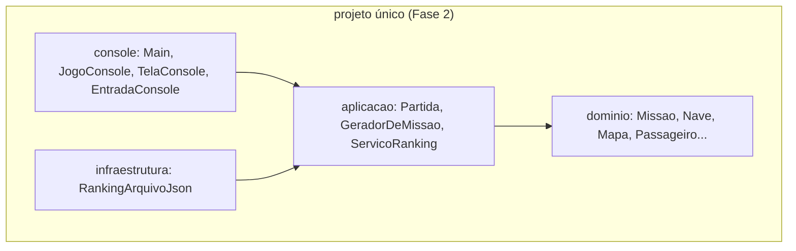
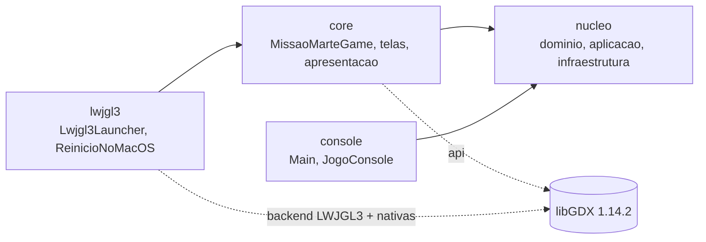
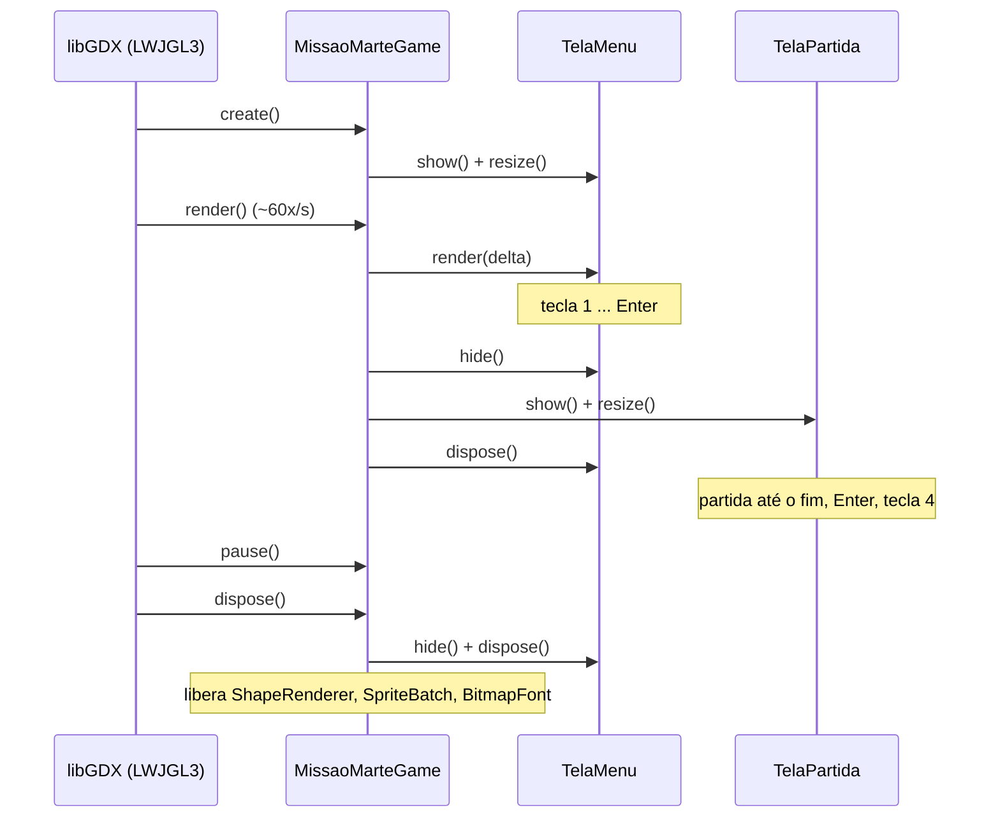
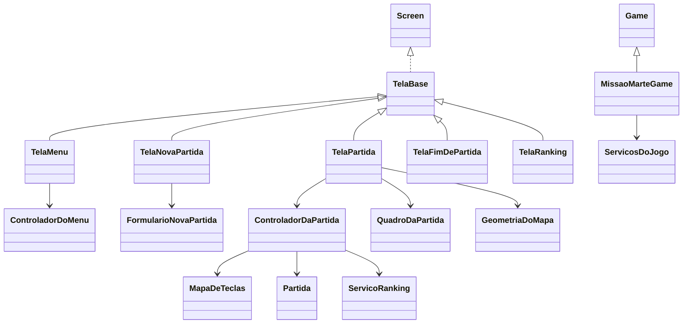

# Fase 3 — Introdução à libGDX

## 1. Introdução

Até a Fase 2 o Missão Marte só existia no terminal. Nesta fase ele ganha uma **janela desktop jogável**, feita com
a libGDX, **sem mudar nenhuma regra do jogo**: a mesma `Partida` da Fase 1 recebe os comandos, e a janela só troca
a forma de ler as teclas e de mostrar o resultado. O jogo de console continua existindo e se comporta exatamente
como antes (com a mesma semente, 200 de 200 partidas idênticas à Fase 2).

Nesta fase a janela desenha só com formas geométricas e a fonte padrão da libGDX. Sprites, sons, animações e
a fonte própria são assunto da Fase 4.

Ponto de partida: a tag `fase-2`. Resultado: a tag `fase-3`.

## 2. Objetivos de aprendizagem

- Explicar o que é a libGDX, como ela é organizada em módulos e por que usa o Gradle.
- Organizar um projeto Gradle **multi-módulo** e entender o que cada módulo pode enxergar.
- Explicar o **ciclo de vida** de uma aplicação libGDX: `create`, `render`, `resize`, `pause`, `resume` e `dispose`.
- Usar `Game` e `Screen` para organizar o jogo em telas, e liberar os recursos de cada tela.
- Tratar o teclado com `InputProcessor` e manter a proporção da tela com `Viewport`.
- Manter as regras testáveis **sem abrir janela nem usar OpenGL**.

## 3. Conceitos teóricos

O referencial teórico é o
[tutorial de API, Gradle e libGDX](https://github.com/marcelobezerra-dotcom/T200-ProjArqSist/blob/main/missaoMarteUnifor/projetoExtensaoFinal/tutorial-api-gradle-libgdx.md)
do projeto-base. As seções são citadas pelo título, porque a numeração do tutorial não é contínua.

| Conceito | Resumo aplicado ao projeto | Seção do referencial |
|---|---|---|
| O que é a libGDX | Framework Java de jogos 2D/3D, aberto, que roda em desktop, Android, iOS e web com o mesmo código | Parte 3: 3.1 História e Origem · 3.2 O que é a libGDX? · 3.3 Características Principais |
| Módulos e classes | `gdx` (a API: `Game`, `Screen`, `ShapeRenderer`, `SpriteBatch`, `BitmapFont`…) e um *backend* por plataforma. Aqui, o `gdx-backend-lwjgl3` (desktop, OpenGL) | 3.3 → Módulos da libGDX · Principais Classes da API |
| Versões | A regra do referencial é usar a versão estável mais recente. Hoje ela é a 1.14.2 | 3.4 Versões da libGDX → Qual versão usar? |
| Por que Gradle | Cada plataforma é um módulo que depende do mesmo `core`. O Gradle baixa a libGDX e as bibliotecas nativas | 3.5 Por que a libGDX usa Gradle? |
| Alternativas e ecossistema | Comparação com outros motores e as ferramentas da libGDX (gdx-liftoff, TexturePacker…) | 3.6 Alternativas à libGDX · 3.7 Ecossistema da libGDX |
| Multi-módulo | `settings.gradle` lista os módulos; um módulo usa outro com `project(':nome')` | Parte 2: 2.11 Projeto Multi-módulo (libGDX) · Parte 8: 7.1 a 7.4 |
| Game Loop | `create()` uma vez; `render()` cerca de 60 vezes por segundo; `dispose()` ao fechar | Parte 5: 4.1 O Game Loop da libGDX |
| Screen | Cada tela é um estado do jogo. `Game.setScreen` troca a tela atual | 4.2 Conceito de Screen · 4.3 Diagrama de Classes |
| Classe principal e launcher | `MissaoMarteGame extends Game` e `Lwjgl3Launcher` (usados só como exemplo de estrutura) | Parte 6: 5.2 Classe Principal · 5.6 Launcher Desktop |
| Desenho sem imagens | `ShapeRenderer` desenha retângulos, círculos, triângulos e linhas. Aqui ele é usado já na Fase 3 | Parte 7 – Alternativa sem Imagens: ShapeRenderer |

**Conceitos fora do referencial, com fonte oficial:**
- **`pause()` e `resume()`**: no desktop, `pause` é chamado quando a janela é minimizada e logo antes do `dispose()`
  ao fechar. Fonte: [libGDX wiki — The Life-Cycle](https://libgdx.com/wiki/app/the-life-cycle).
- **`Viewport`**: o `FitViewport` mantém a proporção do "mundo" de 800x600 em qualquer tamanho de janela.
  Fonte: [libGDX wiki — Viewports](https://libgdx.com/wiki/graphics/viewports).
- **`InputProcessor`** (`keyDown`, `keyTyped`, `keyUp`). Fonte:
  [libGDX wiki — Event Handling](https://libgdx.com/wiki/input/event-handling).
- **`-XstartOnFirstThread` no macOS**: a GLFW, que cria a janela, exige a primeira thread do processo
  ([GLFW — Thread safety](https://www.glfw.org/docs/latest/intro_guide.html#thread_safety)). Os projetos gerados pela
  libGDX resolvem isso reiniciando a JVM (`StartupHelper`, em
  [Starter Classes & Configuration](https://libgdx.com/wiki/app/starter-classes-and-configuration)), e é o que o
  nosso `ReinicioNoMacOS` faz.
- **`BitmapFont` padrão**: a fonte embutida só tem os caracteres Latin-1, e por isso os textos da janela não usam
  os emojis do console. Fonte: [libGDX wiki — Bitmap Fonts](https://libgdx.com/wiki/graphics/2d/fonts/bitmap-fonts).

**Onde o referencial diverge do projeto** (registrado em DA-08 e DA-09):

| Referencial | Projeto | Motivo |
|---|---|---|
| libGDX 1.12.1 | **1.14.2** | a versão estável mais recente, que é a própria regra do referencial. As classes usadas são as mesmas |
| Gradle 8.7 | 8.14.3 | mantido da Fase 2 (DA-07) |
| 2 módulos (`core` e `lwjgl3`) | **4 módulos** (`nucleo`, `console`, `core` e `lwjgl3`) | o domínio sem libGDX vira garantia do compilador, e o console continua jogável (DA-08) |
| `allprojects` + `sourceCompatibility` | `subprojects` + toolchain 17 | mantém a decisão da Fase 2 |
| repositório Sonatype, roboVM, box2dlights | removidos | não são usados |
| classes `Nave`, `Asteroide` e `GameScreen` do exemplo | não usadas | as classes do projeto prevalecem. A nave e os asteroides continuam sendo os do domínio da Fase 1 |
| `core/assets` com imagens | nenhuma imagem | imagens e sons entram na Fase 4 |

## 4. Problemas encontrados no código anterior

1. **Só existe a interface de texto.** O laço de turnos do `JogoConsole` lê uma linha com `Scanner` e imprime o mapa.
   Não há como reaproveitar esse laço numa janela, que não "espera" uma linha: ela recebe eventos de tecla, enquanto
   o `render()` desenha 60 vezes por segundo.
2. **Um módulo só.** A regra "o domínio não depende de interface" era só uma convenção. Bastaria colocar a libGDX
   no `build.gradle` para qualquer classe do domínio poder importá-la sem que nada avisasse.
3. **Nenhuma noção de recursos gráficos.** Fontes, `ShapeRenderer` e `SpriteBatch` ocupam memória de vídeo e
   precisam ser criados depois que a janela existe e liberados ao fechar. O console não tinha nada disso.
4. **Problema herdado do console:** com mapa de tamanho 1 (9 células), as dificuldades Médio e Difícil precisam de
   mais células livres do que existem, e o sorteio de posições nunca termina. Como o console precisa continuar
   idêntico, a correção não foi feita no domínio. A janela só oferece tamanhos de 2 a 10.

## 5. Arquitetura antes da transformação



As camadas vêm da Fase 1 ([tutorial da Fase 1](fase-01-tutorial.md#9-arquitetura-resultante)). O que faltava era
uma segunda interface e a garantia, pelo build, de que as regras não dependem dela.

## 6. Passo a passo da implementação

1. **Dividir em módulos sem mudar código** (commit `2f7edf0`): `git mv` de `dominio`, `aplicacao` e
   `infraestrutura` (e dos testes) para `nucleo/src/...`, e de `console` e `Main` para `console/src/...`. O
   `settings.gradle` passou a ter `include 'nucleo'` e `include 'console'`. Antes de seguir, a validação inteira
   rodou de novo: 65 testes, roteiros 11/11 e 200/200 partidas iguais à Fase 2.
2. **`build.gradle` raiz**: o bloco `subprojects` com o que é comum (toolchain 17, UTF-8, `-Xlint:all`, JUnit 5) e
   `ext { gdxVersion = '1.14.2' }`, a versão da libGDX num único lugar.
3. **`nucleo/build.gradle`**: plugin `java-library`, sem nenhuma dependência. **`console/build.gradle`**: plugin
   `application` e `implementation project(':nucleo')`.
4. **`core/build.gradle`**: `java-library`, com `api project(':nucleo')` e `api "...gdx:$gdxVersion"`. O `api` deixa
   os launchers enxergarem o núcleo e a libGDX. Nos testes entra o `gdx-backend-headless`, que traz implementações
   falsas de `Graphics`.
5. **`lwjgl3/build.gradle`**: `application`, `implementation project(':core')`, o backend `gdx-backend-lwjgl3` e as
   bibliotecas nativas (`gdx-platform:...:natives-desktop`). A tarefa `run` passa `-XstartOnFirstThread` no macOS e
   aceita `-PpastaDoJogo` e `-Dmissaomarte.semente`, como o console.
6. **`MissaoMarteGame extends Game`**: cria os recursos compartilhados no `create()` (`ShapeRenderer`,
   `SpriteBatch`, `BitmapFont`), libera tudo no `dispose()` e navega entre telas por `trocarTela`, que **libera a
   tela anterior**.
7. **`TelaBase implements Screen`** (Template Method): câmera, `FitViewport` de 800x600, `render()` fixo (limpa,
   aplica a câmera e chama `desenhar()`) e o registro do `InputProcessor` em `show()`/`hide()`.
8. **Pacote `apresentacao`**, sem OpenGL e testável: `MapaDeTeclas`, `ControladorDaPartida`, `ControladorDoMenu`,
   `FormularioNovaPartida`, `QuadroDaPartida`, `GeometriaDoMapa`, `TextosDaInterface` e `FimDePartida`.
9. **Pacote `telas`**: `TelaMenu`, `TelaNovaPartida`, `TelaPartida`, `TelaFimDePartida` e `TelaRanking`. Cada uma
   só repassa teclas ao seu controlador e desenha o que ele expõe.
10. **`Lwjgl3Launcher`**: raiz de composição do cliente gráfico. Monta `GeradorDeMissao`, `ServicoRanking` com o
    `ranking.json` e `Relogio` em `ServicosDoJogo`, configura a janela e entrega o jogo à libGDX.
    `ReinicioNoMacOS` reinicia a JVM com `-XstartOnFirstThread` quando o jogo não é aberto pelo Gradle.
11. **Testes do `core`** (39) e **validação** (seção 10).

## 7. Código antes e depois

**O turno.** No console, o laço pede uma linha e executa o comando:

```java
// console/.../JogoConsole.java (igual à Fase 2)
while (partida.emAndamento()) {
    tela.mapa(partida);
    tela.status(partida);
    String digitado = entrada.lerLinha("Comando (w/s/a/d/c/q): ", "").toLowerCase();
    ...
    for (Evento e : partida.executar(Comando.daTecla(digitado.charAt(0)))) {
        tela.evento(e);
        if (e.tipo() == Evento.Tipo.VITORIA) {
            concluirVitoria(partida.getResultado(), ranking);
        }
    }
}
```

Na janela não há laço de leitura: a libGDX chama `keyDown` a cada tecla e `render` a cada quadro. A tela só repassa:

```java
// core/.../telas/TelaPartida.java
public boolean keyDown(int tecla) {
    controlador.teclaPressionada(tecla);
    controlador.getFim().ifPresent(jogo::irParaFimDePartida);
    return true;
}
```

e o controlador faz o papel do laço do console, chamando a **mesma** `Partida`:

```java
// core/.../apresentacao/ControladorDaPartida.java
public boolean teclaPressionada(int tecla) {
    if (fim != null) {
        return false;                                   // depois do fim, as teclas são ignoradas
    }
    Optional<Comando> comando = MapaDeTeclas.comandoPara(tecla);
    if (comando.isEmpty()) {
        return false;                                   // tecla que o jogo não usa não gasta turno
    }
    ultimosEventos = partida.executar(comando.get());
    if (!partida.emAndamento()) {
        fim = concluir();                               // na vitória, grava o ranking como o console
    }
    return true;
}
```

**O desenho.** O console imprime um caractere por célula. A janela pergunta ao `QuadroDaPartida` o que há em cada
célula (com a mesma prioridade: nave, passageiro, asteroide, inimigo, plataforma) e à `GeometriaDoMapa` onde
desenhar:

```java
// core/.../telas/TelaPartida.java (trecho simplificado)
for (QuadroDaPartida.Celula c : QuadroDaPartida.de(controlador.getPartida().getMissao())) {
    Quadrado q = geometria.celula(c.posicao());
    switch (c.conteudo()) {
        case NAVE:
            formas().setColor(Color.CYAN);
            formas().triangle(cx, cy + lado * 0.38f, cx - lado * 0.3f, cy - lado * 0.3f, cx + lado * 0.3f, cy - lado * 0.3f);
            break;
        ...
```

**Os módulos.** Antes, um projeto. Depois:

```groovy
// settings.gradle
rootProject.name = 'missao-marte-unifor'
include 'nucleo'    // regras do jogo; Java puro, sem libGDX
include 'console'   // o jogo em modo texto, que continua funcionando
include 'core'      // cliente libGDX compartilhado entre as plataformas (Game e telas)
include 'lwjgl3'    // launcher desktop (janela com LWJGL3/OpenGL)
```

## 8. Explicação das alterações

- **Por que quatro módulos, e não dois como no referencial.** Com a libGDX fora do classpath do `nucleo`, um
  `import com.badlogic...` no domínio é **erro de compilação** (`docs/evidencias/fase-03/dependencia-proibida.txt`).
  O `console` separado continua jogável e validável. Na Fase 6, o módulo Android vai depender do `core` como o
  `lwjgl3` depende hoje.
- **Por que `trocarTela` chama `dispose()`.** O `Game.setScreen` da libGDX chama `hide()` na tela antiga e
  `show()` na nova, mas nunca `dispose()`. Sem isso, cada troca deixaria a tela antiga na memória, e na Fase 4
  também as texturas e os sons dela. O teste `MissaoMarteGameTeste` confere a ordem exata das chamadas.
- **Por que recursos compartilhados no `Game`.** `ShapeRenderer`, `SpriteBatch` e `BitmapFont` precisam de contexto
  OpenGL, que só existe a partir do `create()`. Um de cada para o jogo inteiro basta, e todos são liberados uma vez
  no `dispose()`.
- **Por que controladores fora das telas (Humble Object).** Tudo o que decide algo fica em classes que não usam
  OpenGL: a tecla que vira comando, o fim da partida, a gravação do ranking, a confirmação antes de apagar e os
  limites do formulário. Os 39 testes do `core` rodam sem janela, e as telas ficam tão simples que quase não têm o
  que testar.
- **Por que `FiltroDeEntrada`.** A tecla `1` do menu gera `keyDown('1')` e depois `keyTyped('1')`. O `keyDown`
  troca para a tela de nova partida, e o `keyTyped` chegaria a ela, digitando "1" no nome. O filtro só repassa
  `keyTyped` e `keyUp` depois que a tela atual recebeu um `keyDown`.
- **Por que o eixo y é invertido na `GeometriaDoMapa`.** No domínio, `w` diminui o y (no console, a linha de cima
  tem o menor y). Na libGDX, o y da tela cresce para cima. A conversão fica num só lugar, testado.
- **Por que `FitViewport`.** As telas desenham num mundo fixo de 800x600. Ao redimensionar a janela, o viewport
  escala tudo mantendo a proporção. Se a proporção da janela mudar, sobram faixas vazias nas bordas, mas nada fica
  distorcido ou cortado.
- **Por que o `Diario`.** Registra `create`, `resize`, `pause`, `resume`, `dispose` e as trocas de tela, para o aluno
  ver no terminal a ordem em que a libGDX chama cada método. Nos testes não há aplicação e nada é registrado.
- **O que não mudou:** nenhuma linha de `nucleo` nem de `console` mudou nesta fase, além do caminho dos arquivos.

## 9. Arquitetura resultante



O ciclo de vida, como aparece no terminal (`[Ciclo]`) ao jogar uma partida e sair pelo menu:





```text
.
├── settings.gradle / build.gradle     4 módulos; configuração comum e gdxVersion
├── nucleo/    dominio, aplicacao, infraestrutura (+ 62 testes)          sem libGDX
├── console/   Main e o jogo de texto (+ 3 testes)                        depende de nucleo
├── core/      grafico/{MissaoMarteGame, ServicosDoJogo, Diario}
│              grafico/apresentacao/  controladores e conversões (+ 39 testes)
│              grafico/telas/         TelaBase e as 5 telas                depende de nucleo + gdx
└── lwjgl3/    Lwjgl3Launcher, ReinicioNoMacOS                            depende de core + backend
```

**Padrões usados:** Template Method (`TelaBase`), State (as telas como estados do jogo), Humble Object / Passive
View (controladores testáveis e telas que só desenham), Adapter (`MapaDeTeclas`) e injeção de dependência pela raiz
de composição (`Lwjgl3Launcher` → `ServicosDoJogo`). O GRASP Controller continua sendo a `Partida`.

## 10. Como executar e testar

Requisito: **um JDK 17 instalado**. O Gradle não precisa estar instalado.

```bash
./gradlew build                                   # compila os 4 módulos e roda os 104 testes
./gradlew :lwjgl3:run                             # abre a janela
./gradlew :lwjgl3:run -Dmissaomarte.semente=3     # mesmo sorteio sempre
./gradlew :console:run -q --console=plain         # o jogo de texto, como antes
./gradlew :lwjgl3:installDist                     # gera lwjgl3/build/install/missao-marte/bin/missao-marte
```

```powershell
.\gradlew.bat build
.\gradlew.bat :lwjgl3:run
```

Controles da janela: `1` a `4` no menu; na nova partida, digite o nome, use as setas `←`/`→` para a dificuldade e
`↑`/`↓` para o tamanho do mapa, e `Enter` para decolar; na partida, `WASD` ou setas movem, `C` ou espaço embarcam
e `Q` ou `Esc` abortam. O `ranking.json` é o mesmo do console (na pasta do projeto, com `./gradlew`).

**Validação da fase** (as saídas estão em `docs/evidencias/fase-03/`):

| Verificação | Resultado |
|---|---|
| `./gradlew clean build` | `BUILD SUCCESSFUL`, sem avisos do `-Xlint:all` |
| JUnit | **104 testes, 0 falhas**: 62 do `nucleo`, 3 do `console` e 39 do `core` (sem janela nem OpenGL) |
| Os testes do `core` pegam defeitos? 7 defeitos inseridos de propósito numa cópia | os 7 foram pegos |
| `import` da libGDX no domínio | o build falha: `package com.badlogic.gdx does not exist` |
| Roteiros do console × gabarito da Fase 1, por `installDist`, `java -jar` e `./gradlew :console:run` | 11/11 nas três formas |
| Mesma semente, Fase 2 × Fase 3 (console) | **200/200 partidas idênticas** |
| Janela real, partida jogada à mão | ciclo de vida completo no log, sem exceções |
| Janela real dirigida pelo `validacao/janela/PilotoDaJanela.java` (semente 3) | as 5 telas, vitória com 60 pontos, `ranking.json` gravado, saída pelo `4` com `pause` → `dispose`. 11 prints em `janela/` |
| Instalação limpa: clone novo, `GRADLE_USER_HOME` vazio, Java 11 como padrão | `BUILD SUCCESSFUL`; baixou o Gradle 8.14.3, a libGDX 1.14.2 e o JUnit; 104 testes, 0 falhas |
| Janela aberta pelo script do `installDist` e por `java -jar` | as duas abrem o menu (o `ReinicioNoMacOS` reinicia a JVM com `-XstartOnFirstThread`) |

O `PilotoDaJanela` existe porque o macOS desta máquina não dá ao terminal as permissões de Acessibilidade (enviar
teclas) nem de Gravação de Tela. Ele abre a janela real, entrega as teclas ao `InputProcessor` da tela atual, na
mesma ordem do backend (`keyDown`, `keyTyped`, `keyUp`), e tira os prints do framebuffer do OpenGL. Como não passa
pelo teclado do sistema, a tradução das teclas físicas foi conferida na partida jogada à mão.

**Não verificado:** a janela no Windows e no Linux, por falta dessas máquinas. Fica como tarefa de revisão para um
integrante com Windows.

## 11. Exercícios para os alunos

1. Rode `./gradlew :lwjgl3:run`, minimize e restaure a janela e depois feche-a. Compare a ordem das linhas
   `[Ciclo]` com a seção "The Life-Cycle" da wiki. Em que momento aparece o `pause`?
2. Apague a linha `anterior.dispose()` de `MissaoMarteGame.trocarTela` e rode `./gradlew :core:test`. Qual teste
   falha e por quê? O que vazaria de memória na Fase 4 se isso fosse para produção?
3. Adicione `import com.badlogic.gdx.Gdx;` em `nucleo/.../dominio/Nave.java` e rode `./gradlew build`. Depois
   troque, em `core/build.gradle`, `api project(':nucleo')` por `implementation project(':nucleo')`: o que deixa de
   compilar no `lwjgl3`? Por quê?
4. Troque o `FitViewport` da `TelaBase` por um `ScreenViewport` e redimensione a janela. O que muda? Qual dos dois
   serve melhor a um jogo de grade?
5. Faça a tecla `R` abrir o ranking durante o menu. Onde fica a mudança (controlador ou tela)? Escreva o teste
   antes, em `ControladorDoMenuTeste`.
6. Mude o `MapaDeTeclas` para aceitar também as teclas do teclado numérico (`8`, `2`, `4` e `6`) para mover a nave,
   com teste.

## 12. Conclusão

O jogo agora tem duas interfaces para as mesmas regras: o console, que se comporta como antes, e uma janela libGDX
jogável. A separação da Fase 1 pagou a conta: a `Partida` não mudou, e a janela só precisou traduzir teclas e
desenhar estados. O build passou a garantir que as regras não dependem da libGDX, e o ciclo de vida
(`create`, `render`, `resize`, `pause`, `dispose`) está visível no log e coberto por testes. Na Fase 4, a mesma
estrutura recebe sprites, texturas, sons, animações e um HUD de verdade, trocando só o que as telas desenham.
