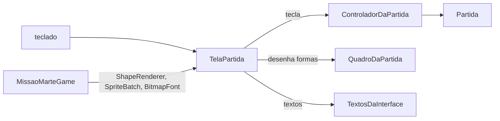
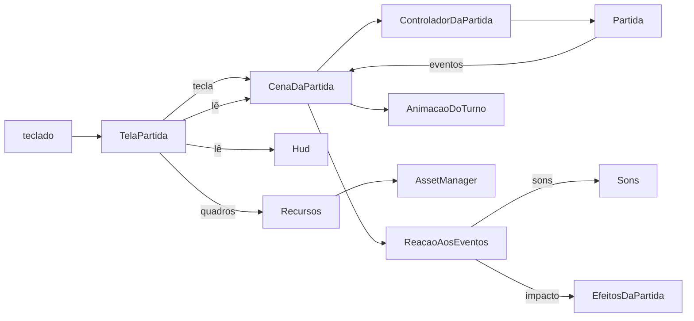
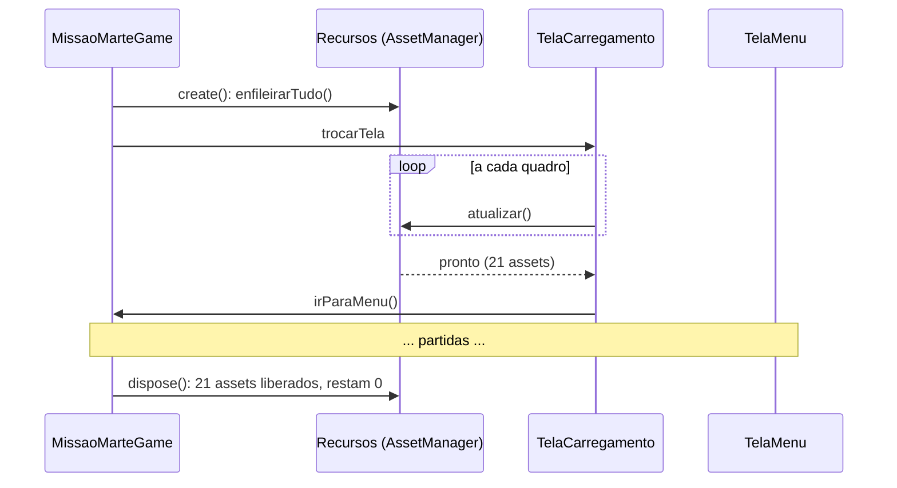

# Fase 4 — Interface gráfica

## 1. Introdução

Na Fase 3 a janela era jogável, mas desenhada com triângulos, círculos e a fonte padrão ampliada. Nesta fase ela
ganha **sprites** renderizados em 3D no Blender, **sons**, **animação** (a nave e os inimigos deslizam de uma célula
para a outra, os passageiros acenam, o asteroide gira), **efeitos** de colisão (explosão e tremor de tela), um **HUD**
com ícones e barras e uma **fonte** nítida. As regras não mudaram nenhuma linha: o `nucleo` e o `console` são os
mesmos da Fase 3, e com a mesma semente as 200 partidas de teste saem idênticas.

O ponto central desta fase é que a tela **reage** ao que a `Partida` decide. A explosão aparece porque a Partida
devolveu o evento `COLISAO`, não porque a tela comparou posições.

Ponto de partida: a tag `fase-3`. Resultado: a tag `fase-4`.

## 2. Objetivos de aprendizagem

- Entender o caminho de uma imagem até a tela: arquivo → `Texture` (GPU) → `TextureRegion` (um quadro) →
  `SpriteBatch`.
- Usar folhas de sprites (*sprite sheets*) e animar por quadros, em laço ou uma vez só.
- Carregar e liberar recursos com o `AssetManager`, com uma tela de carregamento.
- Tocar efeitos sonoros e gerar sons por síntese (PCM).
- Montar um HUD que só lê o estado do jogo.
- Separar **efeito visual** de **regra**: animação e efeitos na apresentação, decisões no domínio.

## 3. Conceitos teóricos

O referencial teórico é o
[tutorial de API, Gradle e libGDX](https://github.com/marcelobezerra-dotcom/T200-ProjArqSist/blob/main/missaoMarteUnifor/projetoExtensaoFinal/tutorial-api-gradle-libgdx.md)
do projeto-base, citado pelo título das seções.

| Conceito | Resumo aplicado ao projeto | Seção do referencial |
|---|---|---|
| Pipeline de imagem | PNG → `Texture` na GPU → `TextureRegion` com o recorte de um quadro → `SpriteBatch.draw` em lote | Parte 3: 3.8 Sprites e Texturas (Pipeline de renderização, Pixmap, Texture, Sprite, SpriteBatch) |
| Texturas compartilhadas | Cada folha é carregada uma vez e todos os sprites usam a mesma textura (a "dica de performance" do referencial) | 3.8 → No projeto Missão Marte |
| Sons | `Sound` para efeitos curtos, carregados inteiros na memória. Os nossos são gerados por síntese PCM, como no referencial, mas gravados em WAV por um script | 3.9 Sons e Áudio (Carregando e reproduzindo sons · Sons procedurais com PCM) |
| HUD | Painel com vidas em ícones, uma barra que muda de verde para vermelho, contadores e mensagens | 3.10 HUD (Head-Up Display) |
| Colisões e explosão | No referencial, `Intersector` com caixas de colisão. Aqui a colisão é por célula e fica no domínio. A tela só mostra a explosão | 3.11 Detecção de Colisões (Efeito visual de explosão) |
| Exemplos de classes | `Nave`, `Asteroide` e `GameScreen` do referencial, só como ideia. As nossas classes de domínio continuam as da Fase 1 | Parte 6: 5.3 a 5.5 |
| Formas | `ShapeRenderer` continua desenhando o tabuleiro translúcido, as barras e os assentos do HUD | Parte 7 – Alternativa sem Imagens: ShapeRenderer |
| Controles | Teclado (WASD/setas, C/espaço, Q/Esc) e a tecla nova `M`, que liga e desliga o som | Parte 9: 8.4 Controles do Jogo |

**Conceitos fora do referencial, com fonte oficial:**
- **`AssetManager`** (carregamento aos poucos, progresso, liberação única):
  [libGDX wiki — Managing your assets](https://libgdx.com/wiki/managing-your-assets).
- **Animação por quadros**: [libGDX wiki — 2D Animation](https://libgdx.com/wiki/graphics/2d/2d-animation). A ideia é a
  mesma da classe `Animation`. Escrevemos as contas em `FolhaDeSprites` para testá-las sem textura.
- **`TextureRegion`**: [SpriteBatch, TextureRegions and Sprites](https://libgdx.com/wiki/graphics/2d/spritebatch-textureregions-and-sprites).
- **Suavização do movimento** ("smoothstep"), mesma família da classe `Interpolation`:
  [libGDX wiki — Interpolation](https://libgdx.com/wiki/math-utils/interpolation).
- **Fontes TrueType com FreeType**: [libGDX wiki — gdx-freetype](https://libgdx.com/wiki/extensions/gdx-freetype).
- **Efeitos sonoros**: [libGDX wiki — Sound effects](https://libgdx.com/wiki/audio/sound-effects).

**Onde o referencial diverge do projeto** (registrado em DA-11 a DA-13):

| Referencial | Projeto | Motivo |
|---|---|---|
| Jogo de tiro em tempo real, colisão com `Intersector` | Jogo por turnos, colisão por célula decidida pela `Partida` | a regra já existe no domínio; repetir na tela duplicaria a regra (critério da issue #6) |
| Texturas criadas com `Pixmap` no código | Sprites renderizados em 3D por scripts Blender versionados | a arte 2.5D da prova de conceito, com origem rastreável (DA-11) |
| Sons PCM gerados ao abrir o jogo | Sons PCM gerados por `arte/sons/gerar_sons.py` e gravados em WAV | mesmo método; o arquivo pode ser ouvido, testado e carregado pelo `AssetManager` |
| `new Texture(...)` em cada classe | Tudo pelo `AssetManager`, atrás da fachada `Recursos` | uma só origem de carga e de liberação (DA-12) |
| Fonte padrão (`BitmapFont`) | Chakra Petch (OFL) via FreeType | a fonte padrão ampliada fica borrada, principalmente em telas Retina |

## 4. Problemas encontrados no código anterior

1. **Visual provisório.** Formas e letras não distinguem bem nave, passageiros e perigos, e a fonte padrão
   ampliada fica borrada.
2. **Sem retorno.** Colidir, embarcar ou chegar ao fim não tinha som nem efeito. Só uma linha de texto mudava.
3. **Movimento aos saltos.** A nave aparecia na célula nova de uma vez.
4. **Sem gestão de recursos de arquivo.** A Fase 3 não carregava nada de arquivo. Bastaria um `new Texture(...)` em
   cada tela para cada troca de tela carregar a mesma imagem de novo, ou nunca liberá-la.
5. **Risco de duplicar regra.** O caminho óbvio para a explosão seria a tela comparar a posição da nave com a dos
   asteroides, repetindo a regra da `Missao`.

## 5. Arquitetura antes da transformação



Os detalhes estão no [tutorial da Fase 3](fase-03-tutorial.md#9-arquitetura-resultante).

## 6. Passo a passo da implementação

1. **Arte.** O pipeline Blender da prova de conceito foi trazido para `arte/blender/`, com a saída apontando para
   `assets/sprites/` e o fundo em 1200x900, na proporção 4:3 da janela. Ganhou o `inimigo.py`: uma sentinela com olho
   vermelho pulsante e espinhos girando, em 8 quadros. Tudo foi regenerado do zero, e o `verify.py` aprovou as 13 folhas.
2. **Sons.** `arte/sons/gerar_sons.py` sintetiza 8 efeitos (WAV 16 bits, mono, 44,1 kHz). A semente é fixa, então
   rodar de novo gera os mesmos bytes.
3. **Fonte.** Chakra Petch Regular e SemiBold, baixadas do repositório do Google Fonts com a licença OFL, em
   `assets/fontes/`. A origem de tudo está em `assets/ORIGEM.md`.
4. **Gradle.** No `core`, `api "...:gdx-freetype"`. No `lwjgl3`, as nativas `gdx-freetype-platform` e
   `sourceSets.main.resources.srcDirs += [rootProject.file('assets')]`, que colocam os assets no classpath e dentro do
   jar.
5. **Recursos.**
   - `Folha` lista as folhas com a mesma geometria do `manifest.json`.
   - `FolhaDeSprites` faz as contas de recorte e de quadro.
   - `CatalogoDeAssets` lista todos os arquivos.
   - `Recursos` envolve o `AssetManager`.
6. **Carregamento.** O `create()` do jogo põe tudo na fila e abre a `TelaCarregamento`, que chama
   `recursos.atualizar()` a cada quadro e vai para o menu quando termina.
7. **`TelaBase`.**
   - ganha o gancho `atualizar(delta)`;
   - desenha o fundo marciano em todas as telas;
   - troca a fonte padrão pela fonte do jogo, mantendo a escala usada desde a Fase 3;
   - ganha `escreverTitulo` e `desenharCentralizado`.
8. **Apresentação sem OpenGL.** São as classes `AnimacaoDoTurno`, `ReacaoAosEventos`, `EfeitosDaPartida`, `Hud` e
   `CenaDaPartida`, que orquestra as outras. O som entra pela interface `Sons`.
9. **Telas.**
   - `TelaPartida` foi reescrita para desenhar o que a `CenaDaPartida` expõe;
   - o menu ganhou a nave e um asteroide animados;
   - o fim da partida ganhou arte e som;
   - o ranking e a nova partida ganharam o fundo e a fonte.
10. **Ícone da janela** (`config.setWindowIcon`), visível no Windows e no Linux.
11. **Testes:** 44 novos no `core`. **Validação:** seção 10.

## 7. Código antes e depois

**A nave.** Antes, um triângulo:

```java
// TelaPartida, Fase 3
formas().setColor(Color.CYAN);
formas().triangle(cx, cy + lado * 0.38f, cx - lado * 0.3f, cy - lado * 0.3f, cx + lado * 0.3f, cy - lado * 0.3f);
```

Depois, o quadro da folha que aponta para a direção do último movimento, na posição interpolada do deslize:

```java
// TelaPartida, Fase 4
AnimacaoDoTurno.Ponto nave = animacao.nave();                    // ex.: (0.5, 0) no meio do deslize
Quadrado qNave = geometria.celula(nave.x(), nave.y());
int quadro = FolhaDeSprites.quadroDaNave(cena.getDirecaoDaNave()); // 0 cima, 16 esquerda, 32 baixo, 48 direita
desenharCentralizado(Folha.NAVE, quadro, qNave.centroX() + dx, qNave.centroY() + dy, lado * 1.25f);
```

**A colisão.** A tela **não** procura colisões. Ela lê os eventos que a `Partida` devolveu:

```java
// ReacaoAosEventos: evento -> som e impacto, sem olhar posições nem vidas
case COLISAO:
    sons.add(Som.COLISAO);
    if (impacto == Impacto.NENHUM) {
        impacto = Impacto.LEVE;
    }
    break;
case NAVE_DESTRUIDA:
    sons.add(Som.EXPLOSAO);
    impacto = Impacto.FATAL;
    break;
```

**Carregar uma imagem.** O jeito ingênuo cria e esquece texturas:

```java
Texture t = new Texture("sprites/nave.png");   // em cada tela, a cada troca de tela
```

No projeto, tudo passa uma vez pelo `AssetManager`:

```java
// Recursos.enfileirarTudo()
for (Folha f : Folha.values()) {
    gerenciador.load(f.getCaminho(), Texture.class, parametrosDaTextura(f));
}
for (Som s : Som.values()) {
    gerenciador.load(s.getCaminho(), Sound.class);
}
// TelaCarregamento.atualizar(delta): um pedaço por quadro, a janela continua respondendo
if (recursos().atualizar()) {
    jogo.irParaMenu();
}
```

## 8. Explicação das alterações

- **Por que a tela espera a explosão antes do "GAME OVER".** A `Partida` termina no mesmo turno da terceira colisão.
  Se a tela fosse direto para o fim, ninguém veria a explosão. `CenaDaPartida.fimParaMostrar()` só devolve o fim
  quando o deslize e os efeitos terminam. A decisão de terminar continua sendo da Partida, e a tela só escolhe
  **quando mostrar**.
- **Por que as teclas não esperam a animação.** Um jogo por turnos não pode perder teclas. Se uma tecla chega no meio
  do deslize, o turno é executado na hora, e a animação recomeça da foto nova. Por isso o console e a janela
  continuam aceitando exatamente as mesmas sequências.
- **Por que mipmaps só nas texturas com lados potência de 2.** Os sprites aparecem menores que o desenho original, e
  os mipmaps deixam a redução nítida. Mas o OpenGL ES 2 do Android, que entra na Fase 6, não gera mipmaps para
  texturas com outros tamanhos. Nelas fica o filtro linear.
- **Por que 8 px entre as letras na textura da fonte.** Com o espaço padrão de 1 px, os mipmaps misturavam a borda de
  uma letra com a vizinha, e aparecia uma barrinha ao lado do "A" e do "T". Os prints da validação mostraram o
  defeito e a correção.
- **Por que `Sons` é uma interface.** A cena da partida toca sons, mas os testes não podem depender de placa de som.
  Nos testes entra um dublê que anota os sons pedidos. Antes do carregamento, entra o `Sons.NENHUM` (padrão Null
  Object). Se o áudio falhar no computador do jogador, o jogo segue em silêncio.
- **Por que o print do piloto força o alfa a 255.** O framebuffer guarda o alfa das partes translúcidas, mas a janela
  mostra só as cores. Sem essa correção, um visualizador de imagens compõe o print sobre branco e mostra um tabuleiro
  mais claro que o real.
- **O que não mudou:** `nucleo` e `console` (`git diff fase-3 -- nucleo console` vazio), os controles da Fase 3 e o
  ranking.

## 9. Arquitetura resultante





```text
arte/
├── blender/          scripts bpy: um por asset + render_all.py (gera) + verify.py (confere)
└── sons/gerar_sons.py
assets/               entra no classpath e no jar
├── sprites/*.png + manifest.json
├── sons/*.wav
├── fontes/*.ttf + OFL-ChakraPetch.txt
└── ORIGEM.md
core/.../grafico/
├── recursos/         Folha, FolhaDeSprites, CatalogoDeAssets (puros) e Recursos (AssetManager)
├── audio/            Som, Sons (interface + Null Object), SonsLibgdx
├── apresentacao/     + AnimacaoDoTurno, ReacaoAosEventos, EfeitosDaPartida, Hud, CenaDaPartida
└── telas/            + TelaCarregamento; TelaPartida reescrita; fundo e fonte em todas
```

**Padrões usados:**
- Observer: os eventos da `Partida` disparam som e efeito.
- Facade: `Recursos` esconde o `AssetManager`.
- Flyweight: uma textura por folha, compartilhada por todos os sprites.
- Null Object: `Sons.NENHUM`.
- Humble Object: `CenaDaPartida` decide, e a `TelaPartida` só desenha.
- Template Method: o gancho `atualizar` da `TelaBase`.

## 10. Como executar e testar

```bash
./gradlew build                     # 148 testes (62 nucleo, 3 console, 83 core)
./gradlew :lwjgl3:run               # janela com sprites, sons e animação
./gradlew :console:run -q --console=plain
python3 arte/sons/gerar_sons.py     # regera os sons (idênticos)
/Applications/Blender.app/Contents/MacOS/Blender -b --factory-startup -P arte/blender/render_all.py -- --engine cycles --samples 128
```

Controles: os mesmos da Fase 3, mais `M` (liga e desliga o som) durante a partida.

**Validação da fase** (as saídas estão em `docs/evidencias/fase-04/`):

| Verificação | Resultado |
|---|---|
| `./gradlew clean build` | `BUILD SUCCESSFUL`, sem avisos do `-Xlint:all` |
| JUnit | **148 testes, 0 falhas**. Os 44 novos do `core` rodam sem janela, áudio ou relógio real |
| Os testes pegam defeitos? 11 defeitos inseridos de propósito nas classes novas | os 11 foram pegos |
| Assets regenerados do zero | 13 folhas em 10,6 s, todas aprovadas pelo `verify.py`. Sons idênticos byte a byte numa segunda geração |
| `import` da libGDX ou do FreeType no domínio | o build falha |
| Console: roteiros × gabarito, por `installDist`, `java -jar` e `./gradlew :console:run` | 11/11 nas três formas |
| Console: mesma semente, Fase 3 × Fase 4 | **200/200 partidas idênticas** |
| Janela real, roteiro "vitoria" (`PilotoDaJanela`) | 11 prints. Vitória com 60 pontos e `ranking.json` gravado. `carregamento concluído: 21 assets` e, ao sair, `21 assets liberados; restam 0` |
| Janela real, roteiro "colisao" | embarque, explosão na colisão, vida apagada no HUD, nave destruída com tremor, e "GAME OVER" só depois da explosão |
| Janela pelo script do `installDist` e por `java -jar`, numa pasta sem `assets/` | as duas carregam os 21 assets de dentro do jar e abrem o menu |
| Instalação limpa: clone novo, cache vazio, Java 11 como padrão | `BUILD SUCCESSFUL`, 148 testes |
| Partida jogada à mão com som (`./gradlew :lwjgl3:run`) | sons audíveis, confirmados por quem jogou (2026-11-18). O log mostra o ciclo completo e `21 assets liberados; restam 0` |

**Não verificado:** a janela no Windows e no Linux, e o ícone da janela, que o macOS não mostra.

## 11. Exercícios para os alunos

1. Mude `QUADROS_POR_SEGUNDO_DA_EXPLOSAO` para 10. O que acontece com o tempo até a tela de "GAME OVER"? Qual teste
   falha, e por quê?
2. Em `arte/sons/gerar_sons.py`, troque a forma de onda do `vitoria` por `quadrada` e regere. Por que o
   `CatalogoDeAssetsTeste` continua passando? Que teste você escreveria para pegar essa mudança?
3. Faça os passageiros pularem quando a nave estiver numa célula vizinha. Em que classe fica essa decisão: na tela,
   na `CenaDaPartida` ou na `Partida`? Justifique e escreva o teste antes.
4. Crie no Blender uma variação do inimigo (outra cor ou outro número de espinhos), regere só ele com `--only inimigo`
   e veja o `verify.py` conferir a folha nova.
5. Troque o `FitViewport` por um `ExtendViewport` e desenhe o fundo cobrindo a janela inteira. O que muda no HUD?
6. Implemente "pausar o som" quando a janela é minimizada, usando `pause()` e `resume()` da tela de partida.

## 12. Conclusão

O jogo agora parece um jogo: arte 2.5D feita pela equipe, sons gerados por código, animação e retorno visual de
cada ação. Nada disso tocou nas regras. A tela reage aos eventos que a `Partida` já devolvia desde a Fase 1, e é por
isso que o console continua idêntico e os 148 testes rodam sem janela nem som. Os recursos têm dono (o
`AssetManager`), entram uma vez e saem uma vez, como mostra o log. A Fase 5 traz o servidor de ranking, e a Fase 6
reaproveita este mesmo `core` no Android.
