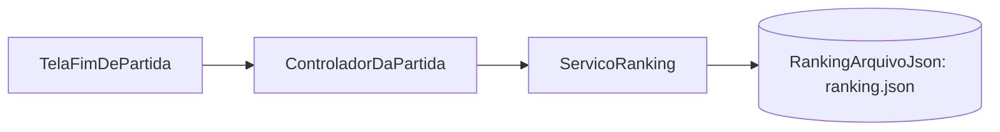
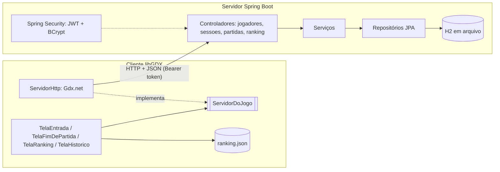
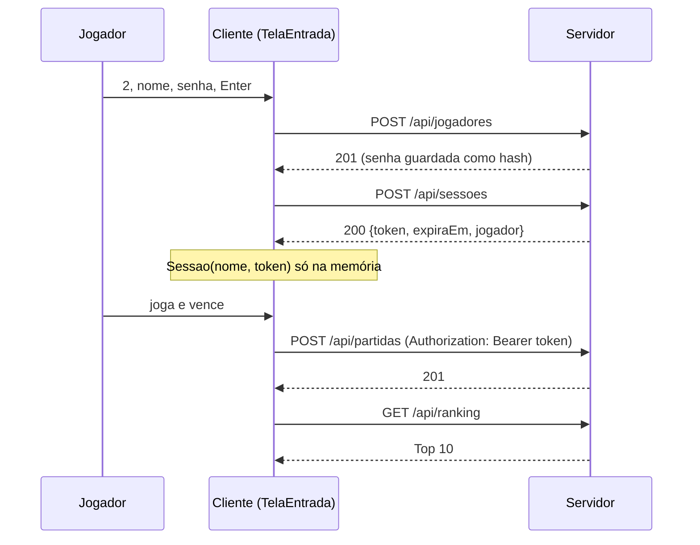

# Fase 5 — Servidor e ranking global

## 1. Introdução

Até a Fase 4 cada computador tinha o seu próprio ranking: o Top 5 em `ranking.json`. Nesta fase o projeto ganha um
**servidor** independente, feito com **Spring Boot**. Ele cadastra jogadores, faz o login com token, guarda o
histórico de partidas e calcula um **ranking global Top 10**. O cliente libGDX passa a conversar com esse servidor
pela rede **sem travar a tela**, e quem não quiser (ou não puder) se conectar continua jogando como **convidado**,
exatamente como antes.

As regras do jogo não mudaram: o `nucleo` e o `console` são os mesmos da Fase 4, e com a mesma semente as 200
partidas de teste saem idênticas. O servidor **não executa o jogo**: ele guarda a pontuação que o cliente envia.

Ponto de partida: a tag `fase-4`. Resultado: a tag `fase-5`.

## 2. Objetivos de aprendizagem

- Montar uma API REST com Spring Boot: controladores, serviços, repositórios e DTOs.
- Persistir dados com JPA (Spring Data) num banco H2 em arquivo.
- Guardar senhas com hash (BCrypt) e proteger rotas com token JWT.
- Validar a entrada (`@Valid`, Bean Validation) e devolver erros num formato padrão (RFC 9457).
- Documentar a API (OpenAPI e Swagger UI) e expor uma verificação de saúde.
- Integrar um cliente de jogo a uma API sem bloquear a thread da interface.
- Testar o servidor de ponta a ponta (MockMvc) e o cliente sem o servidor real.

## 3. Conceitos teóricos

O referencial teórico das Fases 2 a 4 não cobre servidor, persistência nem autenticação (é o que diz o
PROMPT_MESTRE). Por isso, esta fase cita a documentação oficial.

| Conceito | Resumo aplicado ao projeto | Fonte |
|---|---|---|
| Spring Boot | Monta a aplicação a partir das dependências ("starters"), com servidor web embutido (Tomcat) e configuração por `application.properties` e variáveis de ambiente | [Spring Boot](https://docs.spring.io/spring-boot/index.html) |
| API REST | Recursos com URLs (`/api/jogadores`, `/api/partidas`), métodos HTTP (POST cria, GET consulta) e códigos de resposta (201, 400, 401, 409) | — |
| Camadas | Controlador (HTTP) → serviço (caso de uso, transação) → repositório (banco). A entidade JPA não sai do servidor; a API fala com DTOs | — |
| JPA e Spring Data | Classes `@Entity` viram tabelas; o repositório é uma interface e o Spring gera as consultas pelo nome do método (`findByNomeIgnoreCase`) | [Spring Data JPA](https://docs.spring.io/spring-data/jpa/reference/index.html) |
| H2 | Banco SQL em Java, gravado num arquivo (`./dados/missaomarte.mv.db`): não é preciso instalar nada | [H2](https://www.h2database.com/html/main.html) |
| Hash de senha | BCrypt é lento de propósito e usa sal aleatório: o mesmo texto vira hashes diferentes, e um vazamento do banco não revela as senhas | [Password Storage](https://docs.spring.io/spring-security/reference/features/authentication/password-storage.html) |
| JWT | Token assinado (HS256) com o id do jogador e a validade. O servidor não guarda sessão: confere a assinatura e o prazo a cada pedido | [OAuth 2.0 Resource Server JWT](https://docs.spring.io/spring-security/reference/servlet/oauth2/resource-server/jwt.html) |
| Erros padronizados | `application/problem+json` com `type`, `title`, `status` e `detail` (o Spring tem a classe `ProblemDetail`) | [RFC 9457](https://www.rfc-editor.org/rfc/rfc9457) · [Error Responses](https://docs.spring.io/spring-framework/reference/web/webmvc/mvc-ann-rest-exceptions.html) |
| Documentação da API | O springdoc lê os controladores e gera o OpenAPI (`/v3/api-docs`) e a página interativa (`/swagger-ui.html`) | [springdoc](https://springdoc.org/) |
| Saúde | `/actuator/health` responde `UP` quando o servidor e o banco estão de pé (usado na publicação, Sprint 4) | [Actuator Endpoints](https://docs.spring.io/spring-boot/reference/actuator/endpoints.html) |
| Rede no libGDX | `Gdx.net.sendHttpRequest` faz o pedido em outra thread e chama um listener com a resposta; funciona no desktop e no Android | [libGDX wiki — Networking](https://libgdx.com/wiki/networking) |

**Versões** (conferidas no Maven Central em 2026-11-18): Spring Boot 4.1.2, a versão estável mais nova (a 4.2 está
em RC); springdoc-openapi 3.2.0, feito sobre o Boot 4.1.2; Java 17 e Gradle 8.14.3, os mesmos do cliente.

## 4. Problemas encontrados no código anterior

1. **Ranking isolado.** Cada máquina tem o seu `ranking.json`; dois alunos não conseguem comparar pontuações.
2. **Sem identidade.** O "nome do piloto" é só um texto digitado: qualquer um pode usar o nome de outro.
3. **Sem histórico.** Só as 5 melhores vitórias ficam guardadas; derrotas e partidas abaixo do Top 5 somem.
4. **Cliente síncrono.** Se a gravação do ranking passasse a depender da rede do jeito que o console lê o arquivo
   (bloqueando), a tela congelaria enquanto o servidor responde, ou para sempre se ele estivesse fora do ar.

## 5. Arquitetura antes da transformação



O detalhe do cliente está no [tutorial da Fase 4](fase-04-tutorial.md#9-arquitetura-resultante).

## 6. Passo a passo da implementação

**Servidor (`servidor/`):**

1. **Build próprio.** `settings.gradle` com `rootProject.name = 'missao-marte-servidor'`, wrapper copiado do projeto
   (8.14.3), plugins `org.springframework.boot` 4.1.2 e `io.spring.dependency-management`, e os starters `webmvc`,
   `validation`, `data-jpa`, `security`, `oauth2-resource-server`, `actuator`, mais o `springdoc` e o `h2`.
   O plugin do Spring Boot 4 exige que o próprio Gradle rode em Java 17 ou mais novo, então o servidor também tem
   `gradle/gradle-daemon-jvm.properties` com `toolchainVersion=17`: o wrapper procura um JDK 17 instalado e roda o
   daemon nele. Sem esse arquivo, a instalação limpa falhou numa máquina com Java 11 como padrão. O cliente não
   precisa disso, porque compila com o toolchain e o Gradle pode rodar em Java 11.
2. **Configuração** (`application.properties`): H2 em `${MISSAOMARTE_DADOS:./dados/missaomarte}`, porta
   `${PORT:8080}`, segredo `${MISSAOMARTE_JWT_SEGREDO:}`, validade `PT2H`, problem details ligados e só o `health`
   exposto no actuator.
3. **Segurança** (`seguranca/`):
   - `SecurityFilterChain` sem sessão, deixando públicos o cadastro, o login, o ranking, a saúde e a documentação;
   - os beans `JwtEncoder` e `JwtDecoder` com a chave HS256 e o validador de prazo usando o mesmo `Clock`;
   - o `BCryptPasswordEncoder`;
   - o 401 no formato RFC 9457.
4. **Jogadores** (`jogador/`): a entidade `Jogador`, o repositório e os DTOs `CadastroDeJogador` e `Credenciais`,
   com validação. `ServicoDeJogadores` cadastra (409 se o nome existe) e entra (401 com a mesma mensagem para nome
   e senha). Os controladores atendem `POST /api/jogadores`, `POST /api/sessoes` e `GET /api/jogadores/eu`.
5. **Partidas** (`partida/`):
   - a entidade `Partida`, ligada ao `Jogador`;
   - o `RegistroDePartida`, com limites para cada número;
   - `ServicoDePartidas`, que registra a partida para o dono do token e devolve o histórico com as 50 mais recentes;
   - as rotas `POST /api/partidas` e `GET /api/partidas/minhas`.
6. **Ranking** (`ranking/`):
   - uma consulta JPQL busca as vitórias ordenadas por pontos e depois por data, com `join fetch` no jogador;
   - o serviço pega a primeira vitória de cada jogador, até 10;
   - a rota é `GET /api/ranking`.
7. **Erros** (`erro/`): o `TratadorDeErros` (`@RestControllerAdvice`) devolve `ProblemDetail` com `campos` na
   validação e transforma erros inesperados em 500, sem expor detalhes internos.
8. **Testes** (21): MockMvc com H2 em memória e relógio controlado (seção 10).

**Cliente:**

9. **Porta e adaptador** (`core/.../online/`):
   - `ServidorDoJogo` é a interface que as telas conhecem, com o objeto nulo `DESLIGADO`;
   - `ServidorHttp` monta os pedidos (`Net.HttpRequest`, JSON da libGDX), envia pelo `Gdx.net` e traduz a resposta.
     Os códigos 2xx viram objetos, e 400, 401, 409 e 5xx, uma resposta inválida ou a falta de conexão viram uma
     `Falha` com mensagem;
   - `Sessao` guarda o nome e o token só na memória.
10. **Tela de entrada.** `ControladorDaEntrada`, com testes, mais a `TelaEntrada`. Depois do carregamento, o jogo vai
    para a entrada, e dali para o menu.
11. **Resultado da partida.**
    - `FimDePartida` ganhou o resumo `PartidaParaEnviar`, montado pelo `ControladorDaPartida` só lendo a `Partida`;
    - a `TelaFimDePartida` inicia um `EnvioDoResultado` e mostra o andamento: enviando, registrado, falhou ou modo
      convidado.
12. **Ranking e histórico.**
    - `ControladorDoRanking` cuida das abas local e global; a aba global consulta o servidor na primeira vez que é
      aberta;
    - a `TelaHistorico` usa uma `ConsultaRemota`;
    - o menu ganhou as opções 5 (histórico) e 6 (trocar de piloto).
13. **Launcher.** `ServicosDoJogo` recebe `ServidorHttp.daLibgdx(System.getProperty("missaomarte.servidor",
    "http://localhost:8080"))`, e o `:lwjgl3:run` repassa essa propriedade.

## 7. Código antes e depois

**Gravar o resultado.** Antes, só o arquivo local:

```java
// ControladorDaPartida (Fase 4): na vitória, Top 5 em ranking.json
ServicoRanking.Registro registro = servicoRanking.registrarVitoria(rankingAntes, resultado);
```

Depois, o arquivo local continua igual, e a tela de fim também manda o resumo ao servidor, sem esperar:

```java
// TelaFimDePartida.show() (Fase 5)
envio = EnvioDoResultado.iniciar(jogo.getSessao(), jogo.getServicos().servidor(), fim.paraOServidor());

// EnvioDoResultado: convidado não envia; conectado envia e só acompanha o estado
if (sessao.isEmpty()) {
    return new EnvioDoResultado(Estado.CONVIDADO);
}
EnvioDoResultado envio = new EnvioDoResultado(Estado.ENVIANDO);
servidor.registrarPartida(sessao.get(), partida, envio);   // volta na hora; a resposta chega depois
```

**O pedido HTTP**, no adaptador: o `Gdx.net` responde em outra thread, e a resposta volta para a thread do jogo:

```java
net.sendHttpRequest(pedido, new Net.HttpResponseListener() {
    @Override
    public void handleHttpResponse(Net.HttpResponse r) {
        int codigo = r.getStatus().getStatusCode();
        String texto = r.getResultAsString();
        naThreadDoJogo.execute(() -> tratar(codigo, texto, ler, resposta));   // Gdx.app.postRunnable no jogo
    }
    @Override
    public void failed(Throwable erro) {
        naThreadDoJogo.execute(() -> resposta.falha(Falha.semConexao()));
    }
    ...
```

**No servidor**, o dono da partida vem sempre do token, nunca do corpo:

```java
@PostMapping
public ResponseEntity<PartidaResposta> registrar(@AuthenticationPrincipal Jwt token,
                                                 @Valid @RequestBody RegistroDePartida dados) {
    PartidaResposta salva = servico.registrar(ServicoDeTokens.idDoJogador(token), dados);
    return ResponseEntity.created(URI.create("/api/partidas/" + salva.id())).body(salva);
}
```

**Um erro de validação**, como o cliente recebe:

```json
{"type":"about:blank","title":"Bad Request","status":400,"detail":"dados inválidos",
 "campos":{"nome":"o nome deve ter de 3 a 20 caracteres","senha":"a senha deve ter de 6 a 72 caracteres"}}
```

## 8. Explicação das alterações

- **Por que um build Gradle separado para o servidor.** Assim o enunciado ("o servidor não deve depender do código do
  cliente") vira estrutura: não há `project(':nucleo')` disponível para importar. O preço é repetir o enum de
  dificuldade, e isso é intencional: o contrato é a API (`docs/api/openapi.json`), não as classes.
- **Por que JWT e não sessão no servidor.** O token carrega o id e a validade, assinados. O servidor não precisa
  guardar quem está logado, e a mesma regra vale para o desktop, o Android e uma futura versão em outra linguagem.
- **Por que a mesma resposta para "nome inexistente" e "senha errada".** Se a mensagem fosse diferente, qualquer um
  descobriria quais nomes estão cadastrados.
- **Por que o relógio é injetado (`Clock`).** Os testes avançam o tempo para provar que um token expirado é recusado
  e que o empate no ranking favorece quem pontuou primeiro, sem esperar duas horas de verdade.
- **Por que só vitórias no ranking.** É a mesma regra do Top 5 local. O histórico guarda tudo, então nada se perde.
- **Por que o convidado e não login obrigatório.** O enunciado manda preservar o modo convidado e o ranking local.
  O login fica obrigatório só para o que precisa de identidade: ranking global e histórico (escolha registrada em
  DA-17).
- **Por que o cliente não trava.** O `Gdx.net` é assíncrono. A tela desenha a cada quadro a partir de um estado
  (`ConsultaRemota`, `EnvioDoResultado`, etapa da entrada) que a resposta atualiza quando chega. Com o servidor fora
  do ar, o estado vira "falhou" e uma mensagem.
- **Por que ninguém registra a senha.** O corpo dos pedidos não vai para log em nenhum dos lados. Os `toString` de
  `CadastroDeJogador`, `Credenciais`, `TokenResposta` e `Sessao` mostram `***`. A validação procurou a senha e o
  token nos logs e não encontrou nenhuma ocorrência.
- **Limitação, registrada como o enunciado pede:** o servidor não executa a lógica do jogo e não confere se uma
  pontuação é legítima. Um cliente modificado poderia enviar qualquer valor dentro dos limites da validação (até
  10.000 pontos).

## 9. Arquitetura resultante





```text
servidor/                              build Gradle próprio (não inclui nenhum módulo do jogo)
├── build.gradle, settings.gradle, gradlew
└── src/main/java/.../servidor/
    ├── ServidorApplication            Clock injetável
    ├── seguranca/                     filtros, JWT (emitir e validar), BCrypt, 401 padronizado
    ├── jogador/                       entidade, repositório, DTOs, serviço, controladores (cadastro e login)
    ├── partida/                       entidade, repositório (consulta do ranking), DTOs, serviço, controlador
    ├── ranking/                       serviço Top 10 e controlador
    └── erro/                          exceções e TratadorDeErros (RFC 9457)
core/.../grafico/online/               ServidorDoJogo, ServidorHttp, Falha, Resposta, Sessao, DTOs do cliente
core/.../grafico/apresentacao/         + ControladorDaEntrada, ControladorDoRanking, ConsultaRemota, EnvioDoResultado
core/.../grafico/telas/                + TelaEntrada, TelaHistorico; TelaRanking com abas
docs/api/openapi.json                  contrato da API, exportado do servidor rodando
```

**Endpoints:**

| Método | Rota | Autenticação | Respostas |
|---|---|---|---|
| `POST` | `/api/jogadores` | pública | 201 · 400 (campos) · 409 (nome em uso) |
| `POST` | `/api/sessoes` | pública | 200 `{token, tipo, expiraEm, jogador}` · 400 · 401 |
| `GET` | `/api/jogadores/eu` | token | 200 · 401 |
| `POST` | `/api/partidas` | token | 201 · 400 · 401 |
| `GET` | `/api/partidas/minhas` | token | 200 (50 mais recentes) · 401 |
| `GET` | `/api/ranking` | pública | 200 (Top 10) |
| `GET` | `/actuator/health` | pública | 200 `{"status":"UP"}` |
| `GET` | `/swagger-ui.html` e `/v3/api-docs` | pública | documentação |

**Configuração do servidor:**

| Variável | Para quê | Padrão |
|---|---|---|
| `MISSAOMARTE_JWT_SEGREDO` | segredo do token (pelo menos 32 bytes); nunca versionar | temporário, gerado a cada início (com aviso no log) |
| `MISSAOMARTE_DADOS` | caminho do banco H2 (sem a extensão `.mv.db`) | `./dados/missaomarte` |
| `PORT` | porta HTTP | 8080 |

## 10. Como executar e testar

```bash
# terminal 1: servidor (http://localhost:8080; Swagger em http://localhost:8080/swagger-ui.html)
cd servidor
export MISSAOMARTE_JWT_SEGREDO="$(openssl rand -base64 48)"   # opcional em desenvolvimento
./gradlew bootRun

# terminal 2: jogo (na tela de entrada: 1 entrar, 2 criar conta, 3 convidado)
./gradlew :lwjgl3:run
./gradlew :lwjgl3:run -Dmissaomarte.servidor=http://outra-maquina:8080
```

```powershell
cd servidor; .\gradlew.bat bootRun
.\gradlew.bat :lwjgl3:run
```

Testes: `./gradlew build` (cliente, 186 testes) e `cd servidor && ./gradlew build` (servidor, 21 testes).

**Em contêiner** (acrescentado depois da tag `fase-5`; DA-18):

```bash
cd servidor
cp .env.exemplo .env                  # preencha MISSAOMARTE_JWT_SEGREDO; o .env é ignorado pelo Git
docker compose up --build             # imagem missao-marte-servidor:dev, porta 8080, volume "dados"
docker compose up --build --watch     # modo dev: reconstrói quando src/ ou o build.gradle mudam
```

O `Dockerfile` tem dois estágios:
- o primeiro compila com o wrapper num `eclipse-temurin:17-jdk`, com as dependências numa camada própria que fica
  em cache;
- o segundo roda só o jar num `eclipse-temurin:17-jre`, com um usuário sem privilégios, o banco no volume `/dados` e
  um `HEALTHCHECK` que consulta o `/actuator/health` (pelo próprio bash, sem instalar `curl`).

O segredo nunca entra na imagem: vem do ambiente, pelo `.env`. A evidência está em
`docs/evidencias/fase-05/conteiner.txt`:
- a imagem é construída e o contêiner fica `healthy`;
- o processo roda como `uid=999(missao)`;
- o jogo de verdade se conecta, cadastra e registra uma vitória;
- a vitória continua lá depois de `docker compose down` e `up`;
- o segredo não aparece nas camadas da imagem nem nos logs.

**Validação da fase** (as saídas estão em `docs/evidencias/fase-05/`):

| Verificação | Resultado |
|---|---|
| Testes do servidor (MockMvc + H2 em memória + relógio controlado) | **21, 0 falhas**: cadastro válido e inválido, 409, hash BCrypt, login certo e errado, token ausente, inválido, adulterado e expirado, log sem senha nem token, registro com e sem token, isolamento e ordem do histórico, limite de 50, só vitórias no ranking, melhor por jogador, empate, limite de 10 |
| Testes do cliente | **186, 0 falhas**, sem servidor. 38 novos: adaptador contra um servidor HTTP falso em localhost (2xx, 400, 401, 409, 500, resposta inválida, fora do ar, token e corpo enviados), entrada, envio, ranking, menu e resumo |
| Defeitos inseridos de propósito numa cópia descartável | **17/17 pegos**: 11 no servidor (login sem conferir a senha, senha em texto puro, nome repetido aceito, histórico de todos, ranking repetindo jogador, contando derrotas, empate invertido, sem limite, partidas sem token, token sem prazo, pontos negativos) e 6 no cliente |
| Console: roteiros × gabarito, por `installDist`, `java -jar` e `./gradlew :console:run` | 11/11 nas três formas |
| API real (servidor rodando) com o roteiro em `api-roteiro-curl.txt` | 12 pedidos com os códigos esperados (200, 201, 400, 401, 409), token mascarado |
| Persistência | depois de reiniciar o servidor (mesmo `MISSAOMARTE_DADOS`), ranking e histórico continuam lá, e o token antigo vale (mesmo segredo) |
| Janela real, servidor ligado (roteiro `online`) | cadastro pela tela, menu "conectado", vitória com "Resultado registrado no servidor.", ranking global e histórico com a partida |
| Janela real, servidor desligado (roteiro `offline`) | "Servidor indisponível. Você pode jogar como convidado.", o convidado joga, e o ranking global e o histórico avisam sem travar |
| Segredos nos logs | 0 ocorrências da senha, do token e do segredo JWT nos logs do servidor e do cliente |
| Instalação limpa (clone novo, cache vazio, Java 11 padrão) | cliente: 186 testes. Servidor: a 1ª tentativa falhou (o plugin do Spring Boot 4 exige o Gradle em Java 17), e com o `gradle-daemon-jvm.properties` passou com 21 testes |
| Console: mesma semente × Fase 4 | **200/200 partidas idênticas** |
| Documentação | `docs/api/openapi.json` (OpenAPI 3.1, exportado do servidor rodando) e Swagger UI |

**Não verificado:** os dois builds no Windows e no Linux, e o servidor publicado na nuvem (Sprint 4).

## 11. Exercícios para os alunos

1. Use o Swagger (`/swagger-ui.html`): crie uma conta, entre, clique em "Authorize", cole o token e registre uma
   partida. Depois tente registrar sem o token: qual é a resposta, e de onde vem o formato dela?
2. Mude `missaomarte.jwt.validade` para `PT1M`, entre pelo jogo, espere um minuto e termine uma partida. O que a tela
   de fim mostra? Onde está o teste que garante isso no servidor?
3. Escreva um teste em `ApiDeRankingTeste` para um jogador com duas vitórias de mesma pontuação: qual data aparece no
   ranking? Por quê?
4. Proponha uma forma de o servidor desconfiar de pontuações impossíveis (por exemplo, mais pontos do que a
   dificuldade permite). Que informação o cliente precisaria enviar? Isso resolve a limitação?
5. Troque o H2 por PostgreSQL só com configuração (`spring.datasource.*` e a dependência do driver). Que classe do
   código precisa mudar?
6. Ponha o cliente para tentar de novo, uma vez, quando o envio do resultado falhar por falta de conexão. Em que
   classe fica isso, e como testar sem rede?

## 12. Conclusão

O Missão Marte agora tem um servidor de verdade: contas com senha protegida, token, histórico, ranking global,
validação, erros padronizados, documentação e verificação de saúde. O cliente ganhou uma porta (`ServidorDoJogo`) e
um adaptador HTTP assíncrono, de modo que nenhuma tela trava esperando a rede e o modo convidado continua intacto. O
domínio do jogo não percebeu nada, e é por isso que o console segue idêntico. O mesmo contrato (`openapi.json`) é o
ponto de partida para a publicação do servidor (Sprint 4).
