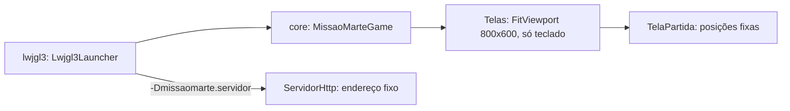
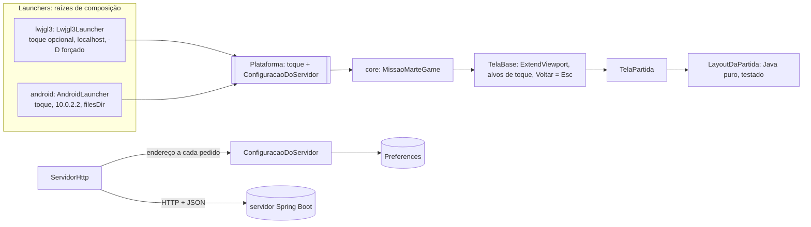
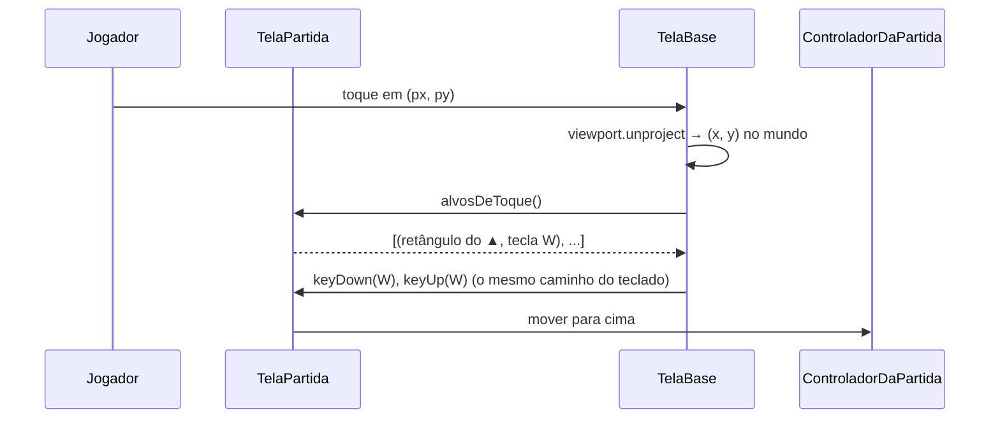

# Fase 6 — Android e controles de toque

## 1. Introdução

Até a Fase 5, o Missão Marte rodava numa janela de desktop de 800x600 e era jogado só pelo teclado. Nesta fase, o
mesmo jogo vira um **aplicativo Android**: o `core` (telas, regras, sons, servidor) é reaproveitado inteiro, e um
novo módulo, `android`, só monta as peças e abre a janela no celular.

Para isso dar certo num aparelho de verdade, três coisas mudaram no `core`:

- **Layout responsivo.** As telas usam a tela toda, em pé ou deitada. Não há mais faixas pretas, e a partida
  reorganiza mapa, painel e botões conforme a proporção da tela.
- **Toque.** Cada tela tem alvos de toque. Na partida, há um direcional e os botões Embarcar, Som e Abortar. O
  botão Voltar do Android funciona como o Esc.
- **Endereço do servidor configurável no jogo.** No celular não existe `-Dmissaomarte.servidor`, e `localhost` é o
  próprio aparelho. A tela de entrada ganhou a opção **4. Servidor**.

As regras não mudaram: `nucleo` e `console` são os mesmos da Fase 5, e com a mesma semente as 200 partidas de teste
saem idênticas. No desktop, sem o modo toque, a janela de 800x600 desenha igual à Fase 5.

Ponto de partida: a tag `fase-5`. Resultado: a tag `fase-6`.

## 2. Objetivos de aprendizagem

- Acrescentar uma plataforma (Android) a um projeto libGDX multi-módulo sem duplicar código.
- Configurar o plugin Android do Gradle: SDK mínimo e alvo, bibliotecas nativas, manifesto e assets compartilhados.
- Trocar um viewport de tamanho fixo por um que se adapta à tela, e separar o cálculo do layout (testável) do
  desenho.
- Tratar o toque reaproveitando o caminho do teclado, e o botão Voltar do sistema.
- Configurar a aplicação em tempo de execução (preferências) em vez de só na linha de comando.
- Validar um app Android sem as mãos: `adb`, prints, roteiros de toque e checagem de API mínima no APK.

## 3. Conceitos teóricos

O referencial das Fases 2 a 4 não cobre Android. Por isso, esta fase cita a documentação oficial.

| Conceito | Resumo aplicado ao projeto | Fonte |
|---|---|---|
| Backend Android da libGDX | `AndroidApplication` (uma `Activity`) chama `initialize(game, config)`. O mesmo `Game` do desktop roda dentro dela, com `Gdx.input`, `Gdx.net`, `Gdx.files` e `Gdx.app` do Android | [libGDX wiki — Starting a project](https://libgdx.com/wiki/start/project-generation) |
| Ciclo de vida | `pause()` quando o app vai para segundo plano, `resume()` na volta. O contexto OpenGL pode ser recriado, e a libGDX recarrega as texturas gerenciadas | [libGDX wiki — Life cycle](https://libgdx.com/wiki/app/the-life-cycle) |
| Viewports | `FitViewport` mantém a proporção e deixa faixas pretas. `ExtendViewport` mantém um mínimo (800x600) e estende o mundo no lado que sobra | [libGDX wiki — Viewports](https://libgdx.com/wiki/graphics/viewports) |
| Entrada | `InputProcessor` recebe `keyDown`, `keyTyped` e `touchDown`. O toque vem em pixels da tela, e `viewport.unproject` converte para o mundo | [libGDX wiki — Event handling](https://libgdx.com/wiki/input/event-handling) |
| Texto no celular | `Gdx.input.getTextInput` abre a caixa de texto do sistema, com o teclado virtual (e modo senha) | [libGDX wiki — Simple text input](https://libgdx.com/wiki/input/simple-text-input) |
| Mudanças de configuração | Girar a tela recria a `Activity`, a menos que o manifesto declare `configChanges`. O jogo trata a rotação no `resize` | [Android — Handle configuration changes](https://developer.android.com/guide/topics/resources/runtime-changes) |
| Tela cheia | O modo imersivo esconde as barras do sistema durante o jogo | [Android — Immersive mode](https://developer.android.com/develop/ui/views/layout/immersive) |
| Tamanho de alvo de toque | O Android recomenda alvos de pelo menos 48 dp | [Android — Accessibility](https://developer.android.com/guide/topics/ui/accessibility) |
| Rede do emulador | Dentro do emulador, `10.0.2.2` é o computador onde ele roda; `localhost` é o próprio emulador | [Android — Emulator networking](https://developer.android.com/studio/run/emulator-networking) |
| HTTP sem TLS | Desde o Android 9, `http://` é bloqueado por padrão; `usesCleartextTraffic="true"` libera | [Android — Network security configuration](https://developer.android.com/privacy-and-security/security-config) |
| Java no Android | O D8 converte o bytecode Java em dex e reescreve parte das APIs novas do Java; outras só existem a partir de certa versão do Android | [Android — Java 8+ support](https://developer.android.com/studio/write/java8-support) |
| adb | Instala o APK, abre o app, toca na tela (`input tap`), digita (`input text`), tira prints (`screencap`) e lê o log (`logcat`) | [Android — adb](https://developer.android.com/tools/adb) |

**Versões** (2026-11-18): Android Gradle Plugin 8.13.2, a mais nova compatível com o Gradle 8.14.3 do projeto;
`compileSdk` e `targetSdk` 36; `minSdk` 26 (Android 8.0); libGDX 1.14.2, a mesma das fases anteriores.

## 4. Problemas encontrados no código anterior

1. **Faixas pretas.** O `FitViewport` mantinha o mundo de 800x600 e preenchia o resto com preto. Num celular
   19,5:9 em pé, mais da metade da tela ficava preta
   (`docs/evidencias/fase-06/android-celular-antes-do-layout.jpg`, um APK de teste montado antes do layout
   responsivo).
2. **Partida com coordenadas fixas.** A `TelaPartida` tinha `LADO_DO_MAPA = 560`, `X_DO_PAINEL = 596` e outras
   posições calculadas para 800x600. Não havia como reorganizar a tela em retrato.
3. **Só teclado.** Todas as telas dependiam de teclas (`1` a `6`, setas, `WASD`, `Enter`). No celular, não havia
   como jogar.
4. **Endereço do servidor só na linha de comando.** No Android não existe `-D`, e o padrão `http://localhost:8080`
   aponta para o próprio celular.
5. **Ranking na pasta de trabalho.** O `ranking.json` ficava "onde o jogo foi chamado", ideia que não existe no
   Android. Lá, cada app tem a sua pasta privada.
6. **Botão Voltar.** Por padrão, o Voltar do Android fecha a `Activity`, e o jogo seria encerrado no meio de uma
   partida.

## 5. Arquitetura antes da transformação



## 6. Passo a passo da implementação

**Build:**

1. **Módulo opcional.** O `settings.gradle` só inclui `android` quando encontra um Android SDK (`ANDROID_HOME`,
   `ANDROID_SDK_ROOT` ou `sdk.dir` no `local.properties`). Sem SDK, aparece um aviso, e desktop, console e testes
   continuam normais. O `pluginManagement` ganhou o repositório `google()`, de onde vem o plugin Android.
2. **`android/build.gradle`.**
   - `com.android.application` 8.13.2, `minSdk 26`, `compileSdk`/`targetSdk 36`, Java 17;
   - `assets.srcDirs = [rootProject.file('assets')]`: os mesmos sprites, sons e fontes do desktop, sem cópia;
   - dependências: `project(':core')` e `gdx-backend-android`.
3. **Bibliotecas nativas.** A libGDX e o FreeType têm partes em C (`libgdx.so`, `libgdx-freetype.so`), uma para
   cada processador (armeabi-v7a, arm64-v8a, x86 e x86_64). A tarefa `copiarNativas` extrai os `.so` dos jars
   `natives-<abi>` para `android/libs/<abi>/`, que o `jniLibs` empacota no APK. A pasta é gerada e está no
   `.gitignore`.
4. **Manifesto** (`android/src/main/AndroidManifest.xml`):
   - permissão `INTERNET`;
   - OpenGL ES 2;
   - `usesCleartextTraffic="true"` (seção 8);
   - tema sem barra de título;
   - `configChanges` cobrindo rotação, tamanho de tela, teclado e densidade: a `Activity` não é recriada, e o jogo
     recebe só um `resize`;
   - `launchMode="singleTask"`;
   - ícone gerado a partir de `assets/sprites/icone.png`.
5. **`gradle.properties`** com `android.useAndroidX=true`: o backend Android da libGDX usa o `androidx.core`.
6. **Gradle em Java 17.** O plugin Android exige que o próprio Gradle rode em Java 17 ou mais novo. Como no
   servidor (DA-14), `gradle/gradle-daemon-jvm.properties` (`toolchainVersion=17`) faz o wrapper procurar um JDK 17
   instalado.
7. **`AndroidLauncher`.** É a raiz de composição do Android, com as mesmas peças do `Lwjgl3Launcher` e três
   diferenças:
   - o ranking fica em `getFilesDir()/ranking.json`;
   - o modo toque vem ligado;
   - o servidor padrão é o `http://10.0.2.2:8080` do emulador.

   O extra de intent `semente` (`am start ... --el semente 3`) faz o papel do `-Dmissaomarte.semente` do desktop,
   para a validação.

**Core (cliente):**

8. **`Plataforma`** (`record Plataforma(boolean toque, ConfiguracaoDoServidor servidor)`). O launcher diz o que
   muda na plataforma, e o `MissaoMarteGame` repassa às telas.
9. **`TelaBase` com `ExtendViewport`.** No `resize`, a câmera fica centrada em (400, 300). Assim, a área de projeto
   de 800x600 aparece sempre inteira e no meio, e o mundo cresce para os lados (celular deitado) ou para cima e
   para baixo (celular em pé). `visivel()` devolve a área visível de verdade, e o fundo é desenhado nela toda.
10. **`LayoutDaPartida`, em Java puro e com testes.** Recebe a área visível e o modo toque e devolve os
    retângulos do mapa, do painel e de cada `Botao`:
    - em paisagem: mapa à esquerda (centralizado na vertical), painel ao lado e controles colados na borda
      direita;
    - em retrato: mapa no alto, painel no meio e controles embaixo, perto do polegar.

    Cada botão tem pelo menos 72 unidades do mundo, cerca de 48 dp num celular deitado. O Abortar fica afastado do
    Embarcar. Numa janela de 800x600 sem toque, o resultado é o mesmo das Fases 4 e 5: o mapa em (20, 20, 560, 560)
    e o painel em (596, 20, 192, 560).
11. **`TelaPartida`.** Calcula o layout a cada `resize` (girar a tela no meio da partida funciona). O painel tem um
    modo coluna (paisagem) e um modo largo (retrato). No modo toque, ela desenha o direcional e as ações.
12. **Alvos de toque em todas as telas.** `alvosDeToque()` devolve pares `(Retangulo, ação)`, e a `TelaBase`
    converte o toque com `viewport.unproject` e executa o primeiro alvo que o contém. Quase todo alvo é
    `tecla(area, tecla, caractere)`, que "aperta" a tecla equivalente: o toque passa pelo mesmo caminho testado do
    teclado.
    - Entrada, menu e nova partida: tocar na opção ou nos botões (`<` `>` dificuldade, `-` `+` mapa, Decolar,
      Voltar).
    - Fim de partida e histórico: tocar em qualquer lugar volta ao menu.
    - Ranking: abas Local e Global e o botão Voltar.
13. **Botão Voltar.** A `TelaBase` pede ao sistema o `Keys.BACK` (`setCatchKey`) e o trata como `Esc`. Na
    partida, o Voltar é ignorado: abortar só pelo botão Abortar ou pelo Esc, para um toque sem querer não jogar a
    partida fora.
14. **Caixa de texto do sistema.** No celular, tocar no nome, na senha ou no endereço abre
    `Gdx.input.getTextInput` (com o teclado de senha quando é senha). No OK, o teclado virtual é escondido: no
    emulador, ele ficava aberto cobrindo metade do jogo. A caixa do endereço abre vazia, com o endereço atual como
    dica, porque apagar texto num teclado virtual é trabalhoso. Confirmar vazio mantém o endereço.
15. **Endereço do servidor.**
    - `ConfiguracaoDoServidor` decide o endereço, nesta ordem: o `-Dmissaomarte.servidor` (só no desktop, sem poder
      trocar na tela), o gravado pelo jogador (opção 4, nas `Preferences` da libGDX) e o padrão da plataforma;
    - endereços inválidos não são gravados e a mensagem diz o motivo ("Use http:// ou https:// no começo do
      endereço.", porta fora de 1 a 65535, usuário ou `?` no endereço);
    - o `ServidorHttp` passou a ler o endereço a cada pedido (`Supplier<String>`), então a troca vale na hora.
16. **Desktop.** O `Lwjgl3Launcher` monta a mesma `ConfiguracaoDoServidor`. Com `-Dmissaomarte.toque=true`, a
    janela mostra os controles de toque, para testar com o mouse.

**Servidor:**

17. **Pronto para publicar.** `MISSAOMARTE_URL_PUBLICA` define o endereço que o Swagger usa: antes, ele estava fixo
    em `http://localhost:8080`, o que quebraria o "Try it out" de um servidor publicado. O guia de publicação
    (variáveis, porta, saúde, persistência, cópia de segurança e HTTPS por proxy) está em
    [`servidor/PUBLICACAO.md`](../servidor/PUBLICACAO.md).

**Validação:**

18. **Ferramentas novas** (seção 10):
    - `validacao/android/pilotar_android.py` joga no emulador ou no celular pelo `adb`;
    - `validacao/android/conferir_api_minima.py` confere a API mínima no APK;
    - o roteiro `toque` do `PilotoDaJanela` testa os botões de toque no desktop.

## 7. Código antes e depois

**Viewport.** Antes, o mundo fixo com faixas:

```java
// TelaBase (Fase 5)
private final Viewport viewport = new FitViewport(MissaoMarteGame.LARGURA, MissaoMarteGame.ALTURA, camera);
...
viewport.update(largura, altura, true);   // true: centraliza a câmera no mundo
```

Depois, o mundo estendido, sempre com a área de projeto no centro:

```java
// TelaBase (Fase 6)
private final Viewport viewport = new ExtendViewport(MissaoMarteGame.LARGURA, MissaoMarteGame.ALTURA, camera);
...
viewport.update(largura, altura, false);
camera.position.set(MissaoMarteGame.LARGURA / 2, MissaoMarteGame.ALTURA / 2, 0);
```

**Partida.** Antes, posições constantes:

```java
// TelaPartida (Fase 5)
private static final float LADO_DO_MAPA = MissaoMarteGame.ALTURA - 2 * MARGEM;
private static final float X_DO_PAINEL = MARGEM + LADO_DO_MAPA + 16;
```

Depois, calculadas para a tela atual por uma classe pura e testada:

```java
// TelaPartida (Fase 6), a cada resize
layout = LayoutDaPartida.calcular(visivel(), toque());
Retangulo m = layout.mapa();
geometria = new GeometriaDoMapa(missao().getMapa(), m.x(), m.y(), m.largura());
```

**Toque reaproveitando o teclado.** Um botão do direcional "aperta" a tecla `W`:

```java
// TelaPartida (Fase 6)
for (Map.Entry<Botao, Retangulo> b : layout.botoes().entrySet()) {
    alvos.add(tecla(b.getValue(), b.getKey().getTecla(), (char) 0));
}
```

**Endereço do servidor.** Antes, lido uma vez da linha de comando:

```java
// Lwjgl3Launcher (Fase 5)
ServidorHttp.daLibgdx(System.getProperty(PROPRIEDADE_SERVIDOR, SERVIDOR_PADRAO))
```

Depois, com prioridades e lido a cada pedido:

```java
// Lwjgl3Launcher (Fase 6); o AndroidLauncher é igual, com o padrão do emulador e sem valor forçado
ConfiguracaoDoServidor servidor = new ConfiguracaoDoServidor(new PreferenciasLibgdx("missao-marte"),
        SERVIDOR_PADRAO, System.getProperty(PROPRIEDADE_SERVIDOR));
... ServidorHttp.daLibgdx(servidor::endereco) ...
```

## 8. Explicação das alterações

- **Por que um módulo `android` e não uma cópia do jogo.** O `core` já não dependia do desktop: telas, regras,
  sons e rede passam pelas interfaces da libGDX. O launcher Android tem 55 linhas. Qualquer correção no
  `core` vale para as duas plataformas.
- **Por que o módulo só entra com SDK.** Quem só quer o desktop, ou o professor corrigindo o console, não precisa
  instalar o Android SDK. O build continua o mesmo para essas pessoas.
- **Por que `minSdk 26`.** O ranking local usa `java.nio.file` e as datas usam `java.time`, que só existem a partir
  do Android 8.0 (API 26). Abaixo disso, seria preciso adaptar o `nucleo`.
- **Por que conferir a API mínima no APK.** O lint do Android analisa só o módulo `android`: `core` e `nucleo` são
  bibliotecas Java puras, e para ele são "dependências externas" (é o que o próprio lint avisa). Um `List.of` ou
  um `String.isBlank` no `nucleo` poderia não existir num Android 8. O D8 reescreve muitos desses métodos, mas não
  todos. Por isso, `conferir_api_minima.py` lê o bytecode final do APK e procura cada chamada do jogo no
  `api-versions.xml` do SDK. Resultado: 223 referências, nenhuma acima da API 26. Uma chamada da API 33 inserida de
  propósito foi acusada.
- **Por que `ExtendViewport`.** Ele aproveita a tela inteira e mantém o desenho das outras telas: tudo o que foi
  feito para 800x600 continua aparecendo inteiro e centralizado. Só a partida precisava saber o tamanho real, e é
  ela que usa `visivel()`.
- **Por que o layout fica numa classe pura.** Dá para testar dezenas de tamanhos de tela sem abrir janela. Os
  testes conferem que nada fica cortado nem sobreposto, que todo botão tem o tamanho mínimo, que o Abortar fica
  longe do Embarcar e que 800x600 sem toque é idêntico às fases anteriores.
- **Por que o toque "aperta teclas".** As telas e os controladores já eram testados pelo teclado. Um alvo de toque
  que gera `keyDown`, `keyTyped` e `keyUp` não cria um segundo caminho para testar: o que muda é só onde tocar.
- **Por que o Voltar não aborta a partida.** No celular, o Voltar fica a um toque sem querer de distância. Abortar
  descarta a partida, por isso exige o botão Abortar, que fica afastado.
- **Por que `10.0.2.2` como padrão no Android.** É o computador visto de dentro do emulador, onde o servidor roda
  em desenvolvimento. Num celular de verdade, o jogador digita o IP do computador na rede local (opção 4), e o
  endereço fica guardado.
- **Por que HTTP liberado (`usesCleartextTraffic`).** Em aula, o servidor roda num computador da rede local, sem
  certificado. Publicado, ele deve ficar atrás de HTTPS (`servidor/PUBLICACAO.md`), e aí o jogo usa `https://`
  normalmente. Desligar o HTTP no APK de uma versão publicada fica como melhoria.
- **Por que nenhuma senha vai para o log.** As caixas de texto entregam a senha direto ao controlador. A validação
  procurou a senha de teste, `Bearer`, `Authorization` e o início de um JWT no log do processo do jogo, no emulador
  e no celular, e não encontrou nenhuma ocorrência.

## 9. Arquitetura resultante





```text
android/                               módulo novo (só entra com Android SDK)
├── build.gradle                       AGP 8.13.2, minSdk 26, assets compartilhados, tarefa copiarNativas
└── src/main/
    ├── AndroidManifest.xml            INTERNET, configChanges, singleTask, usesCleartextTraffic
    ├── java/.../android/AndroidLauncher.java
    └── res/                           nome do app e ícone
core/.../grafico/
├── Plataforma.java                    toque + configuração do servidor
├── apresentacao/                      + Retangulo, Botao, LayoutDaPartida; ControladorDaEntrada com a opção 4
├── online/                            + ConfiguracaoDoServidor, PreferenciasLibgdx; ServidorHttp com Supplier
└── telas/                             TelaBase (ExtendViewport, toque, Voltar); todas as telas com alvos de toque
servidor/PUBLICACAO.md                 guia de publicação; MISSAOMARTE_URL_PUBLICA no Swagger
validacao/android/                     pilotar_android.py (adb) e conferir_api_minima.py (APK)
```

## 10. Como executar e testar

**Requisitos do Android** (só para quem vai gerar o APK):
- Android SDK com a plataforma 36 e o Platform-Tools (`adb`); o Android Studio instala os dois;
- `ANDROID_HOME` apontando para o SDK, ou `sdk.dir=...` num `local.properties` na raiz (ignorado pelo Git);
- o mesmo JDK 17 das outras fases.

```bash
./gradlew :android:assembleDebug        # android/build/outputs/apk/debug/android-debug.apk (cerca de 10 MB)
./gradlew :android:installDebug         # instala no emulador ou no celular conectado (depuração USB ligada)
adb shell am start -n br.edu.unifor.missaomarte/.android.AndroidLauncher            # abre
adb shell am start -n br.edu.unifor.missaomarte/.android.AndroidLauncher --el semente 3   # mesmo mapa sempre
```

```powershell
.\gradlew.bat :android:assembleDebug
.\gradlew.bat :android:installDebug
```

**Servidor para o celular.**
- Emulador: suba o servidor no computador (`cd servidor && docker compose up --build`). O padrão do APK,
  `http://10.0.2.2:8080`, já funciona.
- Celular de verdade, na mesma rede Wi-Fi: na tela de entrada, toque em **4. Servidor** e digite
  `http://<IP do computador>:8080` (no macOS, `ipconfig getifaddr en0`; no Windows, `ipconfig`).

**Desktop com os controles de toque** (para testar com o mouse):

```bash
./gradlew :lwjgl3:run -Dmissaomarte.toque=true
```

**Validação da fase** (as saídas estão em `docs/evidencias/fase-06/`):

| Verificação | Resultado |
|---|---|
| Build e testes | cliente: **209 testes, 0 falhas** (nucleo 62, console 3, core 144); servidor: **23, 0 falhas**. O build completo gera o APK. 23 testes novos no cliente: layout em vários tamanhos de tela, `Retangulo`, configuração do servidor, entrada pelo toque e pela opção 4, e endereço lido a cada pedido |
| Defeitos inseridos de propósito (`testes-detectam-defeitos.txt`) | **24/24 pegos**, entre eles: retrato e paisagem trocados, botão sem tamanho mínimo, controles por cima do mapa, Abortar no lugar do Embarcar, borda do botão sem toque, endereço da linha de comando ignorado, inválido gravado, endereço lido só uma vez, tecla 4 sem efeito e Swagger com endereço fixo |
| Emulador (Android 16 / API 36, 720x1280), roteiro completo pelo `adb` | endereço digitado na caixa de texto, cadastro e login, partida vencedora da semente 3 só com toques no direcional, rotação para paisagem no meio da partida, Voltar ignorado na partida, segundo plano e volta (`pause`/`resume`) na mesma partida, "Resultado registrado no servidor.", ranking global e histórico |
| Emulador, roteiro convidado | entra como convidado, embarca, aborta pelo botão ("Missão abortada", resultado só no ranking local) e o Voltar do Android volta do ranking ao menu |
| **Celular de verdade** (Samsung Galaxy S24 Ultra, Android 17 / API 37, 1080x2340) | o mesmo roteiro completo, com o servidor pelo IP do computador na rede local. Ao voltar do segundo plano, o aparelho devolveu o jogo em retrato no meio da partida, e o layout se reorganizou sem perder nada. O usuário também jogou uma partida à mão, pelo toque, e ela entrou no ranking global |
| Desktop sem toque × Fase 5 (`janela-desktop-comparacao.txt`) | telas sem animação idênticas pixel a pixel; as diferenças restantes ficam nas regiões animadas que já variam entre duas execuções da própria Fase 5 |
| Desktop com toque (roteiro `toque` do `PilotoDaJanela`) | tudo por cliques: convidado, nova partida, vitória com 60 pontos |
| Console: roteiros × gabarito (`installDist`, `java -jar`, `./gradlew :console:run`) | 11/11 nas três formas |
| Console: mesma semente × Fase 5 | **200/200 partidas idênticas** |
| APK (`apk.txt`) | `minSdk 26`, `targetSdk 36`, 4 ABIs, 10 MB; lint com 0 erros (2 avisos de versões mais novas); **0 chamadas do jogo acima da API 26** no bytecode final |
| Segredos (`segredos-nos-logs.txt`) | 0 ocorrências da senha, de `Bearer`, de `Authorization` e de JWT no log do jogo (emulador e celular) |
| Servidor | `MISSAOMARTE_URL_PUBLICA` no Swagger (teste automático e contêiner), documentação desligável por variável, cópia de segurança do volume, dados mantidos ao recriar o contêiner |
| Instalação limpa (`instalacao-limpa.txt`) | clone novo e cache do Gradle vazio, com SDK (gera o APK) e sem SDK (o módulo fica de fora e o resto passa) |

**Não verificado:**
- Android abaixo da API 34 num aparelho ou emulador (a API 26 foi conferida só no bytecode);
- tablets de verdade (o layout 4:3 é testado só em teste de unidade);
- Windows e Linux;
- um APK de release assinado.

## 11. Limitações de dispositivo

- **Versão mínima: Android 8.0 (API 26).** Abaixo disso, o APK não instala.
- **Processadores:** armeabi-v7a, arm64-v8a, x86 e x86_64 (todos os celulares e emuladores comuns).
- **OpenGL ES 2.0** é obrigatório (praticamente todos os aparelhos têm).
- **Rede:** HTTP liberado para o servidor da rede local. Publicado, use `https://`. O celular precisa alcançar o
  computador do servidor: mesma rede Wi-Fi e firewall liberando a porta 8080.
- **Toque:** um toque por ação (segurar o botão não repete o movimento) e sem gestos. A partida é por turnos, então
  isso não atrapalha.
- **Telas 4:3 com toque** (tablets antigos ou a janela de 800x600 com `-Dmissaomarte.toque=true`): o mapa fica
  menor (282 de lado, contra 560 sem toque), porque os botões ocupam a largura. Os testes garantem pelo menos 250.
- **Rotação:** o jogo aceita retrato e paisagem e segue a rotação do sistema. Com a rotação automática desligada,
  alguns aparelhos voltam para retrato ao passar pela tela inicial (visto no Samsung). A partida continua, só muda
  o layout.
- **Caixa de texto:** a aparência é a do sistema e muda de aparelho para aparelho. O nome e a senha seguem os
  limites da Fase 5.
- **APK de depuração:** assinado com a chave de depuração do Android SDK. Uma loja exigiria um APK de release, com
  chave própria.
- **Desempenho e bateria:** não foram medidos. O jogo desenha a 60 quadros por segundo, inclusive parado no menu.

## 12. Exercícios para os alunos

1. Abra o jogo no emulador, gire a tela no meio de uma partida e veja o `logcat` (`adb logcat -s Ciclo`). Quais
   métodos do ciclo de vida aparecem? Por que a `Activity` não é recriada?
2. Em `LayoutDaPartidaTeste`, acrescente o tamanho de um celular dobrável aberto (quase quadrado, por exemplo
   2176x1812). O teste "nada cortado nem sobreposto" passa? Se não, o que mudar no `LayoutDaPartida`?
3. Faça segurar o botão do direcional repetir o movimento a cada 300 ms. Em que classe isso fica? Como testar sem
   tocar na tela?
4. Troque `usesCleartextTraffic="true"` por um `network_security_config.xml` que libere HTTP só para os endereços
   da rede local. O que acontece com `http://10.0.2.2`?
5. Use `-Dmissaomarte.toque=true` no desktop e compare o tamanho do mapa em 800x600 e numa janela larga (arraste a
   borda). Explique a diferença com o `ExtendViewport`.
6. Use `List.of(...)` e depois `Stream.toList()` no `nucleo`, gere o APK e rode
   `validacao/android/conferir_api_minima.py` a cada vez. Algum dos dois quebraria num Android 8? O que o D8 fez
   com cada um?

## 13. Conclusão

O Missão Marte agora roda no celular com o mesmo `core` do desktop. O layout se adapta a qualquer tela, todo o jogo
funciona pelo toque, e o servidor de ranking pode ser trocado de dentro do jogo. As decisões que custavam pouco nas
fases anteriores pagaram aqui: telas passivas, controladores testáveis, uma porta para o servidor e regras
isoladas no `nucleo`. Com isso, Android foi um launcher novo, e não um jogo novo. O console continua idêntico,
partida por partida, e o servidor está pronto para ser publicado com HTTPS, conforme `servidor/PUBLICACAO.md`.
