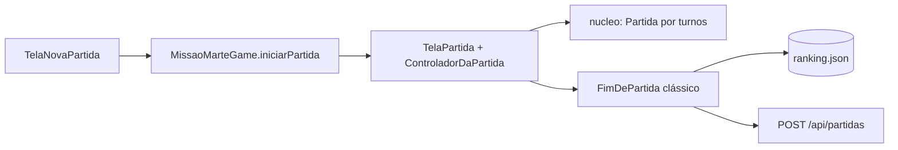
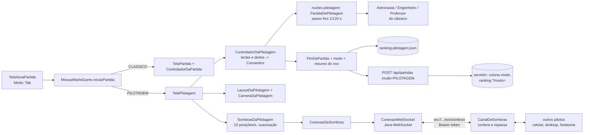

# Fase 7 — Evolução livre: o Modo Pilotagem

## 1. Introdução

A Fase 7 pede uma melhoria escolhida pela equipe, bem integrada à arquitetura e coberta por testes, sem alterar os
comportamentos anteriores sem explicação. A melhoria é o **Modo Pilotagem**, um modo de jogo novo ao lado do
clássico. O objetivo é o mesmo (resgatar os passageiros e levá-los à base), mas o jogador agora **pilota** a nave:
- gira e liga o motor, que empurra na direção do bico e gasta combustível;
- luta contra a gravidade;
- pousa devagar e reto nas plataformas de uma caverna marciana, desviando de paredes de rocha e de asteroides em
  movimento.

A mecânica vem da POC validada pelo usuário em 2026-11-04, e os sprites já estavam no jogo desde a Fase 4.

A análise foi escrita **antes do código**, como a issue #13 pede: a melhoria, o impacto, o que não pode mudar, 17
critérios de aceite e 35 casos de teste. Está em [`fase-07-analise.md`](fase-07-analise.md).

O **modo clássico continua sendo o padrão e não muda**:
- o console, as regras e o ranking clássico são os da Fase 6;
- com a mesma semente, as 200 partidas de teste são idênticas;
- as telas da partida clássica são iguais pixel a pixel.

Por cima da pilotagem veio o **modo shadow** (o "bloco B" do plano): com login, cada piloto vê em tempo real as naves
dos outros pilotos conectados, translúcidas e com o nome em cima. O servidor Spring Boot ganhou um canal WebSocket
que só repassa as posições; ninguém interfere na partida de ninguém.

Ponto de partida: a tag `fase-6`. Resultado: a tag `fase-7`.

## 2. Objetivos de aprendizagem

- Estender um sistema com uma funcionalidade grande sem alterar o que já existe: um modo novo, os pontos de
  extensão e a compatibilidade provada por testes de regressão.
- Simular física em passo fixo, separada da taxa de quadros, e testá-la sem relógio.
- Tratar entrada contínua e multitoque (dois dedos) num controlador testável.
- Evoluir uma API e um banco de dados sem quebrar clientes antigos nem os dados gravados.
- Escrever a análise (critérios de aceite e casos de teste) antes da implementação, e corrigi-la quando a medição
  mostra que uma premissa estava errada.
- Usar um piloto automático como instrumento de validação.
- Comunicar em tempo real com WebSocket: autenticar o aperto de mão, limitar o que o cliente pode mandar e
  suavizar no cliente o movimento que chega aos saltos pela rede.

## 3. Conceitos teóricos

| Conceito | Resumo aplicado ao projeto | Fonte |
|---|---|---|
| Passo fixo | A simulação anda em passos de 1/120 s; o tempo do quadro é acumulado e "gasto" em passos inteiros. O resultado é o mesmo em qualquer taxa de quadros | [Gaffer On Games — Fix Your Timestep!](https://gafferongames.com/post/fix_your_timestep/) |
| Integração semi-implícita de Euler | A cada passo: aceleração (gravidade + empuxo na direção do bico), depois velocidade, depois posição | [Gaffer On Games — Integration Basics](https://gafferongames.com/post/integration_basics/) |
| Realimentação (controle) | O piloto automático mede o erro (velocidade desejada menos a atual) e corrige; o motor liga e desliga numa proporção que dá a média certa (modulação sigma-delta) | — |
| Multitoque na libGDX | Cada dedo tem um número (`pointer`) em `touchDown`, `touchDragged` e `touchUp` | [libGDX wiki — Event handling](https://libgdx.com/wiki/input/event-handling) |
| Textura repetida | `TextureWrap.Repeat` desenha a rocha como um ladrilho; no OpenGL ES 2, repetir exige lados em potência de 2 (256 × 256) | [libGDX wiki — SpriteBatch, TextureRegions and Sprites](https://libgdx.com/wiki/graphics/2d/spritebatch-textureregions-and-sprites) |
| Evolução de esquema (JPA) | Uma coluna nova com valor padrão (`@ColumnDefault`, do Hibernate) preenche as linhas que já existiam quando o `ddl-auto=update` cria a coluna | [Hibernate ORM](https://hibernate.org/orm/documentation/) |
| Compatibilidade de API | Campo novo opcional e parâmetro com valor padrão: o cliente antigo continua igual | — |
| WebSocket | Uma conexão que fica aberta e leva mensagens nos dois sentidos. Começa como um GET HTTP com `Upgrade: websocket` (o "aperto de mão"), respondido com `101`; por isso passa pela mesma segurança da API | [RFC 6455](https://www.rfc-editor.org/rfc/rfc6455) · [Spring — WebSocket API](https://docs.spring.io/spring-framework/reference/web/websocket/server.html) |
| Servidor que só repassa | O servidor não simula o jogo: confere cada posição e a repassa aos outros. Simples e barato, mas não dá para ter colisão entre os jogadores | — |
| Suavização de entidades remotas | As posições chegam 10 vezes por segundo, e a tela desenha 60. A cada quadro, a sombra anda uma fração do caminho até a última posição recebida (`1 - e^(-12·dt)`), em vez de pular | [Gabriel Gambetta — Entity Interpolation](https://www.gabrielgambetta.com/entity-interpolation.html) |

## 4. O que precisou mudar na base (e por quê)

1. **O toque era "uma tecla por toque".** Bastava para um jogo por turnos, mas a pilotagem precisa segurar botões e
   usar dois dedos. A `TelaBase` passou a repassar o número do dedo, o soltar e o arrastar.
2. **O fim de partida era só do clássico.** O `FimDePartida` ganhou o modo e um resumo do voo, e o construtor antigo
   continua valendo, então o clássico não precisou mudar uma linha.
3. **Havia um ranking só.** Os pontos dos dois modos não se comparam. O `ServicoRanking` ganhou um segundo
   repositório (o mesmo serviço) e o servidor ganhou o ranking por modo.
4. **A `Folha` não tinha a chama, a rocha nem a plataforma do passageiro.** Os arquivos estavam em `assets/`,
   "reservados para a Fase 7"; agora são carregados.

## 5. Arquitetura antes da transformação



## 6. Passo a passo da implementação

**Domínio (`nucleo`, pacote `pilotagem`, Java puro):**

1. `ConfigDeVoo` (record) com os números da POC e `para(Dificuldade)`. O Médio é a POC; o Fácil tem mais tanque e um
   pouso mais tolerante; o Difícil, um pouso mais exigente e asteroides mais rápidos.
2. `Caverna` (rochas, plataformas e asteroides) com a fábrica `marciana()`. Os passageiros são os `Astronauta`,
   `Engenheiro` e `Professor` do clássico, com os mesmos nomes.
3. `NaveEmVoo`, `PlataformaDePouso`, `AsteroideEmOrbita` (seno do tempo, sem sorteio), `Rocha`, `Comandos` e
   `EventoDeVoo`.
4. `RegrasDePouso`: uma função pura com os três limites (queda, deslize e inclinação, inclusivos) mais o "centro
   sobre a plataforma".
5. `PartidaDePilotagem`:
   - passo fixo, com voo, contatos, pouso, embarque, entrega, explosão e renascimento;
   - pontos do `Passageiro` mais o bônus de combustível;
   - ao decolar, a nave sobe reta até os pés saírem da plataforma, e só então gira (seção 8);
   - o estado reaproveita o `Partida.Estado` do clássico.

**Apresentação (`core`):**

6. `Modo` (no `nucleo`, usado pelo cliente e pela API). O `FormularioNovaPartida` alterna o modo, e a
   `TelaNovaPartida` mostra a linha "Modo" (Tab ou o botão "Trocar").
7. `ControladorDaPilotagem` (Humble Object):
   - guarda as teclas apertadas e a posição de cada dedo;
   - calcula os `Comandos` a cada quadro e avança a partida;
   - guarda a mensagem do último evento e escolhe o som de cada evento;
   - no fim, monta o `FimDePartida` com o modo e o resumo do voo, grava a vitória no ranking da pilotagem e prepara
     o envio com `modo=PILOTAGEM`.
8. `LayoutDaPilotagem` (◄ ►, MOTOR, Abortar e minimapa) e `CameraDaPilotagem` (seguir a nave dentro da caverna), as
   duas em Java puro e testadas.
9. `TelaPilotagem`:
   - **duas câmeras:** a do mundo segue a nave (no mínimo 1280 × 720 da caverna na tela); a das telas, de 800 × 600,
     desenha o painel, o minimapa e os botões;
   - **mundo:** rocha em ladrilho, plataformas, passageiros que acenam e andam até a nave, asteroides em 32 ângulos,
     a nave em 64 ângulos, a chama girada com ela e a explosão;
   - **painel:** pontos, vidas, uma barra de combustível que muda de cor, quem está a bordo, quantos restam e os
     indicadores de pouso (verde ou vermelho).
10. Ranking: o `ControladorDoRanking` ganhou o modo (↑, ↓ ou M; C ou P), e a `TelaRanking` ganhou o seletor. O
    `ServicosDoJogo` ganhou o `rankingDaPilotagem`, e os launchers gravam em `ranking-pilotagem.json`.
11. Cliente HTTP: `ranking(Modo, ...)` (o antigo `ranking(...)` virou clássico), `modo` no resumo enviado e no
    histórico lido.

**Servidor:**

12. `Modo` (enum próprio) e a coluna `modo` com `@ColumnDefault("'CLASSICO'")`. O `RegistroDePartida.modo` é
    opcional e vira `CLASSICO` quando falta. O ranking é filtrado por modo (`?modo=`, com padrão), e o histórico e a
    resposta trazem o modo. O contrato `docs/api/openapi.json` foi exportado de novo.

**Validação:**

13. `PilotoAutomatico` (nos testes do `nucleo`): uma rota de 3 viagens e um controle por realimentação. É usado pelo
    `PilotoAutomaticoTeste` e pelo roteiro `pilotagem` do `PilotoDaJanela`.
14. Roteiro `pilotagem` do `validacao/android/pilotar_android.py`: toques longos, rotação, segundo plano e Abortar.

**Modo shadow (bloco B):**

15. Servidor: `CanalDeSombras` (um `TextWebSocketHandler`) e `ConfiguracaoDasSombras` (`/ws/sombras`). O aperto de
    mão passa pela segurança da API (DA-32), e o nome vem do token. Cada `posicao` válida vira uma `sombra` para os
    outros pilotos; quem desconecta vira `saiu`.
16. Cliente, porta e adaptador: `ConexaoDeSombras` e `ConexaoWebSocket` (Java-WebSocket). O `ServidorDoJogo` ganhou
    `conexaoDeSombras()` (vazio por padrão; o `ServidorHttp` monta o endereço `ws://`/`wss://` a partir do seu).
17. `SombrasDaPilotagem` (Java puro): conecta no primeiro quadro (só com login), manda a posição a cada 0,1 s, guarda
    e suaviza as sombras, esquece quem some por 3 s e reconecta a cada 3 s.
18. `TelaPilotagem`: desenha as sombras (a nave em azul translúcido, a chama quando o motor está ligado, o nome em
    cima), um ponto azul no minimapa e a linha "Sombras: ..." no painel; fecha a conexão no `hide`.
19. `validacao/sombras/piloto_fantasma.py`: um segundo piloto só pela rede (Python, sem bibliotecas), que voa em
    círculos perto da base e registra as sombras que recebe.

## 7. Código antes e depois

**A pontuação reaproveita o polimorfismo da Fase 1.** O clássico soma `getPontuacao()` ao embarcar; a pilotagem
soma o mesmo ao entregar na base:

```java
// PartidaDePilotagem (Fase 7)
for (Passageiro p : saindo) {
    pontos += p.getPontuacao();   // os mesmos pontos do jogo clássico
}
```

**Um modo novo sem mexer no fim de partida do clássico.** O record ganhou dois campos e um construtor de
compatibilidade:

```java
// FimDePartida (Fase 7)
public FimDePartida(Partida.Estado estado, List<Evento> eventosFinais, Optional<ResultadoPartida> resultado,
                    Optional<RegistroRanking> liderAnterior, boolean entrouNoTop, Optional<String> erroAoSalvar,
                    PartidaParaEnviar paraOServidor) {
    this(estado, eventosFinais, resultado, liderAnterior, entrouNoTop, erroAoSalvar, paraOServidor, Modo.CLASSICO,
            Optional.empty());
}
```

**O toque passou a dizer qual dedo é.** Antes, o número do dedo era jogado fora:

```java
// TelaBase (Fase 6)
return entradaAtual.touchDown(xNaTela, yNaTela, 0, 0);
// TelaBase (Fase 7), mais touchUp e touchDragged repassados
return entradaAtual.touchDown(xNaTela, yNaTela, dedo, botao);
```

**A API ganhou o modo sem quebrar ninguém:**

```java
// ControladorDeRanking (Fase 7): sem o parâmetro, o clássico, como nas Fases 5 e 6
@GetMapping
public List<PosicaoNoRanking> top10(@RequestParam(defaultValue = "CLASSICO") Modo modo) {
    return servico.top10(modo);
}
```

## 8. Explicação das alterações

- **Por que um modo novo, e não trocar o clássico.** O enunciado penaliza mudar comportamentos anteriores sem teste
  ou explicação. Com um modo novo, todo o clássico segue provável pelos mesmos testes, roteiros e comparações das
  fases anteriores (DA-25).
- **Por que o console não ganhou a pilotagem.** Física em tempo real não cabe num terminal por turnos. O console
  continua sendo a referência do clássico.
- **Por que passo fixo e tempo simulado.** Sem isso, a física muda conforme a taxa de quadros e os testes dependeriam
  do relógio. Com o passo fixo, o mesmo voo dá o mesmo resultado a 30 e a 144 quadros por segundo, e a vitória
  inteira no Fácil é um teste de 0,1 s (DA-26).
- **Por que os pontos do clássico.** O plano dizia "10 por passageiro (regra da versão-base)", mas o 10 veio da POC.
  A versão-base dá 20, 15 e 10 por tipo, e o `Passageiro` já sabe isso desde a Fase 1. Seguir a regra de verdade é
  também reaproveitar um ponto de extensão (DA-27).
- **Por que o bônus de combustível.** Sem ele, toda vitória daria 45 e o ranking só desempataria pela data. O bônus
  (até 30, proporcional ao que sobrou no pouso final) premia o voo econômico.
- **Por que o Difícil ficou com 100 de tanque.** A análise previa 80. Medido com o piloto automático, a viagem mais
  longa gasta perto de 100 ou mais, e a própria POC diz que os 100 "cobrem a viagem mais longa". Com 80, o Difícil
  seria impossível. A dificuldade dele vem dos limites de pouso e dos asteroides mais rápidos.
- **O defeito que o teste achou.** O teste do controlador pilota só pelo teclado. Ele mostrou que **girar junto com o
  motor na decolagem** fazia o pé de fora encostar de novo na plataforma: a nave "pousava" no mesmo instante e nunca
  saía do chão. Um jogador humano faria exatamente isso. Agora a nave sobe reta até os pés saírem da plataforma
  (6 unidades), e só então o giro vale. Dois testes de unidade guardam a regra (DA-28).
- **Por que dois rankings.** Os pontos não se comparam: 45 + bônus contra o placar de passos do clássico. Cada modo
  tem o seu Top 5 local (`ranking.json` e `ranking-pilotagem.json`) e o seu Top 10 global (`?modo=`) (DA-29).
- **Por que um piloto automático.** É a única forma de provar, sem mãos e de forma repetível, que a caverna pode ser
  vencida com as regras de verdade. Também gera os prints da janela e mede o combustível de cada viagem (DA-30).

## 9. Arquitetura resultante



```text
nucleo/.../aplicacao/Modo.java                 CLASSICO, PILOTAGEM
nucleo/.../pilotagem/                           ConfigDeVoo, Caverna, NaveEmVoo, PlataformaDePouso, AsteroideEmOrbita,
                                                Rocha, Comandos, EventoDeVoo, RegrasDePouso, PartidaDePilotagem
nucleo/src/test/.../pilotagem/                  PartidaDePilotagemTeste (27), PilotoAutomatico, PilotoAutomaticoTeste (3)
core/.../apresentacao/                          + ControladorDaPilotagem, LayoutDaPilotagem, CameraDaPilotagem;
                                                FimDePartida, FormularioNovaPartida, ControladorDoRanking com o modo
core/.../telas/TelaPilotagem.java               o voo (duas câmeras, painel, minimapa, botões)
core/.../recursos/Folha.java                    + CHAMA, ROCHA, PLATAFORMA_PASSAGEIRO
servidor/.../partida/Modo.java                  + coluna modo (padrão CLASSICO), ranking por modo
validacao/janela/PilotoDaJanela.java            + roteiro pilotagem (o piloto automático na janela real)
validacao/android/pilotar_android.py            + roteiro pilotagem (toques longos pelo adb)
servidor/.../sombras/                           CanalDeSombras, ConfiguracaoDasSombras (/ws/sombras)
core/.../online/                                + ConexaoDeSombras (porta), ConexaoWebSocket (adaptador)
core/.../apresentacao/SombrasDaPilotagem.java   envio, suavização, esquecimento e reconexão
validacao/sombras/piloto_fantasma.py            um segundo piloto só pela rede
```

## 10. Como executar e testar

```bash
./gradlew :lwjgl3:run      # nova missão -> Tab (modo Pilotagem) -> dificuldade -> Enter
./gradlew :android:installDebug
```

**Controles da pilotagem:**
- **Teclado:** ← → (ou A, D) giram; ↑ (ou W, Espaço) liga o motor; Esc aborta.
- **Toque:** ◄ ► à esquerda e MOTOR à direita, que valem enquanto apertados (dá para girar e acelerar ao mesmo
  tempo); Abortar no alto. O Voltar do Android não aborta.

**Modo shadow (ver os outros pilotos):**
1. Suba o servidor (`cd servidor && docker compose up -d --build`) e, em cada aparelho, aponte para ele (opção 4 da
   entrada; no celular, o IP do computador na rede, por exemplo `http://192.168.0.10:8080`).
2. Entre com uma conta em cada aparelho (o convidado vê "Sombras: entre com uma conta").
3. Pilotagem nos dois: cada um vê a nave do outro, translúcida e com o nome.
4. Com um aparelho só: `python3 validacao/sombras/piloto_fantasma.py --segundos 60` põe um piloto de teste voando em
   círculos perto da base.

**Como jogar:**
- Pouse devagar e reto em cima da plataforma de um passageiro e espere o embarque (0,6 s). Cabem 2 a bordo.
- Leve-os à base, onde a nave também reabastece.
- O painel mostra em verde ou vermelho se um pouso agora seria seguro (queda, lado e ângulo).

**Validação da fase** (as saídas estão em `docs/evidencias/fase-07/`):

| Verificação | Resultado |
|---|---|
| Build e testes (`build-e-testes.txt`) | **316 testes, 0 falhas**: `nucleo` 92 (30 novos), `console` 3, `core` 186 (42 novos, 18 deles do shadow), servidor 35 (12 novos, 7 do shadow); o build completo gera o APK |
| Regras do voo, sem janela (CT-01 a CT-17) | 27 testes de unidade: queda, motor, combustível, giro, os três limites exatos (75/50/14 inclusivos), beirada, colisões, embarque aos 0,6 s, nave cheia, entrega com 20/15/10, explosão devolvendo os passageiros, renascer, derrota, vitória com bônus, abortar, 30 × 144 quadros por segundo, a tabela da dificuldade, decolagem girando |
| Piloto automático (CT-18) | vence a caverna inteira no Fácil, determinístico (as mesmas execuções dão os mesmos eventos), sem nenhuma explosão; no Médio e no Difícil faz as viagens do Astronauta e do Engenheiro |
| Controlador e telas (CT-19 a CT-25) | teclas e dois dedos, arrastar e soltar, Abortar, uma vitória completa pilotada só pelo teclado e gravada no ranking da pilotagem (e não no clássico), derrota, resumo com `modo=PILOTAGEM`, layout em 6 tamanhos de tela, câmera, formulário e ranking por modo, cliente HTTP mandando e lendo o modo |
| Servidor (CT-26 a CT-28) | sem modo é clássico; modo inválido dá 400; rankings separados; o histórico traz o modo |
| Migração do banco de verdade (CT-33, `migracao-do-banco.txt`) | o banco de desenvolvimento com partidas das Fases 5 e 6: o ranking clássico ficou igual (6 pilotos), o da pilotagem começou vazio, e a partida antiga aparece como `CLASSICO` |
| Janela real, roteiro `pilotagem` (CT-29) | o piloto automático voa a caverna inteira no Fácil apertando as setas a cada quadro: decolagem, passagem estreita, 3 embarques, 3 entregas, "Missão cumprida!" e o ranking da pilotagem |
| Regressão do clássico (CT-30) | console: **200/200 partidas idênticas** à Fase 6 e roteiros 11/11 nas três formas; janela: telas da partida idênticas, e só a nova missão e o ranking mudaram (de propósito) |
| Emulador e celular (CT-31) | modo escolhido no toque; MOTOR segurado (sobe e pousa de volta); girar no ar e cair torta (explode, perde uma vida); paisagem; segundo plano no meio do voo (a partida continua); Voltar ignorado; Abortar; ranking da pilotagem |
| Defeitos inseridos de propósito (CT-34, `testes-detectam-defeitos.txt`) | **27/27 pegos**: 14 no domínio (por exemplo, limite de queda exclusivo, motor sem combustível empurrando, pontos fixos em vez dos do passageiro, um passo por quadro, girar logo na decolagem), 10 na apresentação (botões sem tamanho mínimo, câmera fora da caverna, soltar o dedo sem soltar o botão, vitória fora do ranking, ranking global sem o modo) e 3 no servidor (ranking misturando os modos, sem modo virando pilotagem, histórico sem o modo) |
| APK (CT-35) | 0 chamadas do jogo acima da API 26; a Java-WebSocket (76 classes) e o slf4j (55) também, 0 |
| Shadow: servidor (CT-36 a CT-40) | 7 testes de ponta a ponta (porta aleatória, clientes WebSocket de verdade): sem token ou com token inválido dá 401; a posição chega aos outros com o nome do token, e não ao próprio piloto; 9 mensagens inválidas são ignoradas sem derrubar a conexão; posições a menos de 40 ms são descartadas; quem sai é anunciado; mensagem grande demais fecha a conexão (1009). No contêiner: 401 sem token, `101` com token (`sombras-servidor.txt`) |
| Shadow: cliente (CT-41 a CT-44) | 12 testes da `SombrasDaPilotagem` (desligadas sem servidor, convidado não conecta, conecta no primeiro quadro com o token, 10 posições por segundo com ponto decimal, aparece e desliza, ângulo pelo lado curto, `saiu` e 3 s sem notícia, mensagens inválidas, nome cortado, reconexão, fechar) e 6 do `ConexaoWebSocket` contra um servidor WebSocket local (token no aperto de mão, mensagens nos dois sentidos pela thread do jogo, servidor caindo, fechar sem aviso, sem servidor) |
| Shadow: aparelhos de verdade (CT-45, `sombras-pilotos.txt`) | dois pilotos fantasma se veem; no celular do usuário, a sombra do fantasma aparece perto da base, com o nome, o ponto no minimapa e "Sombras: 1 piloto" (`android-celular-sombras/`); o fantasma recebeu ao mesmo tempo as posições do celular e do desktop do usuário |
| Shadow: defeitos inseridos (`testes-detectam-defeitos-sombras.txt`) | **20/20 pegos**: 7 no servidor (sem token entra, nome que não vem do token, sem limite de frequência, posição fora da caverna, motor que não é booleano, sombra devolvida ao próprio piloto, saída sem aviso) e 13 no cliente (convidado conectando, posição antes de abrir ou a cada quadro, sombra pulando, ângulo pelo lado longo, sombra que não some, sem reconexão, tela que não fecha a conexão, aperto de mão sem token, avisos fora da thread do jogo, aviso de conexão velha, `https` virando `ws`). A rodada achou um teste instável, corrigido (seção 11) |

## 11. Achados e limitações

- **Combustível no Médio: decidido, fica 100 (DA-34).** O piloto automático é conservador: para e espera o
  asteroide em cada passagem estreita. Do jeito que ele voa (`piloto-automatico.txt`), a viagem do Professor gasta
  60 só na ida, e na volta o tanque acaba a uns 700 da base: cerca de 120 no total, mais que os 100 do Médio. A do
  Engenheiro chega à base com 4,8 de sobra (1,6 no Difícil). A POC registra que os 100 cobrem essa viagem para um
  piloto humano. Depois de jogar no celular e no desktop, o usuário decidiu manter os 100.
- **A sombra fica de 100 a 200 ms atrás** da nave de verdade (intervalo entre as mensagens mais a suavização). Para
  ver o outro voar, basta; uma corrida disputada pediria prever o movimento (extrapolação).
- **Sem salas:** todos os conectados estão na mesma caverna. A mesma conta em dois aparelhos aparece como duas
  sombras (cada conexão é um piloto).
- **`ws://` não é criptografado,** como o `http://` da API: na internet, o servidor fica atrás de um proxy com HTTPS e
  o jogo usa `https://`, que vira `wss://` (`servidor/PUBLICACAO.md`).
- **O servidor não confere a física das sombras:** um cliente modificado poderia "teleportar" a própria sombra. Como
  ela não interfere no jogo de ninguém, o risco é só visual.
- **Um teste instável, achado e corrigido.** O `CanalDeSombrasTeste` contava os pilotos a partir de "quantos já estavam
  conectados". Às vezes, o fechamento do teste anterior ainda não tinha chegado ao servidor, e a conta errava por um
  (falhou 1 vez em 5). Agora cada teste espera o servidor voltar a 0 conexões e conta a partir de 0: 10 de 10
  rodadas sem falha. É o tipo de defeito que aparece em testes com rede e várias threads: o cliente fica sabendo de
  um evento antes de o servidor terminar de processá-lo.
- **Dois dedos ao mesmo tempo** estão testados no controlador, mas o `adb` só segura um dedo por vez. No Android,
  girar e acelerar juntos foi verificado só jogando à mão.
- **Em retrato,** a caverna inteira cabe na altura da tela e a nave fica pequena. É jogável, mas a paisagem é melhor.
- **O tempo da partida é o simulado** (soma dos passos). Quando o app volta do segundo plano, um quadro longo vale no
  máximo 0,25 s, então o voo "pausa" de verdade.
- **Um nível só** (a caverna da POC). Outros níveis caberiam como novas fábricas de `Caverna`.
- O servidor não confere se a pontuação é legítima, a mesma limitação do clássico (Fase 5).

## 12. Exercícios para os alunos

1. Em `PartidaDePilotagemTeste`, escreva um teste para o aviso de combustível baixo depois de reabastecer na base: ele
   volta a avisar?
2. Crie uma segunda caverna (uma fábrica nova em `Caverna`) e uma opção na nova missão para escolhê-la. O que muda no
   `ControladorDaPilotagem`? E no ranking?
3. Troque a física para usar um passo de 1/60 s. Que teste falha? Por quê?
4. Faça o piloto automático decidir a cada 4 passos em vez de a cada passo (como uma janela a 30 quadros por
   segundo). Ele ainda vence? Que parte da rota fica mais arriscada?
5. Acrescente um som de motor contínuo (gerado por `arte/sons/gerar_sons.py`), tocando enquanto o motor estiver
   ligado. Onde fica a decisão de tocar e parar?
6. Proponha uma regra no servidor para recusar pontuações impossíveis na pilotagem (no máximo 45 + 30). O que o
   cliente precisaria mandar a mais?
7. Mande também a velocidade na mensagem `posicao` e, no cliente, desenhe a sombra onde ela **estaria agora**
   (posição recebida + velocidade × tempo desde a mensagem). A sombra fica mais perto da nave de verdade? O que
   acontece quando o outro piloto bate numa parede?
8. Crie "salas": o piloto escolhe um código na nova missão, e o servidor só repassa as posições para quem está na
   mesma sala. Onde fica o código na URL do WebSocket? Que teste do `CanalDeSombrasTeste` você escreveria primeiro?

## 13. Conclusão

O Missão Marte ganhou um segundo jeito de jogar sem perder o primeiro. A melhoria usou os pontos de extensão que as
fases anteriores criaram:
- os passageiros polimórficos, a dificuldade e o `ServicoRanking` com repositório trocável (Fase 1);
- telas passivas com controladores testáveis (Fase 3);
- a porta para o servidor (Fase 5);
- o layout e o toque (Fase 6).

O que precisou mudar na base (o toque com dedos, o fim de partida com modo e o ranking por modo) mudou de forma
compatível, e os testes e roteiros das fases anteriores provam que o clássico continua igual. A análise escrita antes
do código serviu de roteiro e foi corrigida onde a medição mostrou outra coisa: os pontos por passageiro e o tanque do
Difícil. O piloto automático virou ao mesmo tempo prova, demonstração e régua para o equilíbrio do jogo.

O modo shadow seguiu o mesmo caminho: uma porta nova (`ConexaoDeSombras`) ao lado da que já existia para o servidor,
um adaptador trocável e a lógica em Java puro, testada sem rede. No servidor, a segurança da API protegeu o canal
novo sem nenhuma regra a mais.
