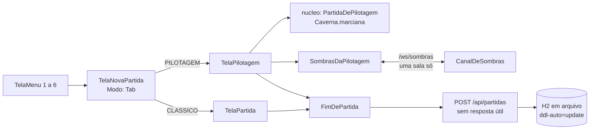
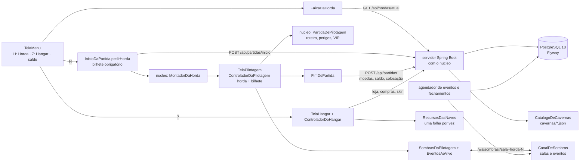

# Fase 8 — Evolução livre: Horda, eventos ao vivo, moedas e skins

## 1. Introdução

O ranking da Pilotagem prendeu o grupo, mas toda partida era igual:
- havia uma caverna só (`Caverna.marciana()`);
- os passageiros esperavam sempre no mesmo lugar;
- os asteroides seguiam um seno e, no mesmo segundo, estavam sempre no mesmo ponto.

Dava para decorar a rota. A Fase 8 torna as partidas variadas com **eventos do servidor**, sem virar um
multiplayer com colisão, e dá um motivo a mais para jogar: **moedas** que compram **skins** da nave.

| Peça | O que é |
|---|---|
| **Horda** | um modo novo. A cada 2 horas, o servidor publica um desafio igual para todos (caverna, passageiros, dificuldade e variações), com um Top 10 próprio |
| **Eventos ao vivo** | perigos e uma oportunidade que o servidor dispara para todos os pilotos em voo naquele instante, na Pilotagem e na Horda |
| **Placar da semana** | a soma da colocação em cada horda com os pontos dos eventos |
| **Moedas e Hangar** | moedas por vitória, uma loja de skins e um Hangar para equipar a skin. A skin aparece também na sombra que os outros veem |
| **Skins** | 8 naves novas, em duas linhas de evolução, renderizadas no Blender como a nave original |

O jogo passa a ter três modos:
- **Clássico**, igual ao da Fase 6;
- **Pilotagem**, a da Fase 7, que a análise chama de "Pilotagem Livre", com o mesmo ranking de antes;
- **Horda**.

A análise foi escrita **antes do código**, como na Fase 7: regras, compatibilidade, impacto por camada, riscos,
17 critérios de aceite e 31 casos de teste. Está em [`fase-08-analise.md`](fase-08-analise.md). O contrato entre
o jogo e o servidor está em [`api/contrato-horda.md`](api/contrato-horda.md).

O trabalho foi dividido em etapas. A seção 7 mostra por quais PRs elas chegaram à `main`.

Ponto de partida: a tag `fase-7` e as entregas posteriores (DA-35 a DA-38). A tag `fase-8` sai depois da validação final no celular (seção da validação, abaixo).

## 2. O que muda para quem joga

**No menu:**
- Uma faixa no rodapé mostra a horda atual. Exemplo: "Horda 123 · Caverna Marciana · Difícil". Embaixo vêm os
  modificadores ("Vento 12,5 para a direita · Gravidade 115%") e o tempo: "Termina em 1h 10min · Próxima às 20:00
  (Fortaleza)".
- **`H`**, ou um toque na faixa, joga a horda atual. O convidado vê "Entre com uma conta para jogar a horda.".
  Sem servidor, a faixa mostra "Horda indisponível".
- **`7`**, ou o toque em "7. Hangar", abre o Hangar. As teclas `1` a `6` continuam iguais.
- Com conta, aparece o saldo ("Moedas: 42") embaixo do nome do piloto.

**Na Horda:** os controles são os da Pilotagem (Fase 7):
- **teclado:** `←`/`→` giram, `↑` liga o motor e `Esc` aborta;
- **toque:** ◄ ► e MOTOR.

O painel mostra "HORDA 123" no lugar de "PILOTAGEM". A caverna, os passageiros, a dificuldade e as variações são
os mesmos para todos os pilotos naquela horda.

**Durante o voo** (Pilotagem e Horda, só com conta):
- Um aviso em faixa amarela, com som de alerta, chega 15 s antes do evento: "CHUVA DE METEOROS EM 12 s". Durante o
  evento, a faixa mostra o nome dele.
- **Chuva de meteoros:** pedras alaranjadas, com rastro, cruzam a caverna em linha reta. Bater numa é fatal.
- **Tempestade de poeira:** rajadas laterais e uma névoa cor de ferrugem na tela.
- **Pane de gravidade:** a nave fica mais pesada por 20 s.
- **Passageiro VIP:** uma cápsula dourada com "VIP" surge num ponto de pouso livre. Quem pousar nela primeiro leva
  o VIP. O jogo mostra "Pouso na cápsula! Aguardando confirmação." e depois "Ana pegou o VIP".
- Cada perigo também pode estar no **roteiro** da horda, num instante fixo da partida, igual para todos.

**No fim da partida:**
- Na vitória com conta: "+3 moedas | Saldo: 45".
- Na Horda: "2º lugar na Horda" ou "Fora do Top 10 da Horda".
- Fora do prazo: "O prazo para registrar esta Horda terminou.".

**No Hangar** (`7`):
- Mostra o saldo e as naves da loja, agrupadas em duas linhas (Padrão e Guará), cada uma com prévia, nível, preço e
  situação: Equipada, Possuída ou Comprar.
- **Teclado:** setas escolhem, `Enter` compra ou equipa, `Esc` volta.
- **Toque:** tocar numa linha a escolhe. Os botões são Voltar, Anterior, Próxima e a ação (Comprar ou Equipar).
- A skin só muda a aparência. A colisão e o voo são os mesmos.

**No ranking:**
- `↑`/`↓` (ou os botões) alternam Clássico, Pilotagem e Horda.
- No Clássico e na Pilotagem, `←`/`→` alternam Local e Global, como antes.
- Na Horda, `←`/`→` alternam "Esta horda" (Top 10) e "Semana" (placar da semana). `H` vai direto à Horda.

**Na página** (https://missao-marte.thebylito.dev):
- Abas Horda, Semana, Pilotagem e Clássico. A aba Horda aparece quando a página consegue ler a horda atual.
- A data do ranking aparece como AAAA-MM-DD HH:MM, no fuso de quem vê, para desempatar.
- Quando o placar semanal está disponível, a aba Semana mostra o período, os pontos de cada piloto e quantas hordas e eventos contaram para ele.

## 3. Objetivos de aprendizagem

- Gerar conteúdo por sorteio com semente, de forma determinística e testável, e protegê-lo com um segredo.
- Descrever níveis como dados (JSON) e validá-los antes de usá-los.
- Acrescentar efeitos temporários a uma física em passo fixo sem mudar nenhum passo da física antiga.
- Compartilhar as regras entre o cliente e o servidor (o `nucleo`) sem acoplar o servidor ao cliente.
- Modelar dinheiro de jogo com um extrato: crédito único, saldo como soma e compra sem corrida.
- Trocar o banco de dados de um sistema em produção com migrações versionadas e uma importação ensaiada.
- Evoluir um protocolo em tempo real (salas e mensagens novas) sem quebrar os clientes já instalados.
- Controlar a memória de textura no Android com várias versões da mesma arte.

## 4. Conceitos teóricos

| Conceito | Resumo aplicado ao projeto | Fonte |
|---|---|---|
| Sorteio com semente | Tudo sai de um único `SplittableRandom(semente)`, numa ordem fixa: a mesma semente dá sempre a mesma horda. Nada de `Math.random`, relógio ou ordem de `HashMap` | [Java 17 — SplittableRandom](https://docs.oracle.com/en/java/javase/17/docs/api/java.base/java/util/SplittableRandom.html) |
| HMAC | Um resumo com chave. Com a semente derivada de HMAC-SHA256(segredo, `horda:N`), quem lê o repositório público não calcula as próximas hordas | [RFC 2104](https://www.rfc-editor.org/rfc/rfc2104) |
| Conteúdo como dados | A caverna deixou de ser código (`Caverna.marciana()`) e virou um JSON. Uma caverna nova não exige nova versão do jogo | — |
| Validação de entrada | O `ValidadorDeCaverna` confere a geometria antes de a caverna entrar no rodízio, e cada problema cita o item do JSON | — |
| Efeito temporário em passo fixo | Cada perigo dura um número inteiro de passos de 1/120 s, a partir do passo em que entrou. O passo fica registrado | [Gaffer On Games — Fix Your Timestep!](https://gafferongames.com/post/fix_your_timestep/) |
| Determinismo e replay | Com os comandos, as sementes e o passo de cada evento, dá para refazer a partida. Para bater entre JVM e Android, as contas precisam ser idênticas (`StrictMath`) | [Gaffer On Games — Deterministic Lockstep](https://gafferongames.com/post/deterministic_lockstep/) |
| Extrato (livro-razão) | O saldo não é um campo: é a soma dos movimentos. Cada crédito tem origem e referência únicas, então repetir o pedido não credita duas vezes (idempotência) | — |
| Trava de linha | A compra trava a linha do jogador (`SELECT ... FOR UPDATE`) antes de conferir o saldo. Duas compras ao mesmo tempo ficam em fila | [PostgreSQL — Explicit Locking](https://www.postgresql.org/docs/current/explicit-locking.html) |
| Migrações versionadas | O esquema do banco é uma sequência de arquivos `V<n>__descricao.sql` que o Flyway aplica uma vez e confere pelo checksum. O Hibernate só confere (`ddl-auto=validate`) | [Flyway — documentação](https://documentation.red-gate.com/flyway) |
| Fuso horário | As hordas e o teto diário seguem `America/Fortaleza` (UTC−3, sem horário de verão). O jogo recebe segundos relativos e não depende do relógio do aparelho | [Java 17 — ZoneId](https://docs.oracle.com/en/java/javase/17/docs/api/java.base/java/time/ZoneId.html) |
| Salas num canal | O WebSocket das sombras separa os pilotos por sala (`livre`, `horda-N`). Cada mensagem só circula dentro da sala, mas os eventos vão a todas | [RFC 6455](https://www.rfc-editor.org/rfc/rfc6455) |
| Atlas de texturas | Várias imagens pequenas numa textura só. As sombras usam um atlas de 64 px com todas as skins, em vez de uma folha de 1024 × 1024 por skin | [libGDX wiki — Texture Packer](https://libgdx.com/wiki/tools/texture-packer) |

## 5. O que precisou mudar na base (e por quê)

1. **O servidor não conhecia as regras do jogo.** A DA-14 dizia que o servidor não inclui nenhum módulo do jogo.
   Para sortear e validar cavernas, ele passou a compilar o `nucleo`, e só ele (DA-39).
2. **O banco não aceitava um modo novo.** O Hibernate 7.4 criava as colunas de enum como `ENUM` nativo do H2, e o
   `ddl-auto=update` não muda o tipo. A primeira partida `HORDA` falharia em produção. As colunas viraram texto
   (DA-40), e depois o banco inteiro foi para o PostgreSQL, com o esquema no Flyway (DA-41).
3. **A caverna era código.** Virou um dado (`DescricaoDeCaverna`), que o `MontadorDaHorda` transforma numa
   `Caverna` pela API pública dela. O `marciana.json` monta exatamente o `Caverna.marciana()`.
4. **A física não tinha efeitos temporários.** A `PartidaDePilotagem` ganhou roteiro, eventos ao vivo, perigos e
   a cápsula VIP, num caminho separado por `if`. Sem efeitos, nenhum passo muda.
5. **O canal das sombras tinha uma sala só e levava só a posição.** Ganhou salas, a skin e as mensagens dos
   eventos. O cliente antigo, sem sala, cai na `livre`.
6. **A nave era uma folha fixa no enum `Folha`.** As skins ficam fora do enum: o `RecursosDasNaves` carrega só a
   folha da skin equipada.
7. **O registro da partida não devolvia nada.** Agora devolve as moedas, o saldo e, na Horda, a colocação
   (`RegistroDePartida`). A porta `ServidorDoJogo` ganhou os métodos novos com implementação padrão, então os
   dublês de teste e os adaptadores antigos continuam compilando.

## 6. Arquitetura antes da transformação



## 7. Passo a passo da implementação

As etapas seguem a seção 8 da análise. As evidências versionadas ficam em `docs/evidencias/fase-08/`.

| # | Etapa | Branch |
|---|---|---|
| 0 | Análise | `fase-8-analise` (PR #26) |
| 1 | Servidor com o `nucleo` e colunas de enum como texto | `fase-8-etapa-1` (PR #27) |
| 1b | PostgreSQL com Flyway e a importação do H2 | `fase-8-etapa-1b` (PR #30) |
| C | Skins: pipeline do Blender e as naves | `skins-naves` (PR #32) |
| 2a | Moedas, bilhete, loja, Hangar e skin nas sombras | `fase-8-etapa-2a-servidor` e `fase-8-etapa-2a-jogo` (PR #32) |
| 3 | Cavernas como dados e o modelo da Horda no `nucleo` | `fase-8-etapa-3` e `fase-8-nucleo-horda` (PR #32) |
| 4 | Horda no servidor | `fase-8-servidor` (PR #32) |
| 5 | Horda no jogo | `fase-8-etapa-5-jogo` (PR #32) |
| 6 | Eventos ao vivo: efeitos no `nucleo`, canal, agendador, painel e placar | `fase-8-nucleo-efeitos` e `fase-8-servidor` (PR #32) |
| 7 | Página e documentação | `pagina-ordem-dos-modos` (#28), `pagina-data-e-hora` (#29), `pagina-semana` (#31) e `fase-8-docs` (#32) |
| — | Ajustes do jogo por variável de ambiente (DA-48) | `fase-8-ajustes` (PR #33) |

O PR #32 reuniu as branches do servidor e do jogo em `fase-8-final`, inclusive `fase-8-jogo-completo`.

### 7.1 Servidor com o `nucleo` (etapa 1, DA-39 e DA-40)

1. `servidor/settings.gradle` inclui `../nucleo`. O `servidor/build.gradle` configura o `nucleo` ali mesmo
   (toolchain 17, UTF-8), com a saída em `servidor/build/nucleo` e os testes do `nucleo` desligados (o build da raiz
   já os roda).
2. O contexto do Docker passou para a raiz (`docker build -f servidor/Dockerfile .`). O
   `servidor/Dockerfile.dockerignore` deixa entrar só o servidor e o `nucleo`: um contexto de cerca de 520 kB.
   O compose, o CI e o deploy usam esse contexto.
3. O `CanalDeSombras` passou a ler o tamanho da caverna do próprio `nucleo` (`NucleoNoServidorTeste`).
4. As colunas de enum passaram a `varchar(20)` (`@JdbcTypeCode(SqlTypes.VARCHAR)`).

### 7.2 PostgreSQL com Flyway (etapa 1b, DA-41)

1. O servidor lê `MISSAOMARTE_DB_URL`, `MISSAOMARTE_DB_USUARIO` e `MISSAOMARTE_DB_SENHA`. Em produção, é a instância
   geral de PostgreSQL 18 do Dokploy (`postgres-br`), com banco e usuário próprios, os dois chamados `missaomarte`.
2. Sem `MISSAOMARTE_DB_URL` (o `./gradlew bootRun` só com o JDK), o servidor usa um H2 em arquivo em modo
   PostgreSQL, também com o Flyway.
3. O esquema fica em `servidor/src/main/resources/db/migration/` (`V1__esquema_inicial.sql`: o esquema da 7.x com
   as colunas de enum em texto, sem `CHECK`). O Hibernate só confere (`ddl-auto=validate`).
4. O `ImportadorDoH2`, ligado por `MISSAOMARTE_IMPORTAR_H2`, copia jogadores e partidas do H2 antigo para um
   PostgreSQL vazio, com os mesmos ids. Ele roda antes de o servidor atender o primeiro pedido.
5. O `servidor/compose.yaml` sobe um `postgres:18-alpine` ao lado do servidor.

### 7.3 Moedas, bilhete e loja (etapa 2a, DA-42)

**Servidor** (pacotes `moedas`, `partida` e `loja`):
1. `MovimentoDeMoedas` é uma linha do extrato. O saldo é a soma dos movimentos do jogador.
2. `ServicoDeMoedas.creditar` não faz nada se o extrato já tem aquela `Origem` com aquela referência. A vitória usa
   a referência `partida:<id>`. As origens são `VITORIA_CLASSICO`, `VITORIA_LIVRE`, `VITORIA_HORDA`, `HORDA`,
   `SEMANA` e `COMPRA`.
3. `ServicoDeBilhetes` emite o bilhete de `POST /api/partidas/inicio`:
   - um bilhete ativo por jogador: pedir outro anula o anterior;
   - vale por 2 h e é usado uma vez, qualquer que seja o resultado;
   - só rende moedas se o modo e a dificuldade batem com os da partida;
   - o tempo real desde o bilhete precisa ser de pelo menos o tempo simulado menos 10 s, e nunca menos de 5 s no
     Clássico e de 45 s na Pilotagem.
4. `CatalogoDeSkins` lê o `skins.json` (id, nome, linha, nível e preço). `ServicoDaLoja.comprar` trava o jogador
   antes de conferir o saldo. Comprar de novo dá 409 `JA_POSSUI`, sem saldo dá 409 `SALDO_INSUFICIENTE`, e equipar
   sem ter dá 409 `NAO_POSSUI`.
5. Rotas: `GET /api/loja` (pública), `POST /api/loja/compras`, `GET /api/jogadores/eu/hangar` e
   `PUT /api/jogadores/eu/skin`. O `POST /api/partidas` passou a devolver `moedasGanhas` e `saldo`.
6. A sombra leva a skin equipada no perfil, e não a que o cliente diz ter.

**Jogo** (`core`):
7. `InicioDaPartida.pedir` pede o bilhete em segundo plano quando a partida começa, só com conta. No fim, se a
   resposta ainda não chegou, o envio espera por ela. Se o pedido falhou, a partida vai sem bilhete: entra no
   ranking, mas não rende moedas.
8. `EnvioDoResultado` guarda o `RegistroDePartida` e monta as linhas "+N moedas | Saldo: M" e a da colocação.
9. `ControladorDoHangar` junta o perfil (`GET /api/jogadores/eu/hangar`) com a loja (`GET /api/loja`). Ele mostra
   só as skins cuja arte o jogo instalado tem, agrupadas por linha e ordenadas pelo nível. O estado de cada item é
   `EQUIPADA`, `POSSUIDA`, `A_COMPRAR` ou `INDISPONIVEL`. Um 401 desconecta o piloto (DA-38).
10. `TelaHangar` desenha a lista (com rolagem) e os botões de toque. O `MissaoMarteGame` guarda o saldo e grava a
    skin equipada na `Sessao` e na `SessaoGuardada`.

### 7.4 Skins (trilha C e etapa 2b, DA-43)

1. Cada skin é um script Blender em `arte/blender/naves/` (`padrao_2_modelo.py` a `padrao_5_modelo.py`,
   `guara_modelo.py` a `guara_4_modelo.py`), sobre a geometria comum (`comum.py`). O `render_all.py` renderiza os
   64 ângulos de cada uma, como a nave original da Fase 4.
2. `atlas.py` grava o `catalogo.json`, a `previas.png` (o quadro 0 de cada skin, em células de 128 px) e a
   `sombras.png` (16 ângulos de 64 px por skin).
3. `verify.py` confere tamanhos, alfa, pivôs e orientação de todas as folhas. Para cada skin, compara a cabine,
   os pés, o bocal, a área e a caixa com os da `padrao`, para a geometria de colisão continuar a mesma. Em cada
   linha, cada nível precisa se parecer com o anterior (IoU de pelo menos 0,6) e ter uma diferença de cor visível.
   A origem de cada arquivo está em `assets/ORIGEM.md`.
4. No jogo, `CatalogoDeNaves` lê o `catalogo.json` e só oferece as folhas que existem. `RecursosDasNaves` mantém
   uma folha de voo por vez (`selecionar`, na troca de tela), carrega as prévias só no Hangar e o atlas das sombras
   só na Pilotagem. A skin vale no menu, no Clássico, na Pilotagem, na Horda e no fim de partida.

A trilha foi feita em paralelo pelo Codex, como a análise previa. Ela começou com naves independentes (Guará,
Bruma, Vereda e outras). O usuário preferiu **linhas de evolução**: cada nível é a mesma nave melhorada (o II
ganha peças, o III materiais, o IV brilho e o V um acabamento épico). Ficaram a linha Padrão (a nave de sempre e os
níveis II a V) e a linha Guará (I a IV). Os modelos que saíram ficaram em `arte/blender/naves/futuras/`, para
linhas futuras.

| Linha | Nível I | II | III | IV | V |
|---|---|---|---|---|---|
| Padrão | grátis (a nave de sempre) | 60 | 120 | 200 | 300 |
| Guará | 60 | 120 | 200 | 300 | — |

A compra é livre: não exige o nível anterior.

### 7.5 Cavernas como dados (etapa 3)

1. No `nucleo`, pacote `pilotagem.horda`: `DescricaoDeCaverna` (limites, rochas, base, pontos de pouso candidatos,
   asteroides e `liberada`), `RochaDescrita`, `PontoDePouso` e `AsteroideDescrito`.
2. `ValidadorDeCaverna.problemas` devolve a lista de problemas, cada um citando o item (`rochas[3]`,
   `pontosDePouso[1]`). As regras:
   - id e nome preenchidos, tamanho positivo, uma base e pelo menos 3 pontos de pouso;
   - rochas dentro dos limites;
   - plataformas dentro dos limites, sem invadir rocha nem outra plataforma;
   - 120 de folga livre acima de cada plataforma, para a nave descer e pousar;
   - a órbita de cada asteroide dentro dos limites, sem passar pelo corpo nem pela folga de nenhuma plataforma.
3. No servidor, `CatalogoDeCavernas` lê `cavernas/*.json` na subida. Uma caverna inválida fica de fora, com um
   aviso no log. Um id repetido derruba a subida.
4. São três cavernas:

| Arquivo | Caverna | Tamanho | No rodízio |
|---|---|---|---|
| `marciana.json` | Caverna Marciana | 3840 × 1440 | sim |
| `poco-polar.json` | Poço Polar | 2400 × 2000 | só depois de uma vitória humana no Difícil |
| `veio-de-ferro.json` | Veio de Ferro | 3180 × 1200 | só depois de uma vitória humana no Difícil |

### 7.6 A horda no `nucleo` (etapa 3)

1. `DescricaoDaHorda` é a horda pronta, como dado: número, dificuldade, caverna, passageiros, velocidade e fases
   dos asteroides, modificadores e roteiro. É o que o servidor grava e manda ao jogo
   (exemplo: [`api/exemplos/horda.json`](api/exemplos/horda.json)).
2. `SorteioDaHorda.sortear(numero, semente, liberadas, anterior)` sorteia, nesta ordem fixa:
   - a caverna, entre as liberadas e válidas, ordenadas pelo id, sem repetir a anterior quando há outra;
   - a dificuldade: Fácil 20%, Médio 50%, Difícil 30%;
   - os pontos do Astronauta, do Engenheiro e do Professor;
   - a velocidade dos asteroides, de 0,8 a 1,3;
   - uma fase por asteroide;
   - de 0 a 2 modificadores: vento de 8 a 20 para um dos lados, gravidade × 1,1 a 1,2 e tanque de 85% a 100% (nunca
     no Difícil, DA-34);
   - o roteiro: 1 ou 2 perigos diferentes, entre 20 s e 120 s de voo, cada um com a sua semente.
3. `MontadorDaHorda.montar` devolve uma `HordaMontada`:
   - a `Caverna`, com os passageiros de sempre (Ast. Maria, Eng. Rosa e Dr. Silva) nos pontos sorteados;
   - a `ConfigDeVoo` da dificuldade, com a gravidade, o tanque e a velocidade dos asteroides multiplicados;
   - o vento constante e o roteiro.

### 7.7 Efeitos na `PartidaDePilotagem` (etapa 6, no `nucleo`)

A partida ganhou métodos novos. Nenhum é chamado na Pilotagem sem eventos.

| Método | O que faz |
|---|---|
| `definirVentoConstante(a)` | soma uma aceleração lateral fixa (o modificador da horda) |
| `definirRoteiro(lista)` | ordena os perigos pelo instante; cada um entra no primeiro passo que alcança o instante |
| `iniciarEvento(tipo, semente)` | agenda um perigo ao vivo para o próximo passo |
| `iniciarVip(x, superficie)` / `encerrarVip()` | põe a cápsula VIP / tira quando outro piloto a pegou |
| `eventosAplicados()` | o histórico: `EventoAplicado(tipo, semente, passo)` |
| `getMeteoros()`, `intensidadeDaTempestade()`, `getCapsulaVip()` | o que a tela desenha |

Como cada efeito funciona (`TipoDeEvento` guarda a duração padrão; desde a DA-48, o servidor pode ajustá-la):

- **Chuva de meteoros (20 s).** `ChuvaDeMeteoros` sorteia, com a semente do evento, de 6 a 10 trajetórias retas:
  - entram pelo teto ou por um lado e saem pela borda oposta. Se a travessia levar mais da metade da chuva (10 s no padrão), cruzam em linha reta entre as bordas mais próximas;
  - têm velocidade de 150 a 250 no padrão (ajustável, DA-48) e raio de 18 a 28;
  - as entradas se espalham pelos 20 s.

  A posição é calculada pela idade da chuva, sem acumular nada, então a mesma semente dá as mesmas posições. O
  meteoro que toca o casco explode a nave ("Atingida por um meteoro!"). Se no mesmo passo o casco também toca um
  asteroide, vale o asteroide, como antes.
- **Tempestade de poeira (25 s).** A rajada lateral é `30 · sen(2π · t / 5 + fase)`: cinco ciclos completos em
  25 s, então a média é zero. A fase sai da semente. A névoa acompanha `sen²(π · t / 25)`: começa transparente,
  fica mais densa no meio e some no fim. A névoa é só desenho: não muda a física.
- **Pane de gravidade (20 s).** A gravidade fica × 1,3, com teto de 1,5 × a gravidade base (55 × 1,5 = 82,5). Com
  o modificador de 1,2, daria 66 × 1,3 = 85,8, e o teto deixa em 82,5.
- **Passageiro VIP (45 s).** A cápsula é uma `PlataformaDePouso` do tipo novo `VIP`:
  - o pouso nela segue as mesmas `RegrasDePouso`;
  - pousar emite `VIP_PEGO`, mas não conta como pouso, não embarca ninguém e não soma pontos;
  - com a nave em cima, a cápsula não some;
  - ela sai de cena depois de 45 s, quando a nave decola ou explode nela, ou quando outro piloto a pega.
- **Sobrevivência.** Cada perigo é um `PerigoAtivo`. Ele começa com "sobreviveu" verdadeiro, se a nave está inteira,
  e qualquer explosão durante o perigo o desliga. No fim, a partida emite `PERIGO_TERMINOU` com valor 1 ou 0.

`EventoDeVoo.Tipo` ganhou `PERIGO_INICIOU`, `PERIGO_TERMINOU`, `VIP_SURGIU`, `VIP_PEGO` e `VIP_SUMIU`.

### 7.8 Horda no servidor (etapa 4, DA-44)

1. **Relógio das hordas.** Uma horda nova em cada hora par de Fortaleza (00h, 02h, …, 22h). Às 19:59:59 vale a das
   18h, e às 20:00:00 a das 20h.
2. **Semente.** O servidor aplica HMAC-SHA256 ao texto `horda:N` em UTF-8, com o número no lugar de `N`, e usa os
   primeiros 8 bytes no sorteio. Para a agenda, usa outro rótulo, `agenda:N`. A chave vem de
   `MISSAOMARTE_HORDA_SEGREDO` ou, como na produção, de 32 bytes aleatórios gerados a cada subida.
3. **Gravada na primeira geração.** O servidor guarda no banco a descrição da horda, a semente do sorteio e a da agenda.
   Depois de um deploy, relê a mesma horda, mesmo que o segredo ou o catálogo tenha mudado.
4. **Rotas** (o formato está no contrato):
   - `GET /api/hordas/atual` (pública): a horda atual, `segundosParaAcabar`, `segundosParaProxima` e `proximaAs`;
   - `POST /api/partidas/inicio` com `{"modo":"HORDA","dificuldade":...,"horda":N}`: o bilhete, obrigatório na Horda;
   - `POST /api/partidas` com `modo=HORDA`, `horda` e `bilhete`: a resposta traz `colocacao` (ou `null`);
   - `GET /api/ranking?modo=HORDA&horda=N`: o Top 10 daquela horda; sem `horda`, a atual;
   - `GET /api/ranking/semanal`: o placar da semana.
5. **Regras do registro.** O servidor aceita o registro até 30 min depois do fim da horda, enquanto o Top 10 está
   aberto. Fora do prazo ou após o fechamento, devolve 409 `HORDA_ENCERRADA`. Sem bilhete válido ou acima de
   75 pontos, devolve 400. O tempo desde a emissão precisa chegar a 45 s e ao tempo declarado menos 10 s.
   O bilhete vale por 2 h. Reenviar uma partida já registrada com o mesmo bilhete devolve o registro anterior,
   mesmo depois do fechamento.
6. **Moedas da Horda.** 5 por vitória com bilhete. A partir de 30 min após o fim, o agendador fecha o Top 10.
   O 1º ganha 20, o 2º ganha 15, o 3º ganha 10 e do 4º ao 10º cada piloto ganha 5.
7. **Ensaio de caverna.** Num servidor local com `missaomarte.hordas.ensaio=<id>`, o sorteio usa a caverna
   indicada, mesmo sem liberação, e não grava a horda de ensaio. A dificuldade continua sendo sorteada.
8. **Salas.** O `CanalDeSombras` aceita `/ws/sombras?sala=livre` ou `?sala=horda-N`. As sombras só circulam dentro
   da sala. Sem `sala`, vale `livre`. A sala de uma horda publicada aceita conexões até 30 min após o fim.

### 7.9 Horda no jogo (etapa 5)

1. `FaixaDaHorda` consulta `GET /api/hordas/atual` quando o menu abre. Ela conta o tempo a partir da chegada da
   resposta (os segundos são relativos) e consulta de novo a cada minuto, ou na virada, o que vier antes. Sem
   servidor, tenta de novo em 60 s.
2. `LeitorDaHorda` lê a `DescricaoDaHorda` do JSON, inclusive as sementes de 64 bits, e confere que o número da
   resposta é o da descrição.
3. `ControladorDoMenu`: `H` devolve `Acao.HORDA` (com conta e com horda disponível), e `7` devolve `Acao.HANGAR`.
   O texto do saldo vem de `textoDoSaldo`.
4. `MissaoMarteGame.iniciarHorda` chama `InicioDaPartida.pedirHorda`:
   - o jogo pede o bilhete com `modo=HORDA`, a dificuldade e o número;
   - com o bilhete, monta a partida (`MontadorDaHorda`, vento e roteiro) e cria o `ControladorDaPilotagem` com o
     número da horda e o bilhete;
   - a `TelaPilotagem` abre com as `SombrasDaPilotagem` na sala `horda-N`.

   Sem bilhete, a Horda não começa, e o menu mostra "Horda não iniciada." com o motivo.
5. No fim, `PartidaParaEnviar` vai com `modo=HORDA`, `horda` e `bilhete`. A Horda não grava o ranking local: o Top
   10 dela é só o do servidor.
6. `ControladorDoRanking` ganhou as abas `ESTA_HORDA` e `SEMANA`. `TelaRanking` ganhou o botão Horda. O histórico
   mostra as partidas da Horda como "Horda".

### 7.10 Eventos ao vivo no canal (etapa 6, DA-45 e DA-46)

**Mensagens** (contrato, seção WebSocket):

| Direção | Mensagem |
|---|---|
| servidor → jogo | `evento-aviso` (15 s antes), `evento-inicio` (com a semente e a duração; o VIP traz `x` e `superficie`), `vip-pego` (com o nome de quem pegou) |
| jogo → servidor | `evento-resultado` (`sobreviveu`, no fim de cada perigo), `vip` (o jogo pousou na cápsula; o servidor decide quem foi o primeiro) |

**No jogo:**
1. `EventosAoVivo` traduz as mensagens para a partida:
   - `evento-inicio` de um perigo vira `iniciarEvento`, e o do VIP vira `iniciarVip`;
   - um `PERIGO_TERMINOU` vira `evento-resultado`, com o id do evento certo, mesmo quando um perigo do roteiro e um
     ao vivo do mesmo tipo caem no mesmo passo;
   - o `VIP_PEGO` vira uma mensagem `vip`, mandada uma vez só.
2. `SombrasDaPilotagem` cria o `EventosAoVivo` no primeiro quadro, só com conta e com o canal. As sombras repassam
   a ele os tipos novos de mensagem, e a tela mostra a faixa do aviso e toca o alerta (`Som.ALERTA`).
3. `TelaPilotagem` desenha os meteoros (com rastro), a cápsula VIP, a névoa e a faixa do evento. O minimapa mostra
   os meteoros e a cápsula. As sombras usam a skin de cada piloto.
4. `ConexaoWebSocket` abre `?sala=` e só aceita `livre` ou `horda-<número>`.

**No servidor:**

5. **Agenda automática.** De 2 a 3 eventos por horda, em horários tirados da semente da agenda. Nunca nos primeiros
   5 min, e com pelo menos 20 min entre eles. O evento só dispara se houver alguém conectado.
6. **Painel.** Cadastre a conta e inclua o nome em `MISSAOMARTE_ADMINS` (nomes separados por vírgula, sem distinguir
   maiúsculas). O painel em `/pagina/admin.html` chama `POST /api/admin/eventos`. O servidor aceita o pedido com
   202 e avisa 15 s antes do início. Sem token válido, devolve 401. Com conta fora da lista, devolve 403.
7. **Eventos em todas as salas.** A posição do VIP é calculada para a caverna de cada sala. O primeiro piloto cujo pedido `vip` é aceito ganha. A disputa abre 3 s depois do início do evento.
8. **Placar da semana.** A semana vai de segunda às 00h até a segunda seguinte (Fortaleza). Cada horda fechada dá
   pontos pela colocação no Top 10 (10, 8, 6, 5, 4, 3, 2, 1, 1, 1). Somam-se os pontos dos eventos: +3 por perigo
   sobrevivido e +5 pelo VIP. A semana pode fechar a partir de segunda às 00h30, com 50, 30 e 20 moedas para os três primeiros.
9. **Fechamentos atrasados.** Na subida e a cada ciclo do agendador, o servidor fecha primeiro as hordas vencidas
   e depois as semanas pendentes. Repetir a verificação não paga os prêmios duas vezes.

### 7.11 Página (etapa 7)

- O ranking global ganhou a aba Horda, que fica escondida enquanto o servidor não tem a horda, e prioriza a Horda e
  a Pilotagem (PR #28).
- A data passou a AAAA-MM-DD HH:MM, para desempatar, e a hora da próxima horda vem pronta do servidor (PR #29).
- Na aba Horda, a contagem até o fim parte de `segundosParaAcabar`. A aba Semana mostra o placar de
  `GET /api/ranking/semanal` e atualiza a cada 30 s enquanto a página está visível (PR #31).

### 7.12 Ajustes por variável de ambiente (DA-48)

Depois do teste no celular (DA-47), o usuário pediu para ajustar o jogo sem lançar outro APK. A física roda no jogo,
então o servidor publica os números e o jogo os usa:

1. **No `nucleo`.** `AjustesDeVoo` reúne, por dificuldade, o tanque, os limites de pouso e a velocidade dos
   asteroides, além dos meteoros e da duração dos eventos. `AjustesDeVoo.PADRAO` são os números da Fase 8, e
   `ConfigDeVoo.para(dificuldade, ajustes)` monta a configuração. Cada valor tem uma faixa, conferida no construtor.
2. **No servidor.** `AjustesDoAmbiente` lê as 21 variáveis `MISSAOMARTE_AJUSTE_*`, e `GET /api/ajustes` as publica.
   Um nome desconhecido ou um valor fora da faixa impedem a subida. A horda grava os ajustes do sorteio em
   `descricao.ajustes` e fica com eles até o fim, e os eventos dela duram o que eles dizem.
3. **No jogo.** A Pilotagem Livre pede os ajustes a cada volta ao menu (`AjustesDoServidor`). A Horda usa os gravados
   nela. O evento ao vivo dura o que a mensagem `evento-inicio` diz.
4. **Jogo antigo.** O APK anterior continua com o padrão. Numa horda com ajustes diferentes, o bilhete dele é
   recusado (409 `JOGO_DESATUALIZADO`), para ninguém disputar o mesmo Top 10 com outra regra. Na Pilotagem Livre,
   o resultado dele só entra se a partida começou quando os ajustes ainda eram o padrão (o bilhete guarda isso).

Os nomes, os padrões e as faixas estão em [`servidor/PUBLICACAO.md`](../servidor/PUBLICACAO.md), seção 12.

## 8. Código antes e depois

**A física sem efeitos não muda.** Os efeitos só rodam quando há algo pendente ou ativo:

```java
// PartidaDePilotagem.avancarUmPasso (Fase 8)
tempo += PASSO;
passo++;
if (!roteiro.isEmpty() || !eventosAoVivo.isEmpty() || !perigos.isEmpty()) {
    atualizarPerigos();
}
if (capsulaPendente != null || capsulaVip != null) {
    atualizarVip();
}
```

O `PilotagemSemEfeitosTeste` prova isso. Ele voa 600 passos com motor e giro, junta tempo, posição, velocidade,
ângulo, combustível, estado, vidas, pousos, pontos e eventos numa assinatura e a compara com a da Fase 7, gravada
antes de a física mudar.

**A pane tem teto:**

```java
// PartidaDePilotagem.voar (Fase 8)
double ay = -config.gravidade();
if (paneDeGravidade) {
    ay = -Math.min(config.gravidade() * 1.3, GRAVIDADE_MAXIMA_COM_PANE);   // 1,5 × a gravidade base
}
```

**A porta para o servidor cresceu sem quebrar ninguém.** Cada método novo tem uma implementação padrão que responde
"sem conexão". Um dublê de teste antigo, ou o modo convidado, continua funcionando e só fica sem Horda:

```java
// ServidorDoJogo (Fase 8)
default void hordaAtual(Resposta<HordaAtual> resposta) {
    resposta.falha(Falha.semConexao());
}
```

O mesmo vale para a sala das sombras. Um adaptador que não conhece salas continua atendendo o voo livre:

```java
// ConexaoDeSombras (Fase 8)
default void abrir(String token, String sala, Ouvinte ouvinte) {
    if ("livre".equals(sala)) {
        abrir(token, ouvinte);
    } else {
        ouvinte.fechada("Sala indisponível");
    }
}
```

**O resultado da pilotagem ganhou a horda e o bilhete:**

```java
// ControladorDaPilotagem (Fase 7)
(long) partida.getTempo(), Modo.PILOTAGEM.name());
// ControladorDaPilotagem (Fase 8)
(long) partida.getTempo(), horda == null ? Modo.PILOTAGEM.name() : "HORDA", bilhete, horda);
```

**O crédito de moedas é idempotente:**

```java
// ServicoDeMoedas.creditar (servidor, Fase 8)
if (extrato.existsByJogadorIdAndOrigemAndReferencia(jogadorId, origem, referencia)) {
    return 0;   // o mesmo crédito nunca entra duas vezes
}
lancar(jogadorId, origem, referencia, valor);
return valor;
```

## 9. Decisões e explicação das alterações

As decisões ficam em [`decisoes-arquiteturais.md`](decisoes-arquiteturais.md). A análise (seção 10) listava as da
Fase 8 como DA-39 a DA-45. Como a DA-41 passou a ser o PostgreSQL, as seguintes foram renumeradas para DA-42 a
DA-46. O ajuste de pouso e meteoros entrou no mesmo PR, como DA-47. Os ajustes por variável de ambiente vieram no
PR #33, como DA-48.

| DA | Decisão | Por quê |
|---|---|---|
| DA-39 | O servidor inclui o `nucleo` | Sortear, validar e, mais tarde, refazer partidas pede as mesmas regras do jogo. Copiá-las criaria duas versões que podem divergir. O `nucleo` não é o cliente: é Java puro, sem libGDX, usado também pelo console. Revoga em parte a DA-14 e a DA-16 |
| DA-40 | Colunas de enum como texto | O `ENUM` nativo do H2 recusa valores novos, e os testes não pegavam, porque criavam o banco do zero. Substituída em parte pela DA-41; a regra do texto continua |
| DA-41 | PostgreSQL, com o esquema no Flyway | O `ddl-auto=update` falhou duas vezes na etapa 1. O H2 em arquivo só abre em um processo, o que obrigava o deploy a parar o servidor (stop-first). Vinham várias tabelas novas. Decisão do usuário |
| DA-42 | Moedas por extrato e bilhete de partida | O servidor não confere os pontos (DA-16). Sem o bilhete, um `curl` gerava moedas à vontade. O extrato dá crédito único e um histórico auditável; a trava do jogador impede o saldo negativo |
| DA-43 | Skins só cosméticas | O catálogo e os preços ficam no servidor (ajustáveis sem nova versão), e a arte fica no jogo. A colisão não muda, então a skin não dá vantagem. As folhas ficam fora do enum `Folha`, e as sombras usam um atlas pequeno |
| DA-44 | A horda é gerada no servidor e vai pronta como dados | Uma fonte só para todos os pilotos. Semente com HMAC, horda gravada na primeira geração, cavernas em JSON e segundos relativos na resposta |
| DA-45 | Canal das sombras com salas e eventos | Revisa a DA-31. Na Horda, só se vê quem está na mesma caverna. Os eventos vão a todas as salas. O cliente sem sala cai na `livre`. A sombra leva a skin do perfil |
| DA-46 | Evento só atrapalha a partida | Quem estava no menu quando o evento caiu não pode sair em desvantagem no ranking. Por isso nada de evento soma na partida: sobreviver (+3) e pegar o VIP (+5) valem só no placar da semana, e o Top 10 da horda guarda a melhor partida |
| DA-47 | Pouso mais tolerante e meteoros mais lentos | O teste no celular levou aos limites de inclinação de 25°, 20° e 15° no Fácil, Médio e Difícil e a meteoros de 150 a 250 unidades/s |
| DA-48 | Ajustes do jogo por variável de ambiente | Ajustar sem lançar outro jogo. O servidor publica os ajustes, a Pilotagem Livre os usa, e cada horda congela os dela para todos disputarem com a mesma regra. Um valor errado impede a subida |

Outras escolhas, e o que mudou em relação à análise:

- **Por que um roteiro além dos eventos ao vivo.** Com 2 ou 3 eventos em 2 h, só cerca de 8% das partidas de
  3 min pegariam um. O roteiro põe 1 ou 2 perigos em instantes fixos de toda partida da horda, iguais para todos.
- **Por que a ordem do sorteio é fixa e documentada.** Mudar a ordem muda todas as hordas. O `SorteioDaHordaTeste`
  tem um teste dourado que acusa a mudança.
- **Por que o tanque nunca é cortado no Difícil.** A viagem mais longa já gasta perto de 100 (DA-34).
- **Por que segundos relativos.** O relógio do celular pode estar errado. O jogo conta a partir da chegada da
  resposta e não usa a hora do aparelho.
- **Loja: linhas de evolução em vez de raridades.** A análise previa raridades (comum 60, rara 150, épica 300). O
  usuário preferiu duas linhas, com preços de 60, 120, 200 e 300 e compra livre.
- **Banco: PostgreSQL em vez do H2.** A análise previa o H2 com um script de conversão (DA-40). As duas falhas da
  etapa 1 levaram à DA-41.
- **Pilotagem Livre sem mudar o ranking.** O Top 10 global e o Top 5 local da Pilotagem continuam misturando as
  dificuldades, por decisão do usuário (2026-11-25). A Horda é o ranking de dificuldade única.
- **Moedas sem retroativo.** Todos começam do zero, por decisão do usuário.

## 10. Arquitetura resultante



```text
nucleo/.../pilotagem/                      + ChuvaDeMeteoros, Meteoro, PerigoAtivo, EventoAplicado;
                                           PartidaDePilotagem (efeitos), EventoDeVoo (5 tipos), PlataformaDePouso (VIP)
nucleo/.../pilotagem/horda/                DescricaoDeCaverna, DescricaoDaHorda, SorteioDaHorda, MontadorDaHorda,
                                           HordaMontada, ValidadorDeCaverna, Modificador, PerigoDoRoteiro,
                                           TipoDeEvento, TipoDeModificador e os records da caverna
core/.../apresentacao/                     + FaixaDaHorda, InicioDaPartida, EventosAoVivo, ControladorDoHangar;
                                           ControladorDoMenu, ControladorDoRanking, ControladorDaPilotagem,
                                           EnvioDoResultado, SombrasDaPilotagem
core/.../online/                           + HordaAtual, LeitorDaHorda, Bilhete, Hangar, SkinDaLoja, RankingSemanal,
                                           RegistroDePartida; ServidorDoJogo, ServidorHttp, ConexaoWebSocket
core/.../recursos/                         + CatalogoDeNaves, RecursosDasNaves
core/.../telas/                            + TelaHangar; TelaMenu, TelaPilotagem, TelaRanking, TelaFimDePartida
servidor/.../banco/                        ConfiguracaoDoBanco, ImportadorDoH2
servidor/.../moedas/                       MovimentoDeMoedas, Origem, ServicoDeMoedas
servidor/.../partida/                      + BilheteDePartida, ServicoDeBilhetes, InicioDePartida
servidor/.../loja/                         CatalogoDeSkins, ServicoDaLoja, ControladorDaLoja, ControladorDoHangar
servidor/.../horda/                        CatalogoDeCavernas, Horda, ServicoDeHordas, ControladorDeHordas
servidor/.../evento/                       AgendaDeEventos, EventoAoVivo, ServicoDeEventos, ControladorDeEventos
servidor/.../ranking/                      ServicoDeFechamentos, PlacarSemanal, ServicoDeRanking
servidor/.../servidor/                     Agendador, ConfiguracaoDoAgendamento
servidor/src/main/resources/               cavernas/*.json, skins.json, static/pagina/admin.html
                                           db/migration/V1__esquema_inicial.sql, V2__moedas_bilhetes_skins.sql,
                                           V3__hordas.sql, V4__fechamentos_e_eventos.sql,
                                           V5__sementes_secretas_e_reenvio_da_horda.sql
arte/blender/naves/                        os modelos das skins, comum.py, atlas.py (futuras/: as que saíram)
assets/sprites/naves/                      8 folhas, previas.png, sombras.png, catalogo.json
```

## 11. Como executar e validar

**Subir o servidor com o PostgreSQL** (o compose já traz o banco):

```bash
cd servidor
cp .env.exemplo .env            # preencha MISSAOMARTE_JWT_SEGREDO (openssl rand -base64 48)
docker compose up --build       # PostgreSQL 18 + servidor em http://localhost:8080
docker compose exec postgres psql -U missaomarte   # abre o banco (a porta 5432 não é publicada)
docker compose down -v          # para e apaga os dados
```

Sem Docker, `./gradlew bootRun` em `servidor/` usa um H2 em arquivo em modo PostgreSQL. Um `servidor/dados` antigo,
das Fases 5 a 7, não abre nesse modo: apague-o ou importe-o com `MISSAOMARTE_IMPORTAR_H2` (DA-41).

**Jogar contra ele:**

```bash
./gradlew :lwjgl3:run      # 4 na entrada: http://localhost:8080; 2 cria a conta; no menu, H (Horda) ou 7 (Hangar)
./gradlew :android:installDebug
```

No celular, aponte para o IP do computador na rede, como na Fase 7. A Horda, os eventos, as moedas e o Hangar
exigem conta.

**Ensaiar uma caverna nova** (antes de liberá-la):

```bash
cd servidor && ./gradlew bootRun --args='--missaomarte.hordas.ensaio=poco-polar'
```

Use um banco local separado. Para ensaiar com o compose, acrescente `MISSAOMARTE_HORDAS_ENSAIO: poco-polar`
à seção `environment` do serviço `servidor`. O compose fornecido não repassa essa variável do `.env`.

Vença a caverna no Difícil, à mão, e só então troque `"liberada": false` por `true` no JSON.

**Disparar um evento pelo painel:** entre em `http://localhost:8080/pagina/admin.html` com uma conta já
cadastrada e incluída em `MISSAOMARTE_ADMINS`.

**Um segundo piloto só pela rede:**

```bash
python3 validacao/sombras/piloto_fantasma.py --segundos 60 --sala atual
```

**Validação da fase:**

```bash
./gradlew build                               # nucleo, console, core e lwjgl3; com SDK, o APK
(cd servidor && ./gradlew build)              # servidor; os testes do PostgreSQL usam Testcontainers (Docker)
# Compile :console:classes também numa cópia da tag fase-7 e indique o caminho dela em FASE7.
classes="console/build/classes/java/main"
regras="nucleo/build/classes/java/main"
principal=br.edu.unifor.missaomarte.Main
python3 validacao/executar_roteiros.py --comparar validacao/gabarito/fase-01 -- \
    java -cp "$PWD/$classes:$PWD/$regras" "$principal"
python3 validacao/comparar_com_semente.py --sementes 1-40 \
    --referencia "java -Dmissaomarte.semente={semente} -cp '$FASE7/$classes:$FASE7/$regras' $principal" \
    --candidato "java -Dmissaomarte.semente={semente} -cp '$PWD/$classes:$PWD/$regras' $principal"
python3 validacao/android/conferir_api_minima.py --sdk $ANDROID_HOME --min 26 \
    android/build/outputs/apk/debug/android-debug.apk
/Applications/Blender.app/Contents/MacOS/Blender -b --factory-startup --python-exit-code 1 -P arte/blender/verify.py
```

| Verificação | Resultado |
|---|---|
| Testes do jogo | `nucleo` 207, `core` 298, `console` 3 e `lwjgl3` 3, depois do PR #33. Nenhum pulado ou com falha. O Android não tem testes unitários próprios |
| Testes do servidor | 209 depois do PR #33, todos passaram, inclusive os 14 com PostgreSQL no Testcontainers |
| Física sem efeitos (CT-04) | `PilotagemSemEfeitosTeste`: a assinatura de 600 passos é igual à da Fase 7, e os 27 testes da `PartidaDePilotagemTeste` passam sem mudança |
| Sorteio e validador (CT-01 a CT-03) | mesma semente, mesma horda; as faixas da análise; o Difícil nunca corta o tanque; a anterior só se repete quando há uma caverna só; cada regra do validador com um caso que passa e um que falha |
| Efeitos (CT-05 a CT-08) | vento; roteiro em ordem com o passo e a semente registrados; evento ao vivo no próximo passo; tempestade com média zero em cinco ciclos; pane com teto; chuva igual para a mesma semente, que termina em 20 s; meteoro fatal; prioridade do asteroide; sobrevivência 1 e 0; VIP sem pontos e sem pouso |
| Cavernas em JSON (CT-10, CT-19) | o `marciana.json` monta exatamente o `Caverna.marciana()`; o mesmo `docs/api/exemplos/horda.json` é aceito pelo servidor e pelo jogo |
| Banco (CT-12) | `EsquemaNovoTeste`, `EsquemaNoPostgresTeste`, `ImportadorDoH2Teste`, `ImportacaoDoH2NoPostgresTeste`, `BancoH2AntigoTeste`; o ensaio com a imagem de produção deu ranking, histórico e perfis iguais byte a byte (`etapa-1b-postgres-flyway.txt`) |
| Bilhete e moedas (CT-13, CT-14) | `ApiDeBilhetesTeste` 18, `MoedasPorVitoriaTeste` 9, `ExtratoDeMoedasTeste` 7, `ApiDaLojaTeste` 14, `CompraSimultaneaTeste` 2; sem a trava, duas compras simultâneas levariam o saldo a −60, e o teste falha já na primeira rodada |
| Horda no servidor (CT-09, CT-11, CT-15 a CT-18) | Passaram os testes do relógio, bilhete, prazo e Top 10 (`ApiDaHordaTeste`), dos prêmios e da recuperação (`FechamentosTeste`, `RecuperacaoDosFechamentosTeste`), da agenda, das salas e do painel (`AgendaDeEventosTeste`, `CanalDeSombrasTeste`) |
| Execução real (CT-24 a CT-29) | O ensaio do compose está em `etapa-1b-postgres-flyway.txt`. A publicação no Dokploy está confirmada. A contagem da página publicada não teve conferência visual nesta revisão. A DA-47 registra um voo no celular. A vitória com Top 10 e moedas, o evento no jogo e no fantasma, a skin entre aparelhos e o roteiro completo no Android têm instruções em `validacao/fase-08/LEIA-ME.md`, sem registro final de execução nesta branch |
| Regressão (CT-30) | Console: 11/11 roteiros iguais ao gabarito da Fase 1. 200/200 partidas idênticas às da tag `fase-7` (40 sementes × 5 cenários). Sem comparação de prints do Clássico registrada nesta fase |
| Skins (CT-31) | O commit `7355412` registra o render e a aprovação das oito skins pelo `verify.py` no Blender do Mac. A saída do verificador não está versionada em `docs/evidencias/fase-08/` |
| APK (CA-17) | O verificador examinou 336 referências no APK de depuração: 0 acima da API 26 e 1 sem resolução (`StringBuilder.setLength(int)`) |

## 12. Achados e limitações

- **O servidor ainda não refaz as partidas.** Ele confere o bilhete e o tempo real mínimo (e, na Horda, o teto de
  75 pontos), mas não a física.
  Um cliente modificado pode esperar o tempo certo e mandar uma vitória falsa. O replay anti-trapaça ficou para
  depois (seção 13). O terreno está preparado: cada evento ao vivo e cada perigo do roteiro já gravam o passo da
  simulação em que entraram (`EventoAplicado`).
- **O evento ao vivo entra no passo em que a mensagem chega.** Dois pilotos veem a mesma chuva de meteoros, com as
  mesmas trajetórias, mas deslocada pela latência de cada um. Para o perigo isso não importa. Para o VIP, quem
  decide o primeiro é o servidor, pela ordem de chegada do `vip`. Por isso o jogo mostra "Aguardando confirmação".
- **Só quem está voando recebe eventos.** O canal só fica aberto durante o voo: quem está no menu, ou joga como
  convidado, não vê o evento. É por isso que o evento não pode ajudar na partida (DA-46).
- **Os clientes 7.x** continuam entrando, jogando e registrando partidas. No canal, caem na sala `livre` e ignoram
  as mensagens novas. Como não pedem bilhete, não ganham moedas.
- **Uma skin nova no catálogo do servidor exige nova versão do jogo.** O Hangar só mostra as skins cuja arte o jogo
  instalado tem. A sombra de uma skin desconhecida aparece como a nave padrão.
- **A sombra tem 16 ângulos,** contra os 64 da nave do próprio piloto. Cada folha de 1024 × 1024 com mipmaps ocupa
  cerca de 5,6 MB, então o jogo carrega só a da skin equipada. As sombras de todas as skins cabem num atlas de
  64 px.
- **A Horda não tem ranking local.** O Top 10 é só do servidor, porque a Horda exige conta.
- **O banco de produção é compartilhado** com outros projetos (`postgres-br`). A cópia de segurança passa a ser o
  `pg_dump`.
- **Compatibilidade com Android 8.** A leitura do endereço do servidor passou de `InputStream.readAllBytes()`
  (API 33) para `StreamUtils.copyStreamToByteArray(in)` da libGDX no commit `ccebf4b`.
- **As decisões da análise que mudaram:** a loja (linhas de evolução em vez de raridades) e o banco (PostgreSQL em
  vez do H2). As duas estão na seção 9.

## 13. O que ficou para depois

- **Replay anti-trapaça.** O servidor refaria a partida a partir dos comandos, com o `nucleo` que ele já compila
  (DA-39). Para o resultado bater entre a JVM e o Android, a física precisa trocar `Math` por `StrictMath`.
- Colisão entre naves, disputa por passageiros e partidas em grupo.
- Editor de cavernas e caverna gerada por sorteio.
- Separar o ranking da Pilotagem Livre por dificuldade (decisão do usuário: fica como está).
- Moedas retroativas pelas vitórias anteriores (decisão do usuário: todos começam do zero).
- Novas linhas de skins, a partir dos modelos guardados em `arte/blender/naves/futuras/`.

## 14. Exercícios para os alunos

1. Crie uma quarta caverna em JSON e passe-a no `ValidadorDeCaverna`. Ponha uma rocha a 100 unidades acima de uma
   plataforma. Que problema ele aponta? Por que 120?
2. Troque, no `SorteioDaHorda`, a ordem das fases e dos modificadores. Que teste falha? O que aconteceria com uma
   horda já gravada no servidor?
3. Proponha um quinto evento, "campo magnético": o giro fica invertido por 15 s. Onde ele entra no `TipoDeEvento`,
   na `PartidaDePilotagem`, no `EventosAoVivo` e na `TelaPilotagem`? Ele só atrapalha?
4. No `CompraSimultaneaTeste`, troque a trava do jogador por um `findById` comum. Quantas rodadas o teste precisa
   para falhar? Por quê?
5. Mostre no fim da partida quantos perigos o piloto sobreviveu (os `PERIGO_TERMINOU` com valor 1). A contagem
   fica na partida, no controlador ou na tela?
6. O bilhete exige que o tempo real seja pelo menos o tempo simulado menos 10 s. Descreva como um cliente
   modificado poderia burlar isso. O que o replay da seção 13 mudaria?
7. Faça o atlas das sombras ter 32 ângulos em vez de 16. Quanto cresce o `sombras.png`? A diferença aparece na
   tela?
8. Faça a `FaixaDaHorda` avisar "Faltam 5 min" quando a horda estiver acabando. Que teste você escreveria primeiro,
   sem esperar 5 minutos de verdade?

## 15. Conclusão

A Fase 8 acrescentou um modo, quatro eventos, uma economia e oito naves e ajustou o pouso da Pilotagem (DA-47).
O caminho foi o mesmo da Fase 7: escrever a análise antes do código, separar o novo por pontos de extensão e
provar a compatibilidade com testes.

O `nucleo` virou a fonte das regras também para o servidor: o mesmo sorteio, o mesmo validador e a mesma montagem
valem nos dois lados. Os dados viajam como dados (a horda, a caverna, o catálogo), e o jogo só precisa de uma
versão nova quando muda a arte.

O que ajuda o piloto ficou fora da partida (o placar da semana e as moedas), e o que vale dinheiro de jogo passou
por um extrato com crédito único e uma trava. A troca do banco mostrou o valor das migrações versionadas e de um
ensaio com os dados de verdade antes da virada.
