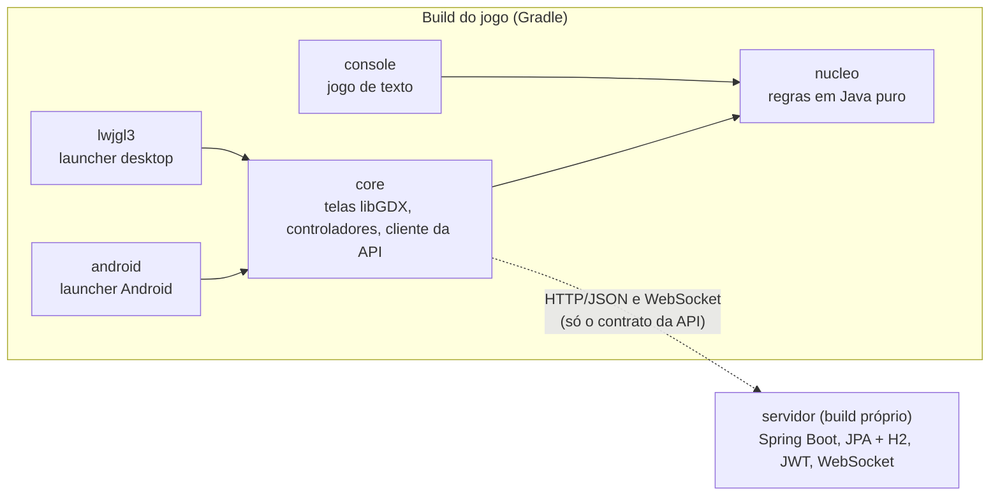

# Relatório técnico — Missão Marte Unifor

Projeto Integrador: a evolução do jogo do console até um jogo gráfico multiplataforma, com servidor de ranking e uma
melhoria própria.

- **Repositório:** https://github.com/thebylito/missao-marte-unifor (tags `fase-0` a `fase-7`)
- **Kanban:** https://github.com/users/thebylito/projects/2
- **Equipe:** Welington da Silva (`thebylito`) e Lucas Gomes Costa (`luckhaosbb`)

## 1. Visão geral

O código evoluiu no próprio lugar, na raiz do repositório. Cada fase validada ganhou uma tag (`git diff fase-0
fase-1` mostra exatamente o que a refatoração mudou), e cada sprint virou um único pull request (DA-01). A `fase-0` é
o projeto do professor sem nenhuma alteração, a linha de base para provar que o comportamento foi preservado (DA-02).

| Fase | Entrega | Tag |
|---|---|---|
| 0 | projeto inicial de console, intacto | `fase-0` |
| 1 | camadas domínio, aplicação, infraestrutura e console | `fase-1` |
| 2 | Gradle Wrapper 8.14.3, toolchain Java 17 e JUnit 5 | `fase-2` |
| 3 | libGDX 1.14.2: janela desktop sobre as mesmas regras | `fase-3` |
| 4 | sprites (Blender), sons, fonte, HUD e animações | `fase-4` |
| 5 | servidor Spring Boot 4.1.2: cadastro, login com JWT, histórico e ranking Top 10 | `fase-5` |
| 6 | Android: APK, layout responsivo, toque e endereço do servidor configurável | `fase-6` |
| 7 | melhoria: **Modo Pilotagem** (física de voo) e **modo shadow** (as naves dos outros pilotos em tempo real) | `fase-7` |

A arquitetura final tem cinco módulos no build do jogo e um servidor com build próprio:



## 2. Arquitetura e principais decisões

As 34 decisões estão em `docs/decisoes-arquiteturais.md`, cada uma com contexto, decisão e consequências. As mais
importantes:

**Regras fora da interface (DA-03, DA-08).** O `Main` original, com 570 linhas, misturava sete responsabilidades:
menu, leitura do teclado, desenho do mapa, regras do turno, sorteio da missão, regra do Top 5 e leitura e escrita do
JSON. Na Fase 1, a `Partida` passou a receber um comando por turno e devolver eventos, sem ler nem imprimir nada:

```java
public List<Evento> executar(Comando comando) {   // nucleo: aplicacao/Partida.java
    ...
    missao.moverInimigos();
    if (missao.naveColidiu()) {
        nave.perderVida();
        if (nave.estaDestruida()) {
            estado = Estado.DERROTA;
            eventos.add(Evento.de(Evento.Tipo.NAVE_DESTRUIDA));
        } ...
```

O console imprime esses eventos, a tela gráfica os anima (`ReacaoAosEventos`) e o Android usa a mesma tela. Na
Fase 3, as regras foram para o módulo `nucleo`, que não declara a libGDX. Assim, "o domínio não depende da
interface" passou a ser garantido pelo compilador: importar a libGDX no `nucleo` dá erro de compilação
(`docs/evidencias/fase-03/dependencia-proibida.txt`).

**Dependências injetadas (DA-04).** O sorteio (`Random`), o relógio (`Relogio`) e o ranking (`RepositorioRanking`)
são passados pelo construtor e montados na raiz de composição (`Main`, `MissaoMarteGame`, `AndroidLauncher`). Isso
permite testes determinísticos e a opção `-Dmissaomarte.semente=N`, que reproduz uma partida. É ela que prova, a
cada fase, que o console continua igual ao da fase anterior.

**Telas passivas (DA-10).** Uma `Screen` da libGDX só roda com janela e OpenGL. As decisões de cada tela (qual tecla
vira qual comando, quando a partida acabou, quando gravar o ranking) ficam em controladores sem OpenGL
(`ControladorDaPartida`, `FormularioNovaPartida`, `LayoutDaPartida`...). As telas só repassam a entrada e desenham.

**Cliente e servidor independentes (DA-14, DA-17).** O servidor tem `settings.gradle` e wrapper próprios e não
importa nada do jogo, e o contrato entre os dois é só a API (`docs/api/openapi.json`). No cliente, as telas dependem
de uma porta, e o adaptador HTTP entrega as respostas na thread do jogo, sem bloquear a interface:

```java
public interface ServidorDoJogo {                  // core: online/ServidorDoJogo.java (porta)
    void entrar(String nome, String senha, Resposta<Sessao> resposta);
    void registrarPartida(Sessao sessao, PartidaParaEnviar partida, Resposta<Void> resposta);
    void ranking(Modo modo, Resposta<List<PosicaoGlobal>> resposta);
    ...
}
// adaptador: Gdx.net é assíncrono (desktop e Android); a resposta volta pela thread do jogo
new ServidorHttp(endereco, () -> Gdx.net, r -> Gdx.app.postRunnable(r));
```

Com o servidor desligado, a entrada avisa "Servidor indisponível" e o jogo segue no modo convidado, com o ranking
local, como na versão-base.

**API com DTOs, validação e token (DA-15, DA-16).** A senha é guardada com BCrypt. O login devolve um JWT HS256
de 2 h, validado pelo resource server do Spring Security. O segredo vem só de uma variável de ambiente. As entidades
JPA não saem do servidor: a API recebe e devolve `record`s validados, e os erros seguem a RFC 9457. O dono da partida
vem sempre do token, nunca do corpo:

```java
// servidor: partida/RegistroDePartida.java (DTO)
public record RegistroDePartida(
        @NotNull Resultado resultado, @NotNull Dificuldade dificuldade,
        @NotNull @Min(0) @Max(10_000) Integer pontos, ..., Modo modo) { ... }

// servidor: partida/ControladorDePartidas.java
@PostMapping
public ResponseEntity<PartidaResposta> registrar(@AuthenticationPrincipal Jwt token,
        @Valid @RequestBody RegistroDePartida dados) { ... }
```

**Android sobre o mesmo `core` (DA-19 a DA-22).** O `AndroidLauncher` é só a raiz de composição. O layout da
partida é um `record` em Java puro, testado em vários tamanhos de tela. O toque "aperta" a tecla equivalente, o que
reaproveita os controladores já testados. O endereço do servidor é configurável dentro do jogo (opção 4 da
entrada), e o APK não leva nenhum segredo.

**A melhoria (DA-25 a DA-33).** O **Modo Pilotagem** é um modo novo ao lado do clássico, que continua sendo o
padrão e não mudou. A nave gira, liga o motor e sofre gravidade; é preciso pousar devagar e reto para embarcar
passageiros e levá-los à base. As regras ficam no pacote `nucleo/pilotagem`, em passo fixo, para que a física não
dependa da taxa de quadros:

```java
// nucleo: pilotagem/PartidaDePilotagem.java
public void atualizar(double segundos, Comandos comandos) {
    acumulador += Math.min(Math.max(segundos, 0), QUADRO_MAXIMO);
    while (acumulador + FOLGA >= PASSO && estado == Partida.Estado.EM_ANDAMENTO) {
        avancarUmPasso(comandos);   // PASSO = 1/120 s
        acumulador -= PASSO;
    }
}
```

A pilotagem reaproveita os passageiros (os pontos vêm do polimorfismo de `Passageiro`, desde a Fase 1), a
`Dificuldade`, o `ResultadoPartida` e o `ServicoRanking`, este com outro `RepositorioRanking`
(`ranking-pilotagem.json`). Na API, o `modo` é um campo opcional, e um cliente das Fases 5 e 6 continua
funcionando. O **modo shadow** acrescenta um canal WebSocket no mesmo servidor (`/ws/sombras`), protegido pelo
mesmo token. O servidor só repassa as posições, e cada cliente desenha as naves dos outros, translúcidas e com o
nome.

## 3. Padrões e princípios aplicados

| Padrão / princípio | Onde | Por que foi útil |
|---|---|---|
| Camadas e regra de dependência (DIP) | `nucleo` ← `console`, `core` ← `lwjgl3`, `android` | trocar a interface três vezes (console, janela, celular) sem tocar nas regras |
| GRASP Controller | `Partida`, `PartidaDePilotagem` | um ponto único que recebe comandos e aplica as regras na ordem certa |
| Polimorfismo / Information Expert | `Passageiro` → `Astronauta` (20), `Engenheiro` (15), `Professor` (10) | os pontos ficam com quem os conhece; a pilotagem os reaproveitou sem duplicar regra |
| Strategy | `MovimentoInimigo` / `MovimentoAleatorio` | o movimento dos inimigos pode mudar sem mexer na `Missao` |
| Repository | `RepositorioRanking` (arquivo JSON; dublê nos testes), repositórios JPA | o ranking da pilotagem é o mesmo serviço com outro arquivo |
| Ports and Adapters | `ServidorDoJogo` / `ServidorHttp`, `ConexaoDeSombras` / `ConexaoWebSocket`, `Sons` / `SonsLibgdx` | as telas não conhecem HTTP, WebSocket nem áudio; os testes usam dublês |
| Humble Object | telas libGDX finas sobre controladores testáveis | 186 testes do `core` rodam sem janela, OpenGL, áudio ou rede |
| Facade e Flyweight | `Recursos` sobre o `AssetManager`; regiões recortadas uma vez | carregar e liberar tudo uma única vez (ao sair, o log mostra `restam 0`) |
| Observer | `ReacaoAosEventos` traduz os eventos do turno em som e efeito | efeitos sem duplicar regras na tela |
| Null Object | `Sons.NENHUM`, `ServidorDoJogo.DESLIGADO` | sem `if (servidor != null)` espalhado; o convidado é só outra implementação |
| DTO | `record`s da API, `PartidaParaEnviar` no cliente | o contrato não muda quando a entidade muda |

## 4. Testes e resultados

| Fase | Testes | Defeitos inseridos e pegos | Comportamento anterior |
|---|---:|---:|---|
| 1 | 65 (executor próprio) | 4/4 | 200/200 partidas iguais à Fase 0, pela semente · roteiros 8/11: os 3 diferentes são as 2 correções de bug, explicadas no gabarito |
| 2 | 65 (JUnit 5) | 4/4 | 200/200 · roteiros 11/11 em `run`, `installDist` e `java -jar` |
| 3 | 104 | 7/7 | 200/200 · janela validada de ponta a ponta |
| 4 | 148 | 11/11 | 200/200 · `nucleo` sem nenhuma linha alterada |
| 5 | 207 (cliente 186, servidor 21) | 17/17 | 200/200 · API real, online e offline |
| 6 | 232 (cliente 209, servidor 23) | 24/24 | 200/200 · telas do desktop sem animação iguais à Fase 5, pixel a pixel |
| 7 | **316** (cliente 281, servidor 35) | 27/27 + 20/20 | 200/200 · roteiros 11/11 · telas do clássico iguais |

Além dos testes de unidade e de integração, usamos estas técnicas:

- **Equivalência por semente:** `validacao/comparar_com_semente.py` joga 40 sementes × 5 cenários nas duas versões
  e compara a saída.
- **Defeitos inseridos de propósito:** um por vez, numa cópia descartável; cada um precisa derrubar algum teste. É
  uma mutação manual, que prova que os testes enxergam as regras.
- **Execução real automatizada:** o `PilotoDaJanela` dirige a janela de verdade e tira prints, o
  `pilotar_android.py` dirige o emulador e o celular pelo `adb`, e um piloto automático vence a caverna da
  pilotagem.
- **Instalação limpa:** um clone novo, com o cache do Gradle vazio e Java 11 como padrão, compila e passa os testes
  com e sem o Android SDK.
- **Segredos:** nenhuma senha, token ou JWT nos logs (servidor, janela, logcat). O gitleaks no histórico inteiro
  achou só um texto de teste (`Bearer nao-e-um-token`).

As evidências de cada fase estão em `docs/evidencias/fase-XX/`.

## 5. Dificuldades, limitações e melhorias futuras

**Dificuldades.**

- O macOS exige `-XstartOnFirstThread` para a janela (DA-09).
- O Spring Boot 4 e o plugin Android exigem que o próprio Gradle rode em Java 17 (DA-14, DA-23).
- O OpenGL ES do Android não gera mipmaps para texturas fora da potência de 2 (DA-12).
- Tornar a física independente da taxa de quadros levou ao passo fixo (DA-26).
- Um teste de rede ficou instável porque o fechamento de uma conexão chegava ao servidor depois do teste seguinte
  começar, e foi corrigido.
- Os testes acharam defeitos reais: a decolagem girando, que "pousava" de novo (DA-28), e o estouro de
  `Long.MIN_VALUE`, que descartava a primeira posição de cada sombra (DA-32).

**Limitações (registradas como o enunciado pede).**

- O servidor não executa o jogo e não confere se a pontuação, ou a posição de uma sombra, é legítima.
- O HTTP sem criptografia fica liberado no app (para a rede local da aula).
- A sombra fica de 100 a 200 ms atrás da nave, e não há salas.
- **Não verificado:**
    - Windows e Linux;
    - Android abaixo da API 34 (a API 26 foi conferida só no bytecode) e tablets de verdade;
    - um APK de release assinado;
    - o servidor publicado com HTTPS;
    - uma partida da pilotagem jogada à mão no celular chegando ao ranking global: foi registrada pelo relato
      do integrante, e não pelo sistema.

**Melhorias futuras.**

- Ranking por consulta com função de janela.
- `network_security_config` para restringir o HTTP.
- Previsão de movimento (extrapolação) nas sombras, e salas.
- Mais níveis de caverna.
- Imagem do servidor menor.
- Publicar o servidor com HTTPS.

## 6. Participação dos integrantes

| Integrante | Participação |
|---|---|
| Welington da Silva (`thebylito`) | implementação de todas as fases, com código, testes, validação e evidências, e a documentação (tutoriais, decisões, este relatório). É o autor de todos os commits e responsável pelas issues, ao lado do Lucas |
| Lucas Gomes Costa (`luckhaosbb`) | revisão e aceite de cada sprint (o merge dos PRs #16 a #19); testes manuais das versões no console, na janela e no celular; decisões de planejamento (a escolha da melhoria, as prioridades e o Kanban); demonstração e slides da apresentação |

Os commits saíram de uma única conta, então a participação do Lucas aparece no histórico pelos merges dos PRs e
pelas atribuições das issues, e não pelos commits.
